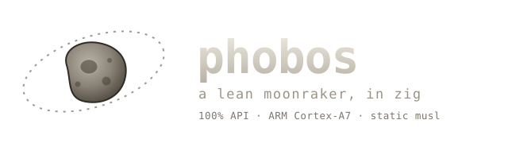

<p align="center">
  
</p>

# phobos

A Zig 0.17 reimplementation of [Moonraker](https://github.com/Arksine/moonraker), the API
server for [Klipper](https://www.klipper3d.org/) 3D printers. It aims to match Moonraker's
API exactly while idling in a few megabytes of RAM on 32-bit ARM printer hosts.

> phobos is the smaller, faster of Mars' two moons.

## Why

Moonraker is about 36k lines of Python on asyncio and Tornado. On a printer-class host it
brings the Python runtime, an event loop, and a heap that grows with load. phobos serves the
same HTTP, WebSocket, and JSON-RPC endpoints and notifications from one static musl binary
with bounded buffers, sized for a Cortex-A7.

## Status

The coverage gate checks registered endpoint paths, JSON-RPC method names and
notification names against Moonraker `900848584374`. It does not prove behavioral
parity. The [per-call API table](docs/api/API_COVERAGE.md) records implemented,
partial and missing behavior; [TODO.md](TODO.md) records completed work and
remaining limits.

The live paths include the Klippy bridge, SQLite persistence, HTTP and WebSocket
transports, MQTT 3.1/3.1.1/5, Spoolman accounting, RSS feeds, GPIO buttons,
PanelDue, extension agents, and selected power, WLED and TD-1 drivers. Git and
Web/ZIP updates can replace configured installations. Host reboot and shutdown
remain no-ops; package execution requires an injected runner. Full Jinja2, LDAP
and Apprise are out of scope.

Use `--compat forge-x` to enable Forge-X upload conversion, stock print macros
and update behavior. Native [timelapse](docs/TIMELAPSE.md) and Feather support
load from their configuration sections. The separate [Forge-X tracker](docs/api/FORGE_X.md)
records implemented behavior and hardware checks still needed. The default
profile remains `moonraker`; existing installations are not switched automatically.

[Memory measurements](docs/MEMORY.md) and [load-test results](docs/PERFORMANCE.md)
compare v0.2.3 with Moonraker in fresh Forge-X
printer probes and an isolated KVM guest, with metric directions, trial ranges
and measured scheduling limits. Published-release captures remain archived.
The latest release is
[v0.2.3](docs/releases/v0.2.3.md).

## Architecture

Networking is `std.Io.net` on the `std.Io.Threaded` backend, the only standard I/O backend
available on 32-bit ARM. The listener spawns a task per connection, and `std.http` handles
HTTP and WebSocket on those streams. Every transport feeds one JSON-RPC dispatcher backed by
a runtime method table. The Core mutex serializes shared state and notification fan-out.
Blocking network and process work runs outside Core; concurrent read paths use component
locks. Persistence defaults to a vendored SQLite database in Moonraker's
`moonraker-sql.db` format; a pure-Zig file backend is selectable with
`[database] backend`. See [`DEVELOPMENT.md`](DEVELOPMENT.md).

## Repository layout

```
build.zig                 build graph (musl by default, cross-target options)
src/
  main.zig                entry point, --dump-api, schema
  app.zig                 App: wires components; registerAll() registers methods
  io.zig                  std.Io.Threaded listener and accept loop
  jsonrpc.zig             JSON-RPC 2.0 dispatcher and error codes
  http_transport.zig      HTTP/REST and /server/jsonrpc over std.http
  transport/ws.zig        WebSocket transport over std.http
  server/                 serialized core, connections, notify bus, registry
  config/                 confighelper-compatible parser
  store/                  DataStore interface, SQLite and atomic-rename file backends
  core/methods.zig        server.info, server.config
  components/             one module per Moonraker component
  oracle/                 in-process response-key and error-code checks
  testutil/               TestServer, HTTP and WebSocket test clients
vendor/sqlite/            pinned SQLite amalgamation
vendor/moonraker/         gitignored Moonraker reference checkout
api/api_surface.json      generated Moonraker API baseline
conformance/              golden captures, normalization and replay against Moonraker
tools/api_scanner/        Moonraker API extractor, drift and coverage checks
tools/client_api_scanner/ client call scanner (Mainsail, Fluidd, KlipperScreen, GuppyScreen, HelixScreen)
tools/perf_harness/       phobos vs Moonraker load tests and profiling
scripts/                  release matrix and memory measurement
docs/                     API surface, coverage, memory, performance, release notes
TODO.md                   status and remaining work
```

## Quick start

Requires Zig 0.17.0, plus `uv` for the Python tooling. The default build compiles
SQLite 3.54.1 from the verified amalgamation in `vendor/sqlite/`.

```sh
# Test suite (musl-static by default)
scripts/test.sh Debug

# Print the API surface phobos registers
zig build && zig-out/bin/phobos --data-path "$PWD/.scratch/api-dump-data" --dump-api | less
zig-out/bin/phobos schema

# API coverage against the Moonraker baseline (exit 0 means 100%)
tools/coverage.sh

# Static binary for the Cortex-A7 target
zig build -Dtarget=arm-linux-musleabihf -Dcpu=cortex_a7 -Doptimize=ReleaseFast

# Build and validate the Linux release matrix in isolated scratch prefixes
scripts/build-release.sh
```

Some hosts, the deploy target included, cannot link their system glibc with Zig 0.17, so
the build targets musl. Do not run a glibc `zig build`.
The [build guide](docs/BUILDS.md) lists ARMv6, ARMv7 floating-point variants,
Cortex-A7, AArch64 and x86-64 assets, their CPU requirements and verification scope.

## Tracking Moonraker

phobos tracks Moonraker 9008485, checked out in `vendor/moonraker` (gitignored). After
bumping that checkout, the drift check exits 1 if the API changed:

```sh
git clone https://github.com/Arksine/moonraker vendor/moonraker
git -C vendor/moonraker checkout 900848584374
PYTHONPATH=tools uv run --with tree-sitter --with tree-sitter-python \
  python -m api_scanner diff --source vendor/moonraker/moonraker --baseline api/api_surface.json
```

## Documentation

Change and verification history: [`docs/PROVENANCE.md`](docs/PROVENANCE.md).

- [`TODO.md`](TODO.md): implemented work and remaining behavior limits.
- [`DEVELOPMENT.md`](DEVELOPMENT.md): building, testing, adding a component.
- [`docs/BUILDS.md`](docs/BUILDS.md): static Linux release profiles and host selection.
- [`docs/CI.md`](docs/CI.md): automated tests, native/cross builds and tag-based releases.
- [`docs/api/API_SURFACE.md`](docs/api/API_SURFACE.md): the Moonraker API phobos must match.
- [`docs/api/COVERAGE_HEATMAP.md`](docs/api/COVERAGE_HEATMAP.md): coverage method and verification limits.
- [`docs/MEMORY.md`](docs/MEMORY.md), [`docs/PERFORMANCE.md`](docs/PERFORMANCE.md): measurements and how to reproduce them.
- [`docs/STDLIB.md`](docs/STDLIB.md): Zig 0.17 std APIs in use and where local code remains.
- [`docs/FILE_MANAGEMENT.md`](docs/FILE_MANAGEMENT.md): file and thumbnail contracts.
- [`docs/MACHINE.md`](docs/MACHINE.md): service providers and peripheral queries.
- [`docs/UPDATES.md`](docs/UPDATES.md): managed services, release installation and rollback.
- [`docs/MQTT.md`](docs/MQTT.md): protocols, credentials, QoS and Klippy status topics.
- [`docs/POWER_BUTTONS.md`](docs/POWER_BUTTONS.md): power hooks, HTTP templates and GPIO buttons.
- [`docs/ANALYSIS.md`](docs/ANALYSIS.md): injected estimator execution, ownership and file safety.
- [`docs/TEST_RUN_FINDINGS.md`](docs/TEST_RUN_FINDINGS.md): why Moonraker's own test suite cannot be the parity oracle.

## License

[GPL-3.0-only](LICENSE), matching Moonraker. SQLite is public domain.

For private vulnerability reports, see [SECURITY.md](SECURITY.md).
