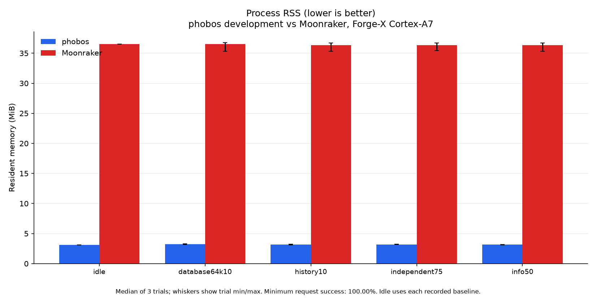
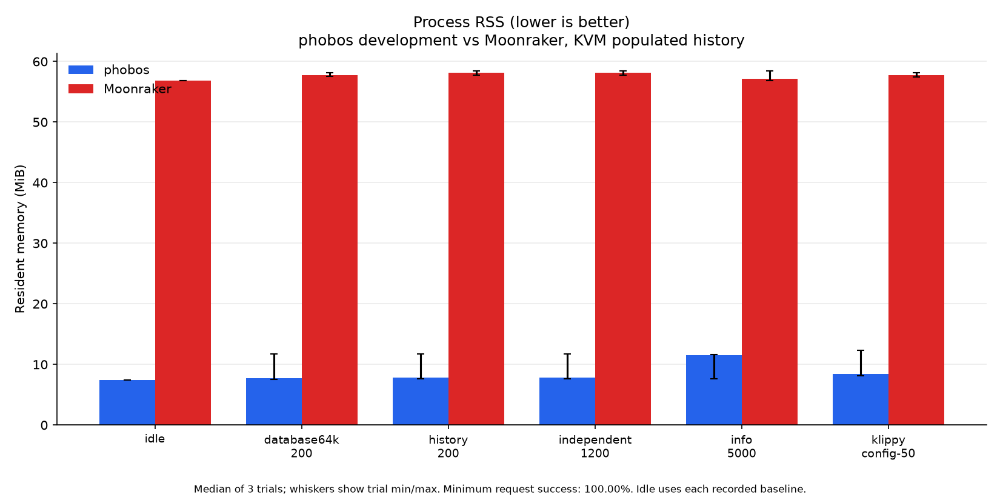
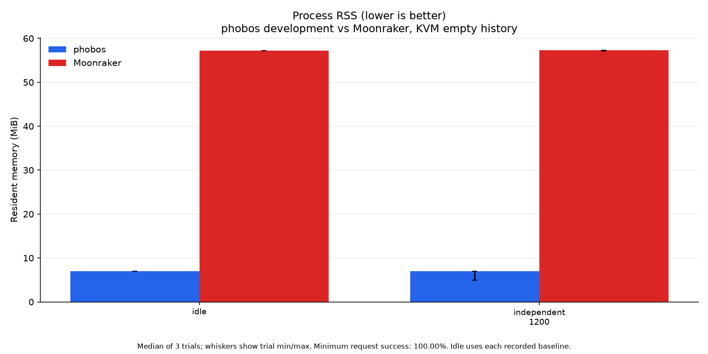

# Memory footprint

Current measurements compare the **0.2.2 development build with Moonraker**,
measured 2026-10-22. The development build is not the published v0.2.2 asset.
The [performance report](PERFORMANCE.md) and
[capture method](perf/optimization-20261022/METHOD.md) identify source blobs, executable hashes,
fixtures, rates, repetitions and measured scheduling limits. Active graphics
contain only development phobos and Moonraker. Baseline rows remain in the
numerical before/after records.

**Lower RSS is better.** KiB means 1,024 bytes. RSS counts resident pages,
not total allocations or private memory. Idle values are medians of three
fresh-process trial medians, with min/max ranges. Load tables give the largest
sampled RSS across workloads/repetitions; plots show each workload's median
trial maximum with min/max whiskers. Samples can miss brief peaks. Allocators
and worker pools can retain pages after requests finish.

## Cortex-A7 printer

Forge-X 1.4.2 chroot, Linux 5.4.61, two Cortex-A7 cores and 110,404 KiB RAM.
Production was paused during the study and restored afterward. Private probes
use the same minimal config, 266-job seed and synthetic 64 KiB item on loopback
7126. The probe component set is smaller than production. The reference is
the installed Moonraker on Python 3.11.10.

| Process | Median idle KiB ↓ (trial range) | Maximum sampled load KiB ↓ | Peak threads |
| --- | ---: | ---: | ---: |
| phobos development | 3,188 (3,176 to 3,236) | 4,480 | 12 |
| Moonraker | 37,396 (37,176 to 37,624) | 38,288 | 4 |

The table includes HTTP and full-subscription samples; the graphic covers
HTTP workloads and idle. About 100 ms samples measure the load itself;
roughly 250 ms lifetime samples also cover startup/preflight work. VmHWM
retains earlier unlimited-history preflight peaks and is not a per-workload
peak. The [subscription records](perf/optimization-20261022/printer/subscriptions.json)
retain both current RSS and HWM observations.

Board MemAvailable stays above 22,376 KiB with a
16 MiB stop guard. Probe VmSwap stays 0 KiB.
Existing board SwapFree ranges from 0 to
1,196 KiB, including zero. Zero probe swap does
not establish that the whole board avoided swapping. Swap settings were
unchanged. [Board samples](perf/optimization-20261022/printer/board-memory.json) and
[final production state](perf/optimization-20261022/printer/final-state.json) retain these
limits. The board boot ID is unchanged, Klippy is ready, heaters target zero,
and the probe listener is absent.

The exact tested development binary was installed afterward; the
[deployment record](perf/optimization-20261022/deployment.json) records its
backup, production subscription check and unchanged board boot ID.

## KVM guest, populated history

Four vCPUs and 4 GiB locked RAM, with server, generator and stub/controller on
separate guest CPUs and exclusive physical cores. Both servers use the same
fixture and affinity; their runtimes, SQLite versions and scheduling controls
are recorded in [the performance report](PERFORMANCE.md#kvm-guest-isolated-physical-cores).

| Process | Median idle KiB ↓ (trial range) | Maximum sampled load KiB ↓ | Peak threads |
| --- | ---: | ---: | ---: |
| phobos development | 7,620 (5,572 to 9,636) | 12,632 | 18 |
| Moonraker | 58,168 (58,108 to 58,868) | 59,872 | 4 |

## KVM guest, empty history

Same VM controls with fresh databases containing only the 64 KiB record.

| Process | Median idle KiB ↓ (trial range) | Maximum sampled load KiB ↓ | Peak threads |
| --- | ---: | ---: | ---: |
| phobos development | 7,112 (5,084 to 7,160) | 7,168 | 12 |
| Moonraker | 58,572 (58,156 to 58,632) | 58,696 | 4 |

Host QEMU RAM, idle polling and the 4 GiB reservation are excluded from daemon
RSS. Locked host memory stays above 4,838,436 KiB;
VM/cgroup swap stays zero. The guest has no configured swap. These controls do
not make daemon RSS fixed or prove literal zero steal. All fresh processes
handle history preflights before idle sampling. Complete idle ranges and
load records remain in each fixture directory.

## Allocation and ownership changes

The Klippy router skips the result tree with a typed `std.json` envelope,
retains one owned wire copy and lets the waiter decode the result once.
A regression test routes a 256 KiB reply with less than payload-size plus
4 KiB of allocation, then clobbers the original bytes to verify ownership.
Notifications still receive a full parse and depth validation after routing;
notification-flood throughput is outside this capture.

Known history map and array sizes are reserved before insertion. JSON result
serialization scans long plain ASCII strings with portable Zig vectors;
escaping and Unicode stay in `std.json`. Those changes reduce work and
intermediate allocations, but request arenas and process allocators may
retain pages. The before/after records are the evidence for RSS changes;
the allocation test is not a promise of a matching resident-memory reduction.

Resident-memory gains over the pre-change build are not consistent. Printer
idle medians change from 3,244 to 3,188 KiB; VM idle and per-workload RSS ranges
overlap and some candidate trial medians are higher. RSS includes pages retained
after preflights and worker-pool activity; their contributions are not isolated.
The populated VM maximum changes
from 12,900 to 12,632 KiB across all measured workloads; three trials do not
establish a universal percentage reduction.

`VmSize` includes reserved address space and is not RSS. Temperature rings
retain their configured bound. Ordinary history pages select scalar IDs before
decoding records; filtered and unlimited history may decode the full namespace.
The file backend still links SQLite and is not measured. The separate
`scripts/measure-memory.sh` minimal idle fixture is not comparable to these
connected-daemon studies. Never measure against the live printer database.

[Published v0.2.2 captures](perf/v0.2.2/) and earlier tuning evidence remain
archived unchanged. Measurements do not establish long-soak behavior, printing
memory use or behavior on every ARM/AArch64 release profile.
