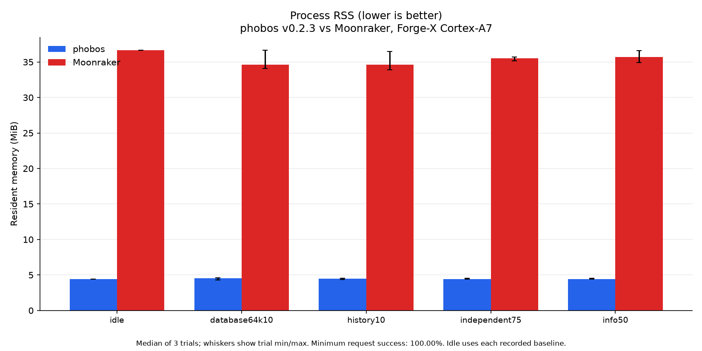
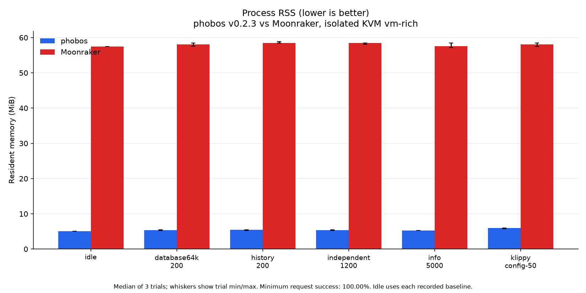
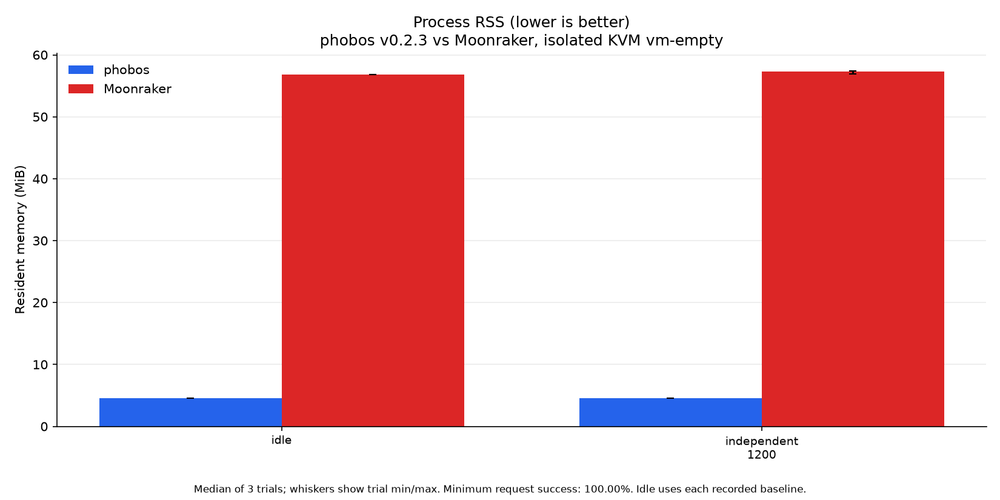

# Memory footprint

Current measurements compare **phobos v0.2.3 with Moonraker**,
measured 2026-10-23. The ReleaseFast binaries come from the release matrix.
The [performance report](PERFORMANCE.md) and [method](perf/optimization-20261023/METHOD.md) identify
sources, executable hashes, fixtures, rates and measured scheduling limits.
Every active graphic shows only the current build and Moonraker.

**Lower RSS is better.** KiB means 1,024 bytes. RSS counts resident pages,
including executable text and allocator-retained pages, not total allocations
or private memory. Idle values are medians of three fresh-process trial medians,
with their range. Load tables give the maximum sampled RSS across all workloads
and repetitions. Plots show each workload's median trial maximum with min/max
whiskers. Samples can miss brief peaks; VmSize and VmHWM are different metrics.

## Cortex-A7 printer

Forge-X 1.4.2 chroot, Linux 5.4.61, 110,404 KiB RAM. Production is paused during
load. Private probes use the same minimal config, 266-job seed and synthetic
64 KiB item; their component set is smaller than production. All server threads
run on CPU 1. The installed reference uses Python 3.11.10.

| Process | Median idle KiB ↓ (trial range) | Maximum sampled load KiB ↓ |
| --- | ---: | ---: |
| phobos v0.2.3 | 4,512 (4,388.0 to 4,652) | 5,968 |
| Moonraker | 37,536 (37,276 to 37,820) | 37,532 |

The table includes HTTP and full-subscription samples; the graphic covers HTTP
and idle. Load sampling is about 100 ms; lifetime/idle sampling about 250 ms.
VmHWM can retain a previous unlimited-history preflight peak and is not a
per-workload peak. Board MemAvailable stays above 19,668 KiB,
with a 16 MiB guard. Probe VmSwap stays 0 KiB.
Board SwapFree ranges from 0 to
204 KiB; zero probe swap does not prove the entire
board avoided swapping. Swap settings remain unchanged.
[Board observations](perf/optimization-20261023/printer/board-memory.json) retain these limits.

## KVM on the benchmark PC, populated history

Four vCPUs and 4 GiB locked RAM, with separate server, generator and stub CPUs,
an isolated physical L3 group and no VM swap. Both servers use the same fixture.
Runtime, SQLite and scheduling controls are in the [performance report](PERFORMANCE.md).

| Process | Median idle KiB ↓ (trial range) | Maximum sampled load KiB ↓ |
| --- | ---: | ---: |
| phobos v0.2.3 | 5,200 (5,196 to 5,200) | 6,164 |
| Moonraker | 58,868 (58,020 to 58,912) | 60,324 |

## KVM on the benchmark PC, empty history

Same controls with fresh databases containing only the 64 KiB item.

| Process | Median idle KiB ↓ (trial range) | Maximum sampled load KiB ↓ |
| --- | ---: | ---: |
| phobos v0.2.3 | 4,700 (4,696 to 4,700) | 4,712 |
| Moonraker | 58,220 (58,076 to 58,608) | 58,800 |

QEMU's locked host RAM is excluded from daemon RSS. RSS can vary by several
MiB between fresh phobos processes because of allocator/worker/address-layout
behavior. Three trials do not isolate those effects. The separate local-host
[corroboration](perf/optimization-20261023/local-vm/) is not pooled with remote-host measurements.

## Allocation and ownership

The entry point uses `std.process.Init.gpa`. Zig 0.17 selects a checked allocator
in Debug/ReleaseSafe and `std.heap.c_allocator` for this libc-linked ReleaseFast
program. The previous entry point overrode release modes with the SMP allocator.
Component and request allocations remain explicit. Focused allocator comparisons
are archived; no universal resident-memory reduction is attributed to that choice.

Klippy's reader owns a persistent 64 KiB standard I/O buffer. A reply is parsed
once into its own arena, retained by its waiter, copied into the caller's
allocator and released. There is a deliberate peak-memory tradeoff: the 256 KiB
baseline reply allocation test observes about 580 KiB (594,223 bytes) of parsed
storage, below 2.5 times wire size plus 4 KiB. Standard dynamic JSON string growth
and arena growth account for that spare capacity. The subsequent long-ASCII
token adapter reserves once and shrinks the token; its 256 KiB ownership test
and Klippy dispatch test tighten the budget to twice wire size plus 4 KiB.
The same budget covers a 256 KiB SQLite JSON record decoded into a caller arena,
including owned bytes after overwriting the encoded input.
Unicode and other tokens keep the standard path. Neither allocation budget
is an RSS promise; fresh-process RSS rose in the first profiling trials despite
lower parser allocation, so no resident-memory gain is attributed to that change.

The subsequent native worker-stack experiment uses 1 MiB instead of the default
16 MiB. Three alternating remote trials lower median trial-maximum RSS from
10,016 to 5,952 KiB, while CPU rises from 1.020 to 1.063 ms/request and p99 from
1.862 to 1.917 ms. Post-load `smaps_rollup` shows 4,096 and 6,144 KiB of anonymous
huge pages in two baseline trials and none in their candidates; the third pair
has none and similar RSS. Host transparent-huge-page policy stays unchanged.
These diagnostic trials use pinned cores without VM isolation. The combined
release comparisons above include this change. ARM32 already used the 1 MiB bound.

Console snapshots no longer copy the full ring before selecting entries. The
request arena reserves only the requested array and exactly three fields per
entry using public standard-map capacity/index operations. The wrapped-ring
regression bounds a one-entry request to 8 KiB and the full 1,000-entry request
to 512 KiB, including arena growth. Every allocation-failure path releases the
request arena. These are allocation budgets, separate from RSS measurements.

Long valid UTF-8 strings use a 1 KiB stack output buffer and a 896-byte compile-time
escape table derived from the standard encoder. SIMD comparisons find unescaped
runs. Nondefault options and invalid UTF-8 use the standard path. Status updates
are batched before per-client filtering, avoiding a separate frame per object.
Connection references, deadlines, authentication and field masks are preserved.

Legacy SQL history without KV overrides selects only the requested page instead
of collecting every ID and issuing one query per row. A 10,000-job, one-row-page
regression test checks correct content and less than 64 KiB request allocation.
Mixed KV/table histories retain the validated full-ID fallback; filtered and
unlimited reads may still decode the full namespace. Temperature rings remain
bounded. The file backend still links SQLite and is not measured.

ReleaseFast produces larger executables than ReleaseSmall and may increase
resident code pages. Earlier-build comparisons do not show a universal RAM
reduction; memory is traded for lower request CPU where measured. Published
[v0.2.2](perf/v0.2.2/) and earlier studies remain unchanged. These measurements
do not establish printing memory, long-soak behavior or all ARM/AArch64 hardware.
