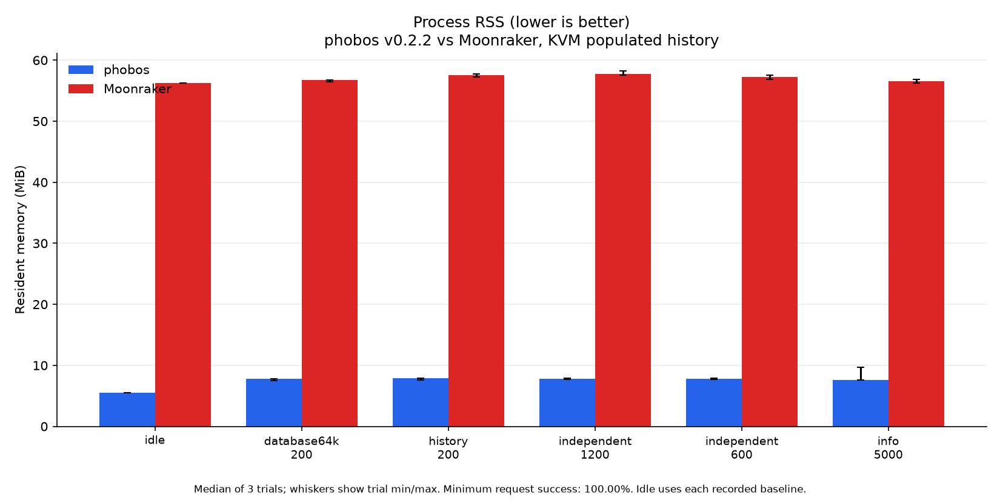
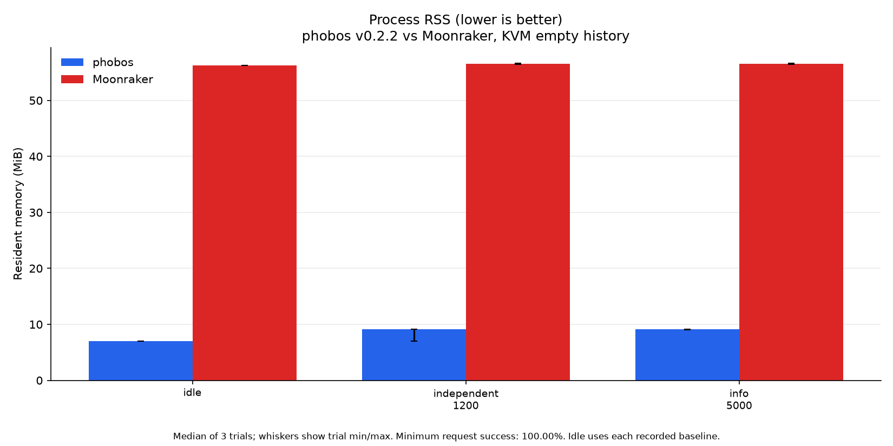

# Memory footprint

Current comparison: **phobos v0.2.2 versus Moonraker**, measured 2026-10-21
with the published static musl ReleaseSmall assets. The
[performance report](PERFORMANCE.md) gives matched workloads, rates, repetition
order, exact versions and capture limits. These tables and graphics contain
only v0.2.2 and Moonraker.

**Lower RSS is better.** KiB means 1,024 bytes. RSS measures resident pages,
not total allocations or private memory. Idle values are medians of three
fresh-process trial medians, with their min/max range. Load tables give the
largest sampled RSS across every workload and repetition; plots give each
workload's median trial maximum with min/max whiskers. Samples can miss brief
peaks. Worker pools and earlier workloads can leave pages resident.

## Cortex-A7 printer

Earlier capture, 2026-10-21. The VM followup did not contact the printer.

Forge-X 1.4.2 chroot, Linux 5.4.61, two Cortex-A7 cores, 110,404 KiB RAM.
The official Cortex-A7 asset is 2,629,960 bytes,
SHA256 `94737315462468de6ec1fa54cb86c46c4127f5918b452c532c0311606ed56290`.
The reference is the actual Forge-X Moonraker on Python 3.11.10. Each private
probe uses loopback 7126, the same minimal core config and its own copy of the
266-job seed plus a 64 KiB record. Production v0.2.2 stays on 7125. The probe
config has fewer components than production; this is not an all-components
memory guarantee.

| Process | Median idle KiB ↓ (trial range) | Maximum sampled load KiB ↓ | Peak threads |
| --- | ---: | ---: | ---: |
| phobos v0.2.2 | 3,044 (3,016 to 3,096) | 3,500 | 14 |
| Moonraker | 36,696 (33,048 to 36,788) | 36,816 | 4 |

Thirty eight-second load trials and six idle windows use roughly 250 ms RSS
and board samples. MemAvailable stayed at or above
23,960 KiB, with a 16 MiB stop guard. Maximum probe
VmSwap was 0 KiB. Existing board SwapFree ranged
from 3,072 to 11,552
KiB; production VmSwap ranged from 0 to
428 KiB. A zero probe VmSwap does not establish
that the board avoided swapping. Swap settings were unchanged.

[Idle trials](perf/v0.2.2/printer/idle-trials.json),
[all load trials](perf/v0.2.2/printer/summary.json),
[environment](perf/v0.2.2/printer/environment.json) and
[board limits](perf/v0.2.2/printer/board-memory.json) retain the observations.
At cleanup of that capture, production was PID 29180, ready, standby,
both heater targets zero, with its release hash and boot ID unchanged.
[Final state](perf/v0.2.2/printer/final-state.json) records production RSS and
swap separately from the probes. No long-soak or reboot-persistence test is
claimed.

## KVM guest, populated history

The isolated KVM study uses four vCPUs and 4 GiB locked RAM. Each backend is
pinned to the same single guest CPU; the generator and stub/controller use
separate guest CPUs. All vCPUs have exclusive physical cores with unused SMT
siblings. The identical published v0.2.2 asset, Moonraker pin, database inputs
and method are in [the VM report](PERFORMANCE.md#kvm-guest-isolated-physical-cores).

| Process | Median idle KiB ↓ (trial range) | Maximum sampled load KiB ↓ | Peak threads |
| --- | ---: | ---: | ---: |
| phobos v0.2.2 | 5,608 (5,604 to 7,612) | 9,884 | 17 |
| Moonraker | 57,604 (57,552 to 57,616) | 59,656 | 5 |

## KVM guest, empty history

Same VM and affinity, with fresh independent databases and the 64 KiB record.

| Process | Median idle KiB ↓ (trial range) | Maximum sampled load KiB ↓ | Peak threads |
| --- | ---: | ---: | ---: |
| phobos v0.2.2 | 7,132 (7,112 to 7,132) | 9,368 | 17 |
| Moonraker | 57,608 (57,520 to 57,692) | 58,016 | 4 |

Host QEMU memory, idle polling and the 4 GiB reservation are excluded from
daemon RSS. Host VM swap remains zero and its locked memory stays above
4,838,436 KiB; these guarantees do not imply
that process RSS is fixed. The guest has no configured swap. About 100 ms
process samples cover 42 twenty-second trials and six idle windows per fixture.
Each fresh process handles history preflights before the five-second idle
capture. The full [populated](perf/v0.2.2/vm-rich/idle-trials.json) and
[empty](perf/v0.2.2/vm-empty/idle-trials.json) idle ranges and load records remain
checked in. The VM does not establish literal zero steal or fixed physical
frequency; see the measured scheduling and frequency limits in the report.

The printer was not contacted for this study. Its figures above are from the
earlier capture, not a new printer check. Earlier native shared-host
[populated](perf/v0.2.2/host-rich/summary.json) and
[empty](perf/v0.2.2/host-empty/summary.json) measurements stay archived separately.

## Allocation and ownership limits

`VmSize` includes reserved address space and is not RSS. Thread stacks reserve
bounded space; request arenas free their contents on return. Long-lived
component state, SQLite pages and connection workers can remain resident.
Temperature rings allocate only reported fields, retaining the configured
1,200-sample bound. Ordinary unfiltered history pages select scalar IDs before
decoding records, reuse one scoped legacy statement, and own returned strings.
Filtered and unlimited history can still decode the full namespace, and the
scalar ID index grows with job count. These mechanisms do not imply a fixed
RSS reduction for every workload.

The file backend remains available but is not measured here and still links
SQLite. `scripts/measure-memory.sh [port]` is a separate minimal idle fixture
without Klippy and uses a bare Python baseline. Its outputs are not comparable
to these connected-daemon measurements. Never point a measurement helper at
the live printer database. The [harness](../tools/perf_harness/README.md) and
[performance report](PERFORMANCE.md#reproduce-and-limits) describe reproduction.

Historical [temperature allocations](perf/temperature-memory-20261021.json),
[history arena/tuning results](perf/history-tuning-20261021/summary.json) and
[earlier process captures](perf/history-memory-20261021/printer/aggregate.json)
remain archived, with favorable and unfavorable results intact. They are not
current v0.2.2-versus-Moonraker measurements and are excluded from these graphics.
