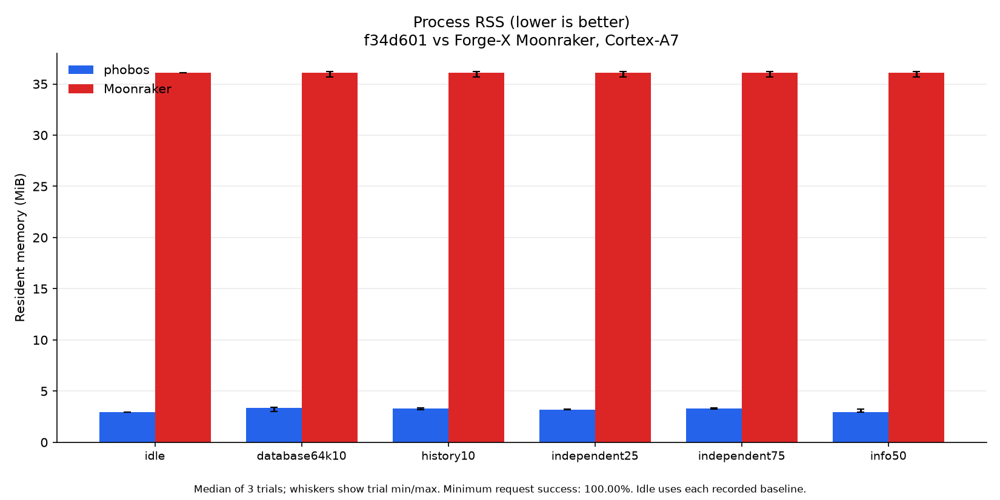
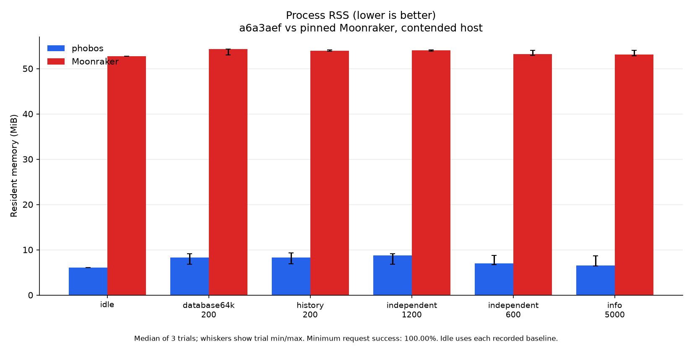

# Memory footprint

Measured 2026-10-21 alongside [the load comparisons](PERFORMANCE.md).
Host capture: `a6a3aef`. Final Cortex-A7 capture: `f34d601`. Earlier phobos is
`39386ca`, already including lazy temperature rings. All use static musl
ReleaseSmall builds with SQLite 3.54.1. The file backend remains available
but is not measured in this study and does not remove linked SQLite code.

**Lower RSS is better:** it leaves RAM for Klippy and other services.
KiB means 1,024 bytes. RSS is resident pages, not total allocated bytes or
private memory. The tables report the maximum sampled load RSS across all
trials, not an instantaneous allocation peak. Worker pools and prior workloads
can leave resident pages behind; a lower arena allocation need not lower RSS
by the same amount.

## Cortex-A7 printer

Forge-X 1.4.2 chroot, Linux 5.4.61, two Cortex-A7 cores and 110,404 KiB RAM.
The final executable is 2,630,600 bytes, SHA256
`c3afd1bcdb905ccb2661689d2e1762550c4dc67fa3670ecfd61bf0c5388cb755`.
Probes run sequentially on loopback 7126 using identical copied inputs and
common core configuration. Production v0.2.1 stays running on 7125. This is
the actual Forge-X Moonraker daemon, not an estimated Python baseline.

| Process | Median idle KiB ↓ (trial range) | Maximum sampled load KiB ↓ | Peak threads |
| --- | ---: | ---: | ---: |
| Earlier phobos | 3,268 (3,244 to 3,280) | 4,792 | 15 |
| Optimized phobos | 3,028 (3,012 to 3,040) | 3,532 | 16 |
| Moonraker | 36,980 (36,456 to 37,080) | 37,080 | 5 |

↓ Lower is better. Optimized phobos uses less idle and sampled load RSS than
Moonraker in this fixture. Earlier and optimized phobos are much closer;
their [trial ranges](perf/history-memory-20261021/printer/idle-trials.json)
and per-workload peaks accompany the report. The common config omits optional
update remotes and differs from production, so this is not an all-components
memory guarantee.

There are three fresh-process repetitions per backend, 45 eight-second read
trials, and about 250 ms process/board samples. Each idle phase has eight
one-second sleeps plus guard/read overhead; its actual observed duration is
stored with the samples. No probe reported swapped pages. Board swap existed
before testing and its free space varied from
0 to 232 KiB;
zero probe VmSwap does not mean the board did no swapping. Available board
memory stayed at or above 34,268 KiB, above the
16 MiB stop guard.

[Environment and binary hashes](perf/history-memory-20261021/printer/environment.json),
[all measured trials](perf/history-memory-20261021/printer/all-trials.json)
and [board memory limits](perf/history-memory-20261021/printer/board-memory.json)
record the inputs and counters. All probes stopped; production PID, binary,
boot ID, Klippy readiness and zero heater targets were preserved.

After probe shutdown, eight production read checks passed with 62,040 KiB
available board memory. Production phobos had 2,712 KiB RSS and 1,192 KiB
VmSwap. The comparison therefore does not claim that production stayed fully
resident. Swap controls were unchanged. The
[final state record](perf/history-memory-20261021/printer/final-state.json)
contains those counters and checks without response payloads.

## Host optimization capture

Ryzen 9 9950X, CachyOS x86-64, Linux 7.2.10. The portable optimized binary is
2,751,768 bytes, SHA256
`8294a0b8341a47865948493f4060da555e20312bc5af9ff98729284041c160ab`.
Pinned Moonraker runs on Python 3.12.12 against the same Klippy stub, copied
266-job database and synthetic 64 KiB record. The later nullable-time fix is
not in this host capture.

| Process | Median idle KiB ↓ (trial range) | Maximum sampled load KiB ↓ | Peak threads |
| --- | ---: | ---: | ---: |
| Earlier phobos | 6,172 (4,180 to 6,208) | 11,020 | 18 |
| Optimized phobos | 6,252 (6,252 to 8,308) | 9,536 | 19 |
| Moonraker | 54,024 (53,940 to 54,168) | 55,624 | 5 |

The host had external CPU contention. RSS also varies with worker allocation
and workload order: the earlier same-binary adaptive-worker control ranged
from 9,692 to 32,024 KiB under load. That control used a different rate and
worker bound; it is not an uncertainty estimate for this table. The fixed
eight-worker final host run retains all favorable and unfavorable measurements.
[PERFORMANCE.md](PERFORMANCE.md) records the empty-history CPU regression and
why an isolated-host verdict remains unavailable.

The [idle trials](perf/history-memory-20261021/host/idle-trials.json) and
[complete trial records](perf/history-memory-20261021/host/all-trials.json)
retain ranges. No file-backend or long-soak comparison was made here.
The older release's file-backend idle result remains in the
[historical v0.2.1 capture](perf/host-v0.2.1/phobos-file/idle.json).

## Reservations and ownership

`VmSize` and `VmData` include reserved address space; RSS counts resident
pages. Background workers use bounded stack reservations, and the 32-bit
daemon owns a threaded I/O backend with 1 MiB handler stacks. Those are
implementation settings, not fresh measurements of every mapping.
Request arenas are freed on return, but long-lived component state, SQLite
pages and the connection worker pool can remain resident after load.

`scripts/measure-memory.sh [port]` provides a separate, minimal idle
ReleaseSmall fixture with no Klippy connection and a bare Python baseline.
It uses an isolated scratch prefix and stops only its own process. Its
configuration differs from the connected measurements above; do not compare
those values as a storage-only change. Never point measurement helpers at a
live printer database.

## Temperature-store allocation review

The post-v0.2.1 temperature store allocates optional target, power and speed
rings only when Klippy reports those fields. Each ring retains the configured
1,200-sample capacity. A late field still starts its own history, and omitted
fields retain their last reading. Responses allocate JSON arrays at their final
length and read the deque directly, avoiding a scratch copy and array growth
inside the request arena.

The allocation regressions use the same inputs and `std.testing.FailingAllocator`
before and after the change on x86-64. These are requested/retained allocation
bytes, not process RSS or printer-wide RAM:

| Measurement | Before bytes ↓ | After bytes ↓ |
| --- | ---: | ---: |
| New plain sensor, including its map entry | 39,909 | 11,109 |
| Arena retained by one full 1,200-value response | 135,816 | 100,872 |

↓ Lower is better. The configured Forge-X reports two heaters with temperature,
target and power, and two plain temperature sensors. Allocating only those eight
fields removes eight unused rings: `8 × 1,200 × 8 = 76,800` bytes (75 KiB).
That is a ring-payload calculation, not an asserted RSS reduction. The tests
check a wrapped full window, late fields and unused buffers; the bounded sampler
fuzzer also checks that an unreported speed field has no allocation.

A private Cortex-A7 ReleaseSmall baseline/candidate pair used the same settings
and separate copies of the existing probe database on loopback port 7126.
Twenty-one `/proc` samples covered 20 seconds after Klippy became ready. Median
RSS over the last ten samples was 2,984 KiB for the published v0.2.1 baseline
and 2,712 KiB for the candidate (lower is better). Both returned the four expected
sensor field sets and added about 20 samples per field. Directory capacity also
passed. This single short pair is not a soak or a general RSS guarantee; a full
1,200-sample response was checked in the unit suite. Exact hashes, samples,
field counts and final printer state are in the
[capture summary](perf/temperature-memory-20261021.json). Both probes stopped;
production v0.2.1 on 7125 and the board boot ID were unchanged.

The local MISRA-Zig handbook's allocator and resource rules (Dir 4.12,
Dir 4.14, 21.3, 22.1 and 22.2) support explicit owners, bounded inputs,
matching frees and allocation-failure checks. They do not forbid dynamic
allocation in this daemon. A later checkout of the local checker compiled with
Zig 0.17 and scanned all 80 source files: 2,342 syntax findings, including test
code. These are review inputs, not confirmed defects or a compliance result.
The memory review distinguishes request-arena cleanup, ownership transfer and
streaming file copies from actual leaks or unlimited allocation. Bounded JSON
recursion remains a deliberate difference from the handbook's no-recursion
rule. No blanket suppressions or mechanical rewrites were applied.

## History pages and SQLite reads

Unfiltered SQLite history pages now select and order scalar job IDs before
decoding the requested records. KV records still override migrated table rows.
Noncanonical keys, non-object records and time-filtered queries use the existing
namespace implementation, as does the file backend. Their ordering, offset,
limit and error behavior remains covered against that implementation.

SQLite JSON reads also decode the current column directly, before the statement
is finalized. The JSON value owns its strings, so retaining a second encoded
record is unnecessary. A regression overwrites the database record after the
read and verifies that the returned payload remains intact.

| Native allocation fixture | Before retained bytes ↓ | After retained bytes ↓ |
| --- | ---: | ---: |
| 20-job page from 200 KV jobs, 4 KiB metadata each | 1,396,192 | 235,146 to 235,578 |
| Read one 64 KiB JSON payload | 393,638 | 149,834 |

These are x86-64 request-arena allocations measured with
`std.testing.FailingAllocator`, not process RSS. Both fixtures failed their
allocation budgets before the change. Pagination tests compare the real history
handler with the namespace path, including overrides, filters, unusual keys,
negative/large offsets and unlimited requests. Allocation-failure injection and
a bounded differential fuzzer cover the optimized store operation.

KV syntax checks use `std.json.validate` on actual rows. Empty or migrated-only
history does not prepare a SQL JSON-validation expression. Scalar ID storage
still grows with total job count; filtered and unlimited responses can still
decode the full history. These changes reduce ordinary page cost without
changing the API's unlimited-query behavior.

The copied printer history also exposed nullable SQL end times being read as
zero. The row mapper now preserves `NULL`, which also lets the existing `before`
filter exclude unfinished rows correctly. The final ARM probe matches Forge-X
Moonraker for all 266 copied jobs, seven null end times, both page orders,
offsets, time filters and a single unfinished job. The
[parity record](perf/history-memory-20261021/nullable-history-parity.json)
contains counts and response hashes without publishing job data.
