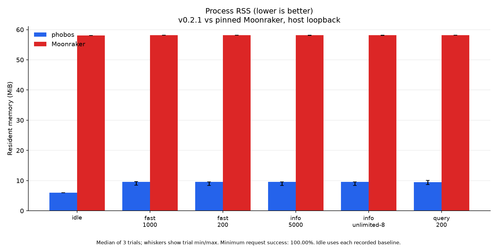
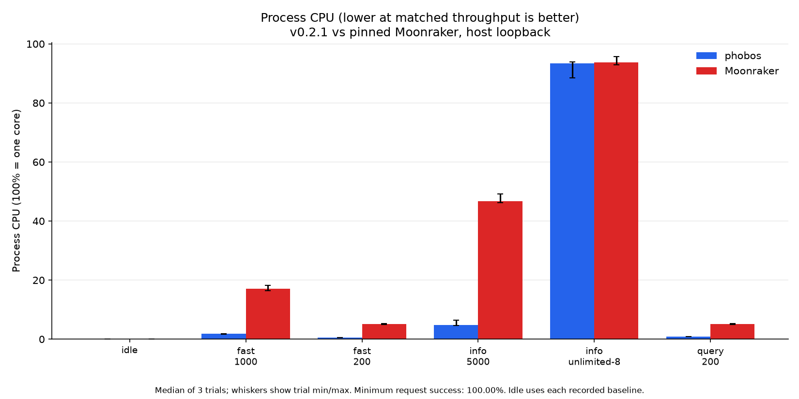

# Memory footprint

Measured 2026-10-21 alongside the v0.2.1 [load comparisons](PERFORMANCE.md).
Values are process RSS from `/proc`, in KiB (1,024 bytes) and MiB. The
binary includes SQLite and musl; the file backend remains a runtime choice
and does not remove linked SQLite code.

**Lower RSS is better:** it leaves more RAM for Klippy and the rest of the
system. Lower CPU is better at matched throughput. Thread counts are diagnostic;
fewer threads do not automatically mean better performance.

## Host idle and load

AMD Ryzen 9 9950X, CachyOS x86-64, Linux 7.2.10-1-cachyos.
The exact portable ReleaseSmall x86-64 asset is 2,745,112 bytes (2.62 MiB).
Full pinned Moonraker runs on Python 3.12.12 with its dependencies loaded;
the comparison is not a bare interpreter or an estimated production range.

Both servers are Klippy-ready against the same protocol stub. Their fresh
databases contain the same seeded `mainsail.settings` value. After successful
fixture reads and three seconds of settling, 101 samples span ten seconds.
The file-backend measurement uses the same phobos executable, common config,
stub and seeded value, with an independent file store.

| Process / store | Median idle KiB ↓ | MiB ↓ | Threads | CPU, one core ↓ |
| --- | ---: | ---: | ---: | ---: |
| phobos / SQLite | 6,112 | 5.97 | 12 | 0.00% |
| phobos / file | 5,448 | 5.32 | 12 | 0.00% |
| Moonraker / SQLite | 59,468 | 58.07 | 5 | 0.10% |

↓ Lower is better. In this fixture phobos/SQLite uses 9.7× less idle RSS
than full Moonraker; phobos/file has the lowest measured idle RSS.

The SQLite/file difference is 664 KiB in this fixture. It is not a fixed
SQLite cache cost or a universal saving. Zero measured CPU means no process
ticks advanced within this short sampling window.

The SQLite phobos and Moonraker processes each run 15 load trials; the file
backend has an idle measurement only. The table reports
the maximum sampled RSS across three trials of each workload, the median
whole-trial CPU percentage and peak thread count. Earlier workloads can leave
resident allocations and worker threads behind. CPU excludes the stub and
load generator; 100% is one core.
The RSS figure shows the median of the three trial peaks and their range;
the table keeps the maximum across all three.

| Process | Workload | Peak RSS MiB ↓ | Median CPU ↓ at matched rate | Peak threads |
| --- | --- | ---: | ---: | ---: |
| phobos | Info, unlimited / 8 workers | 9.59 | 93.35% | 21 |
| Moonraker | Info, unlimited / 8 workers | 58.19 | 93.75% | 5 |
| phobos | Info, 5,000/s | 9.60 | 4.79% | 21 |
| Moonraker | Info, 5,000/s | 58.19 | 46.78% | 5 |
| phobos | Independent mix, 200/s | 9.61 | 0.60% | 21 |
| Moonraker | Independent mix, 200/s | 58.19 | 5.19% | 5 |
| phobos | Independent mix, 1,000/s | 9.66 | 1.80% | 21 |
| Moonraker | Independent mix, 1,000/s | 58.19 | 17.15% | 5 |
| phobos | Stub query, 200/s | 10.04 | 0.80% | 21 |
| Moonraker | Stub query, 200/s | 58.19 | 5.09% | 5 |

phobos uses less RSS in every measured workload and less CPU at every matched
offered rate. The unlimited rows perform different amounts of work, so their
CPU percentages alone do not decide which implementation is more efficient.

Idle JSON, trial measurements and source/tool metadata are in
[the host capture summary](perf/host-v0.2.1/summary.json) and its neighboring
files. These are short read workloads, not a leak or long-soak test.

## Cortex-A7 printer

Forge-X 1.4.2 chroot, Linux 5.4.61, two Cortex-A7 cores, 110,404 KiB RAM.
The candidate Cortex-A7 asset is 2,623,944 bytes (2.50 MiB), SHA-256
`5f878845076f575756b0ba2239a82ba5e00b30ff22d6ec7634790836673957cf`.
Each private probe uses a database copy, the real configured components and
Klippy connection; production v0.2.0 remains running separately. RSS below
counts the probe only, not the complete board's resident memory.

| Probe version | Idle RSS KiB ↓ | Idle MiB ↓ | Idle threads | Peak load RSS KiB ↓ | Peak load MiB ↓ | Peak threads |
| --- | ---: | ---: | ---: | ---: | ---: | ---: |
| v0.2.0 | 3,056 | 2.98 | 11 | 5,052 | 4.93 | 16 |
| v0.2.1 | 3,100 | 3.03 | 11 | 5,056 | 4.94 | 16 |

↓ Lower is better. v0.2.0 measured 44 KiB less idle RSS and 4 KiB less peak
load RSS. These small differences do not establish a general memory regression.

Idle uses the last ten seconds before load, excluding startup, with 37
samples per version over about 9.8 seconds. Load comprises 42 eight-second
read trials, including the real Klippy query and config directory paths.
The shell sampler reads process and board memory about every 250 ms.
Board MemAvailable stayed at or above 49,540 KiB; an automatic guard would stop
load below 16 MiB. No new full Moonraker process was started on the board.
No file-backend measurement was made on the printer in this release.

See [the printer summary](perf/printer-v0.2.1.json) for exact samples,
trial ranges, rates and transport limits. RSS is neither total allocated
memory nor proof that all optional components fit on another printer.

## Reservations and ownership

`VmSize` and `VmData` include reserved address space; RSS counts resident
pages. Background workers use bounded stack reservations, and the 32-bit
daemon owns a threaded I/O backend with 1 MiB handler stacks. Those are
implementation settings, not fresh measurements of every mapping.
Request arenas are freed on return, but long-lived component state, SQLite
pages and the connection worker pool can remain resident after load.

`scripts/measure-memory.sh [port]` provides a separate, minimal idle
ReleaseSmall fixture with no Klippy connection and a bare Python baseline.
It uses an isolated scratch prefix and stops only its own process. Its
configuration differs from the connected measurements above; do not compare
those values as a storage-only change. Never point measurement helpers at a
live printer database.

## Temperature-store allocation review

The post-v0.2.1 temperature store allocates optional target, power and speed
rings only when Klippy reports those fields. Each ring retains the configured
1,200-sample capacity. A late field still starts its own history, and omitted
fields retain their last reading. Responses allocate JSON arrays at their final
length and read the deque directly, avoiding a scratch copy and array growth
inside the request arena.

The allocation regressions use the same inputs and `std.testing.FailingAllocator`
before and after the change on x86-64. These are requested/retained allocation
bytes, not process RSS or printer-wide RAM:

| Measurement | Before bytes ↓ | After bytes ↓ |
| --- | ---: | ---: |
| New plain sensor, including its map entry | 39,909 | 11,109 |
| Arena retained by one full 1,200-value response | 135,816 | 100,872 |

↓ Lower is better. The configured Forge-X reports two heaters with temperature,
target and power, and two plain temperature sensors. Allocating only those eight
fields removes eight unused rings: `8 × 1,200 × 8 = 76,800` bytes (75 KiB).
That is a ring-payload calculation, not an asserted RSS reduction. The tests
check a wrapped full window, late fields and unused buffers; the bounded sampler
fuzzer also checks that an unreported speed field has no allocation.

A private Cortex-A7 ReleaseSmall baseline/candidate pair used the same settings
and separate copies of the existing probe database on loopback port 7126.
Twenty-one `/proc` samples covered 20 seconds after Klippy became ready. Median
RSS over the last ten samples was 2,984 KiB for the published v0.2.1 baseline
and 2,712 KiB for the candidate (lower is better). Both returned the four expected
sensor field sets and added about 20 samples per field. Directory capacity also
passed. This single short pair is not a soak or a general RSS guarantee; a full
1,200-sample response was checked in the unit suite. Exact hashes, samples,
field counts and final printer state are in the
[capture summary](perf/temperature-memory-20261021.json). Both probes stopped;
production v0.2.1 on 7125 and the board boot ID were unchanged.

The local MISRA-Zig handbook's allocator and resource rules (21.3, 22.1 and
22.2) support explicit owners, matching frees and allocation-failure checks.
They do not forbid dynamic allocation in this daemon. The local checker did
not compile with Zig 0.17 because it references the removed `asterisk_asterisk`
token; this review applies the handbook manually and makes no compliance claim.

The next place to measure is history pagination: `loadAllJobs` reads and parses
the entire namespace before the list handler filters, sorts and returns a page.
Pushing selection into the store could reduce peak memory for large histories,
but needs matching SQLite/file-backend ordering and pagination tests. Smaller
thread stack reservations alone would reduce virtual address space, not prove
lower RSS. Neither change is included in these temperature-store measurements.
