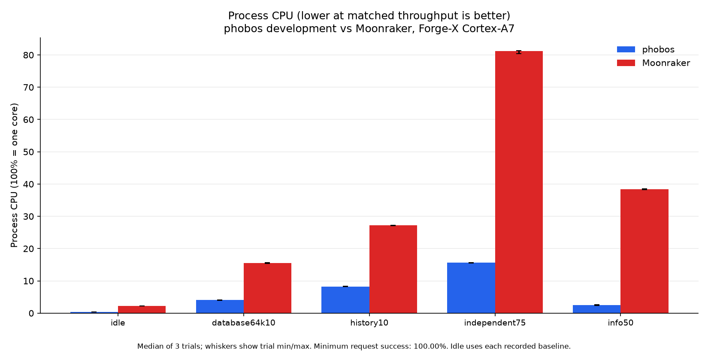
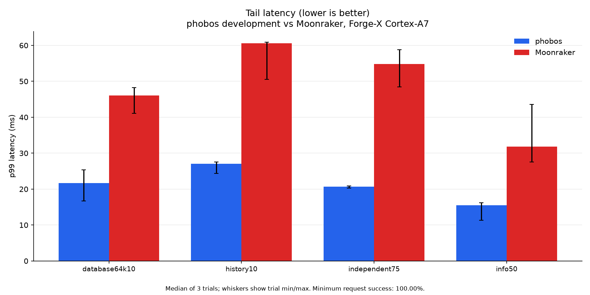
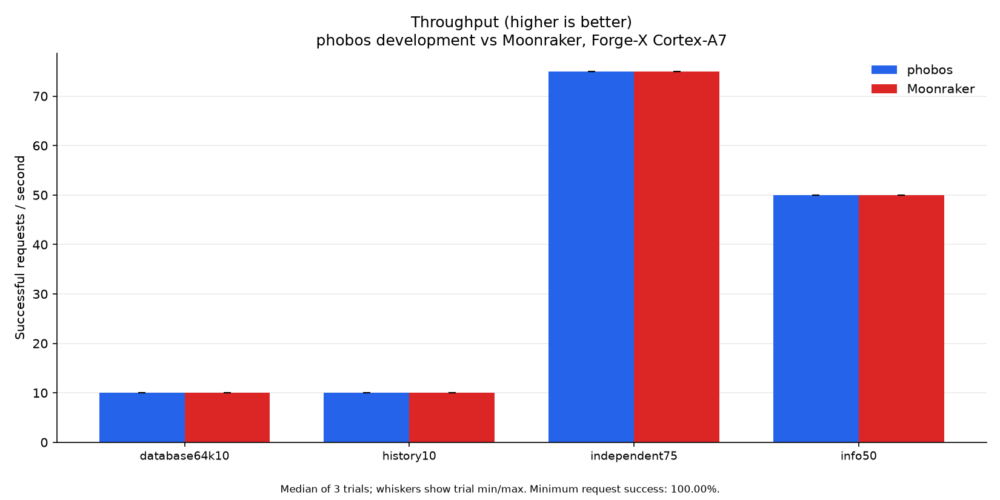
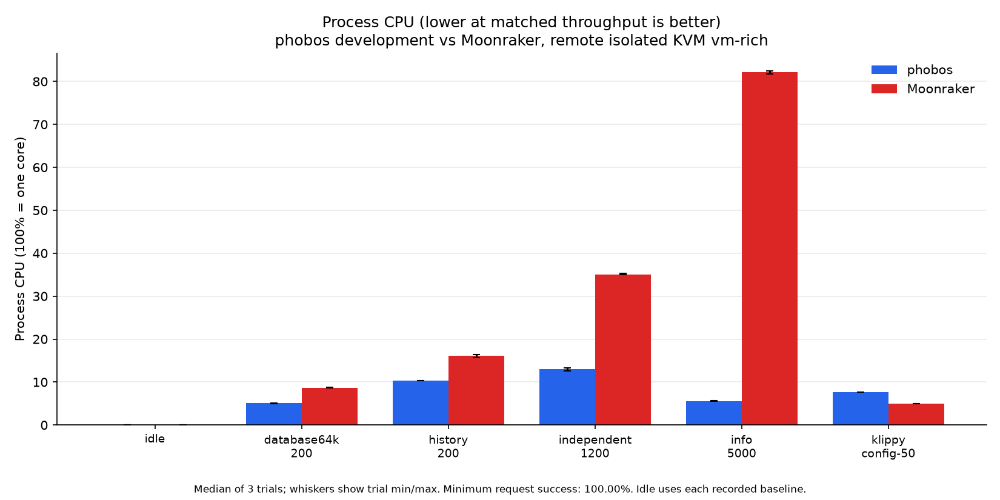
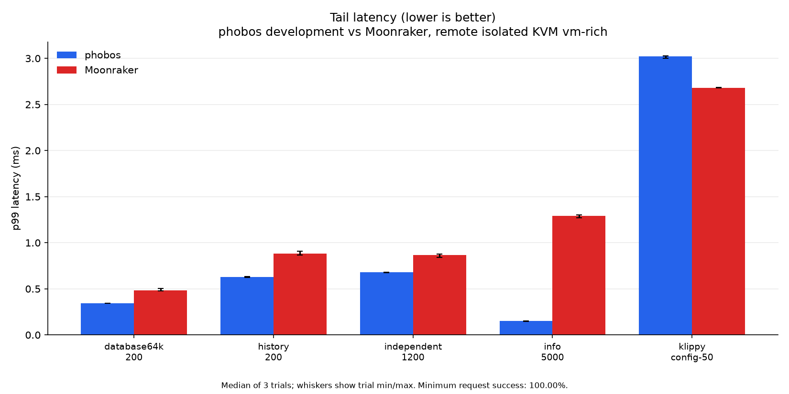
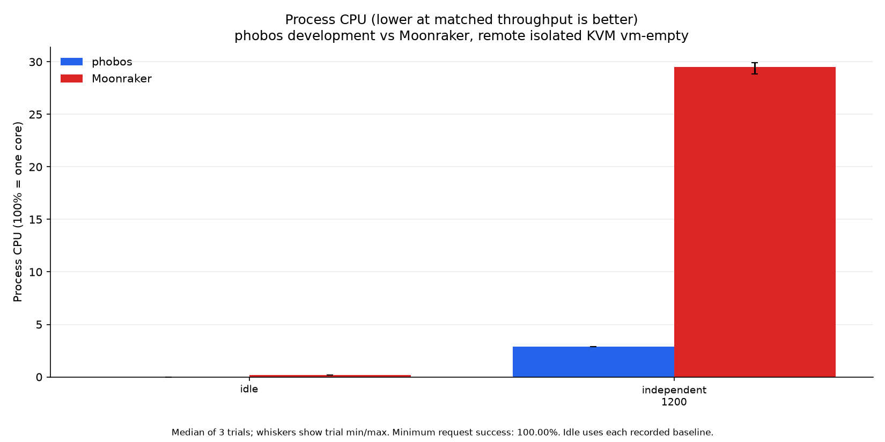
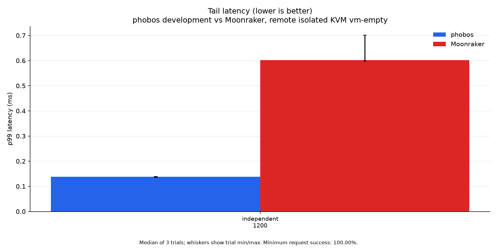
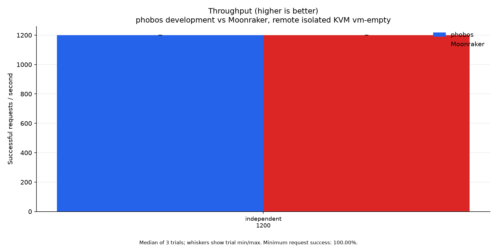

# Performance

Current measurements compare **phobos 0.2.2 development with Moonraker**, measured
2026-10-22. The candidate uses ReleaseFast, a single parsed Klippy response,
vectorized buffered JSON strings, SQL history pagination, batched status delivery
and Zig's standard startup allocator. It is not the published v0.2.2 asset.
Exact source blobs, binary hashes, fixtures and controls accompany the
[capture method](perf/optimization-20261022-2/METHOD.md). Earlier [results](perf/optimization-20261022/)
and rejected/intermediate [experiments](perf/optimization-20261022-2/experiments/) remain archived.
Every active graphic shows only the current build and Moonraker.

**Lower CPU time, latency and RSS are better. Higher successful throughput is
better.** These fixed-arrival tests measure whether each server meets the offered
rate, not maximum capacity. Tiny throughput differences near that rate do not
establish a winner. Tables show medians of three trial statistics; plot whiskers
show trial minima/maxima, not confidence intervals. CPU 100% means one core.

## Physical Forge-X printer

Forge-X 1.4.2 chroot, Linux 5.4.61, two Cortex-A7 cores and 110,404 KiB RAM.
The reference is installed Moonraker API 1.4.0 on Python 3.11.10. Production
is paused during load. Both servers use private copies of the same 266-job
database on loopback 7126. No benchmark opens the live database.
The generator runs on CPU 0, all server threads on CPU 1, with SSH outside
the timed request path. Read-only guards require readiness, idle and zero
heater targets throughout. No print, motion, heating or hardware restart is used.

All 24 twelve-second HTTP trials succeed: **10,440 requests**,
plus **126 full WebSocket subscriptions** and 36 matching
history comparisons. Request content is checked before timing.

| Workload | phobos CPU ms/req ↓ | Moonraker CPU ms/req ↓ | phobos p99 ms ↓ | Moonraker p99 ms ↓ |
| --- | ---: | ---: | ---: | ---: |
| database64k10 | 4.08 | 15.4 | 21.7 | 46 |
| history10 | 8.17 | 27.2 | 27.1 | 60.6 |
| independent75 | 2.09 | 10.9 | 20.7 | 54.8 |
| info50 | 0.5 | 7.68 | 15.5 | 31.8 |

Each subscription requests all 268 objects visible in the private config,
including six pins hidden by production's Fluidd config. Twenty-one fresh
connections arrive at 1.75/s in each repetition. The rate samples seven phases
of Klippy's 250 ms subscription tick, rather than locking to one phase at 1 Hz.
CPU time per subscription is **46.19 versus 88.10 ms**.
Median scheduled-arrival through decoded-reply latency is **284.33
versus 320.30 ms**. Median time after Klippy's snapshot is
**149.90 versus 156.40 ms**, using its CLOCK_MONOTONIC_RAW
eventtime. All names match. These measurements include client decoding and are
not Fluidd page-loading times. [All subscription trials](perf/optimization-20261022-2/printer/subscriptions.json)
retain ranges and every request; no trial is dropped for its result.

The [benchmark final state](perf/optimization-20261022-2/printer/final-state.json) records the original
production daemon restored on 7125, ready and idle with zero targets, unchanged
board boot ID and no listener on 7126. Deployment afterward is recorded
separately. [Known differences](perf/optimization-20261022-2/mismatches.json) distinguish identity,
supported defaults, deliberate policy and private-fixture environment from bugs.
The API stays 1.5.0 with phobos identity; the Python stub, CAN empty-list fallback
and optional component implementations remain intact.

## KVM on the benchmark PC

The Ryzen 9 5950X at 192.168.0.99 runs a private four-vCPU guest with 4 GiB
preallocated locked RAM and no NIC. Moonraker is pinned to `900848584374`, on
Python 3.12.12, with msgspec enabled. Fresh rich and empty
databases use the same fixtures as the printer. The synthetic config reply
has no hardware action; the stub does not reproduce a live status flood.

An isolated cgroup reserves an entire L3 group, host CPUs 8-15/24-31, including
SMT siblings. vCPUs pin to separate physical cores 10/11/12/13; the emulator
uses CPU 8. The guest server uses CPU 1, generator 2/3 and stub/controller 0.
Scheduling is SCHED_OTHER with nice -20, without idle polling. Existing frequency
policies stay unchanged. **Fixed frequency and literal zero steal are not
established.** Guest steal tick sums are `{"cpu": 1, "cpu0": 1, "cpu1": 0, "cpu2": 0, "cpu3": 0}`. Maximum server-vCPU run-queue delay is 0.000693% of its trial window; the maximum for any vCPU is 0.000989%. Locked RAM stays at least 4,837,408 KiB. VM/cgroup swap and quota throttling remain zero.
[Every isolation window](perf/optimization-20261022-2/vm-isolation-summary.json) and
[cleanup](perf/optimization-20261022-2/vm-cleanup.json) remain available.

### Populated history

| Workload | phobos CPU ms/req ↓ | Moonraker CPU ms/req ↓ | phobos p99 ms ↓ | Moonraker p99 ms ↓ |
| --- | ---: | ---: | ---: | ---: |
| database64k-200 | 0.255 | 0.435 | 0.346 | 0.485 |
| history-200 | 0.515 | 0.805 | 0.63 | 0.884 |
| independent-1200 | 0.108 | 0.293 | 0.678 | 0.868 |
| info-5000 | 0.0112 | 0.165 | 0.151 | 1.29 |
| klippy-config-50 | 1.53 | 0.995 | 3.02 | 2.68 |

### Empty history

| Workload | phobos CPU ms/req ↓ | Moonraker CPU ms/req ↓ | phobos p99 ms ↓ | Moonraker p99 ms ↓ |
| --- | ---: | ---: | ---: | ---: |
| independent-1200 | 0.0242 | 0.247 | 0.139 | 0.602 |

The remote config reply remains slower: phobos uses 1.525 versus 0.995 ms CPU
per request, 53.3% more, and p99 is 3.02 versus 2.68 ms, 12.7% higher. Other
measured remote workloads favor phobos for median CPU, p99 and sampled RSS.
The local config result is much closer (0.850 versus 0.885 ms CPU, 1.483 versus
1.495 ms p99); timings from one host do not establish a universal win. Further
profiling must address the remote gap rather than discard that host's result.

All **54 trials and 719,980 requests** succeed, with 108 matching
history comparisons. Totals include the retained earlier ReleaseSmall baseline;
active plots contain only the candidate and Moonraker. Trials last at least
10 seconds and offer at least 2,000 requests, so the 50/s config case lasts
40 seconds. This minimum was chosen before the final studies to improve p99
sampling. Every backend receives the same rate and duration.

An independent local Ryzen 9 5950X corroboration completes **54 trials
and 719,983 successful requests** with the same build, method and seed.
Its [measurements](perf/optimization-20261022-2/local-vm/trials.json),
[isolation](perf/optimization-20261022-2/local-vm/isolation-summary.json) and
[cleanup](perf/optimization-20261022-2/local-vm/cleanup.json) are separate from the remote results;
timings from the two hosts are not pooled.

## Why these paths changed

The previous largest gap was the large Klippy config reply. ReleaseSmall's
size-oriented copies, repeated JSON decoding and byte-at-a-time escaping cost
more CPU than Moonraker's accelerated JSON backend. The current path parses once,
retains the parsed arena until its waiter copies the result, batches reads in a
64 KiB standard reader and buffers escaping with portable Zig vectors. Standard
JSON handles punctuation, scalar formatting and nondefault string options.
Mandatory escape bytes are generated by the standard encoder at compile time.

Migrated legacy history without KV overrides uses ordered SQL LIMIT/OFFSET,
decoding only selected rows. Mixed histories retain their validated fallback.
One Klippy status push now produces one filtered notification per interested
client, preserving object/field masking and connection ownership. Unit/fuzz tests
cover malformed input, allocation/writer failure, large pipelined frames and
multiple clients. [Memory results](MEMORY.md) distinguish allocation from RSS.

The [experiment archive](perf/optimization-20261022-2/experiments/) includes slower alternatives,
overlapping latency results and harness failures. A local FIFO/idle-poll trial
starved a host kernel worker and was invalidated; valid runs use neither setting.
An early printer harness mixed two clock domains; its assertion was corrected
against live Klippy sources before the final study. Neither failure is presented
as a daemon crash or a performance win. Earlier shorter config trials are not
used for cross-duration speedup percentages.

These studies do not establish maximum capacity, universal superiority,
printing/upload performance, file-backend performance, long-soak behavior or
notification-flood throughput. Other release profiles pass build/ABI validation,
not physical-printer daemon tests. The printer kernel disables perf events;
on-device microbenchmarks use process CPU counters rather than a sampled profile.
See the [method](perf/optimization-20261022-2/METHOD.md) for reproducible plotting commands and limits.
