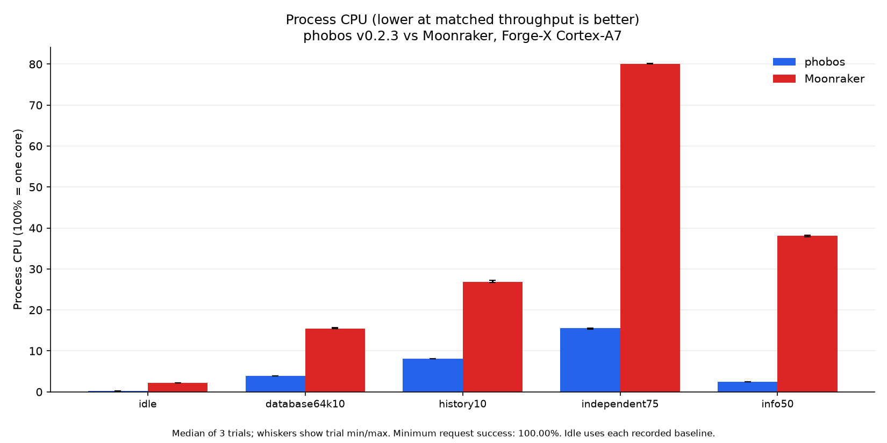
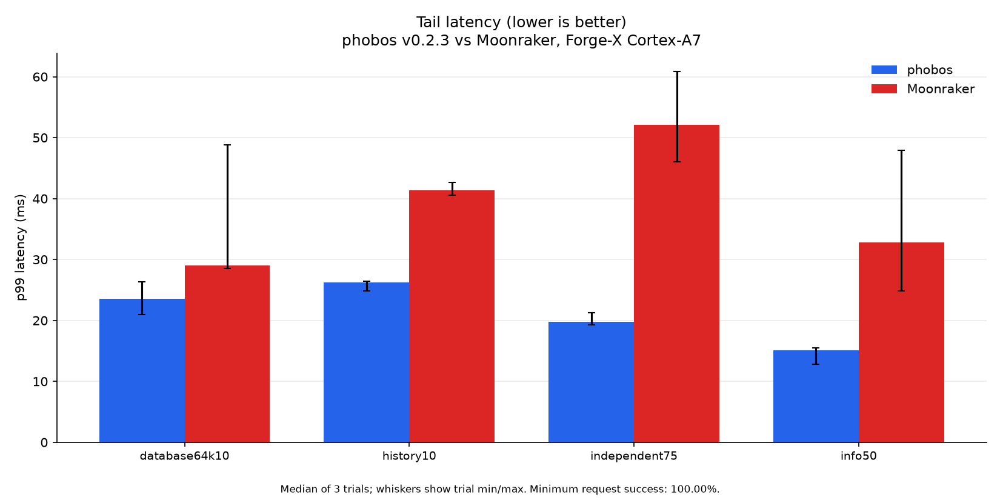
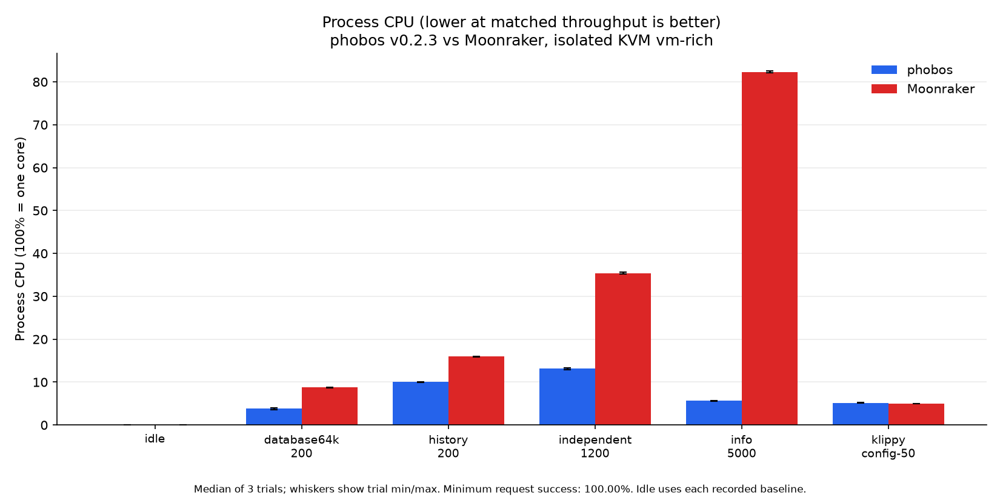
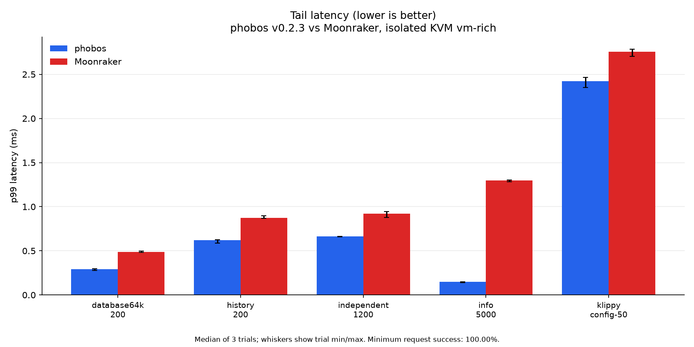
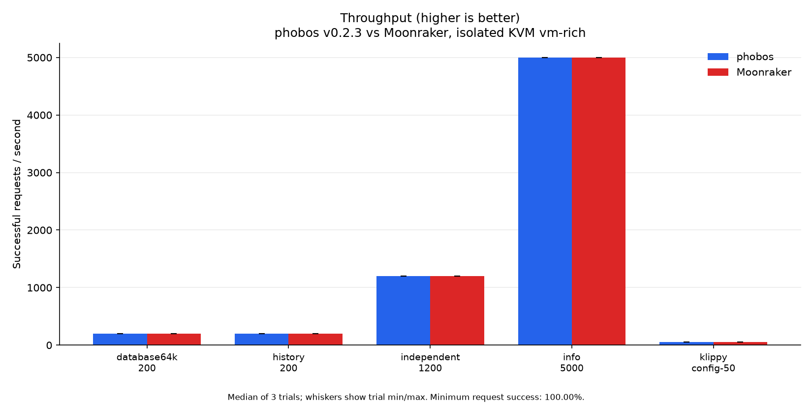
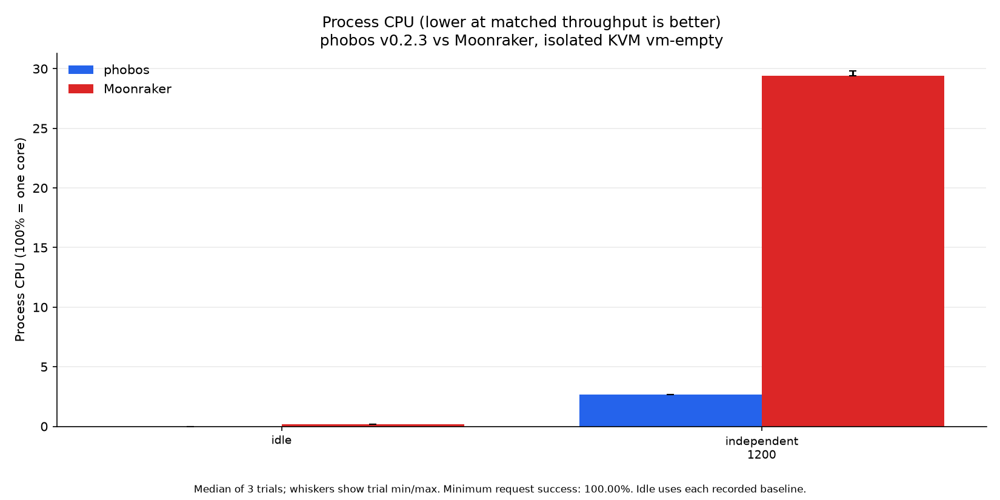
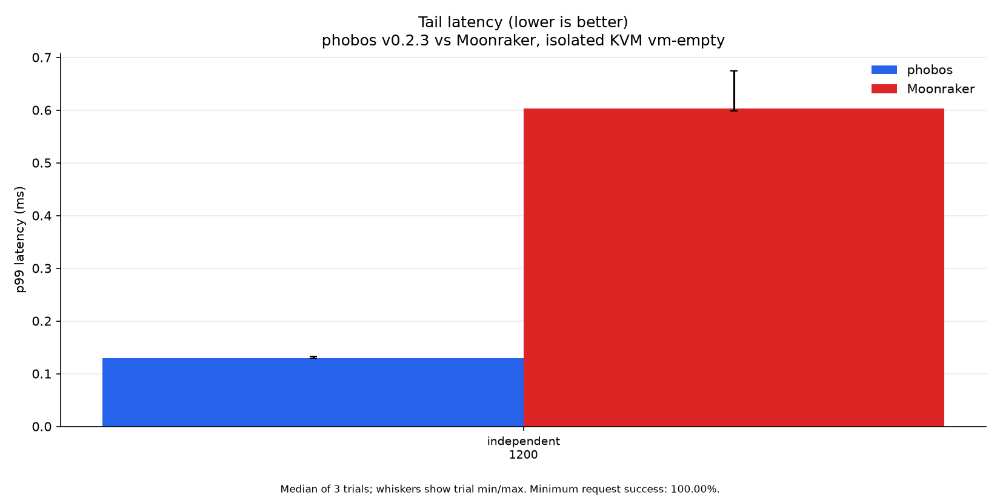
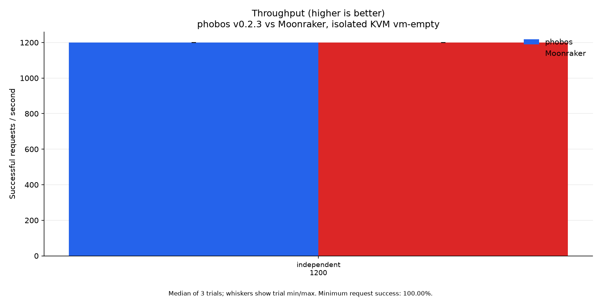

# Performance

Current measurements compare **phobos v0.2.3 with Moonraker**, measured
2026-10-23. The candidate uses ReleaseFast, bulk ASCII JSON values, buffered
encoding, reused SQLite statements, metadata-only file checks, compact console
snapshots and bounded worker stacks. Its hashes match the release matrix.
Exact source blobs, binary hashes, fixtures and controls accompany the
[capture method](perf/optimization-20261023/METHOD.md). Earlier [results](perf/optimization-20261022/)
and rejected/intermediate [experiments](perf/optimization-20261022-2/experiments/) remain archived.
Every active graphic shows only the current build and Moonraker.

Phobos has lower median p99 and sampled RSS in every measured HTTP case on both
PCs and the printer. Remote large-config CPU remains 2.0% above Moonraker:
1.025 versus 1.005 ms/request. All other HTTP workload CPU medians favor phobos.
Subscription latency ranges overlap; these are measured cases, not a claim
about every workload or printer.

**Lower CPU time, latency and RSS are better. Higher successful throughput is
better.** These fixed-arrival tests measure whether each server meets the offered
rate, not maximum capacity. Tiny throughput differences near that rate do not
establish a winner. Tables show medians of three trial statistics; plot whiskers
show trial minima/maxima, not confidence intervals. CPU 100% means one core.

## Physical Forge-X printer

Forge-X 1.4.2 chroot, Linux 5.4.61, two Cortex-A7 cores and 110,404 KiB RAM.
The reference is installed Moonraker API 1.4.0 on Python 3.11.10. Production
is paused during load. Both servers use private copies of the same 266-job
database on loopback 7126. No benchmark opens the live database.
The generator runs on CPU 0, all server threads on CPU 1, with SSH outside
the timed request path. Read-only guards require readiness, idle and zero
heater targets throughout. No print, motion, heating or hardware restart is used.

All 24 twelve-second HTTP trials succeed: **10,440 requests**,
plus **126 full WebSocket subscriptions** and 36 matching
history comparisons. Request content is checked before timing.

| Workload | phobos CPU ms/req ↓ | Moonraker CPU ms/req ↓ | phobos p99 ms ↓ | Moonraker p99 ms ↓ |
| --- | ---: | ---: | ---: | ---: |
| database64k10 | 3.92 | 15.3 | 23.5 | 29.1 |
| history10 | 8.08 | 26.8 | 26.2 | 41.3 |
| independent75 | 2.08 | 10.7 | 19.7 | 52.1 |
| info50 | 0.5 | 7.63 | 15.1 | 32.8 |

Each subscription requests all 268 objects visible in the private config,
including six pins hidden by production's Fluidd config. Twenty-one fresh
connections arrive at 1.75/s in each repetition. The rate samples seven phases
of Klippy's 250 ms subscription tick, rather than locking to one phase at 1 Hz.
CPU time per subscription is **48.10 versus 86.19 ms**.
Median scheduled-arrival through decoded-reply latency is **299.98
versus 314.14 ms**. Median time after Klippy's snapshot is
**153.02 versus 154.65 ms**, using its CLOCK_MONOTONIC_RAW
eventtime. All names match. These measurements include client decoding and are
not Fluidd page-loading times. [All subscription trials](perf/optimization-20261023/printer/subscriptions.json)
retain ranges and every request; no trial is dropped for its result.

The [benchmark final state](perf/optimization-20261023/printer/final-state.json) records the original
production daemon restored on 7125, ready and idle with zero targets, unchanged
board boot ID and no listener on 7126. Deployment afterward is recorded
separately. [Known differences](perf/optimization-20261023/mismatches.json) distinguish identity,
supported defaults, deliberate policy and private-fixture environment from bugs.
The API stays 1.5.0 with phobos identity; the Python stub, CAN empty-list fallback
and optional component implementations remain intact.

## KVM on the benchmark PC

The Ryzen 9 5950X at 192.168.0.99 runs a private four-vCPU guest with 4 GiB
preallocated locked RAM and no NIC. Moonraker is pinned to `900848584374`, on
Python 3.12.12, with msgspec enabled. Fresh rich and empty
databases use the same fixtures as the printer. The synthetic config reply
has no hardware action; the stub does not reproduce a live status flood.

An isolated cgroup reserves an entire L3 group, host CPUs 8-15/24-31, including
SMT siblings. vCPUs pin to separate physical cores 10/11/12/13; the emulator
uses CPU 8. The guest server uses CPU 1, generator 2/3 and stub/controller 0.
Scheduling is SCHED_OTHER with nice -20, without idle polling. Existing frequency
policies stay unchanged. **Fixed frequency and literal zero steal are not
established.** Guest steal tick sums are `{"cpu": 0, "cpu0": 0, "cpu1": 0, "cpu2": 0, "cpu3": 0}`. Maximum server-vCPU run-queue delay is 0.002091% of its trial window; the maximum for any vCPU is 0.004400%. Locked RAM stays at least 4,837,408 KiB. VM/cgroup swap and quota throttling remain zero.
[Every isolation window](perf/optimization-20261023/vm-isolation-summary.json) and
[cleanup](perf/optimization-20261023/vm-cleanup.json) remain available.

### Populated history

| Workload | phobos CPU ms/req ↓ | Moonraker CPU ms/req ↓ | phobos p99 ms ↓ | Moonraker p99 ms ↓ |
| --- | ---: | ---: | ---: | ---: |
| database64k-200 | 0.195 | 0.44 | 0.294 | 0.487 |
| history-200 | 0.505 | 0.8 | 0.622 | 0.874 |
| independent-1200 | 0.11 | 0.295 | 0.663 | 0.921 |
| info-5000 | 0.0114 | 0.165 | 0.148 | 1.3 |
| klippy-config-50 | 1.03 | 1 | 2.42 | 2.76 |

### Empty history

| Workload | phobos CPU ms/req ↓ | Moonraker CPU ms/req ↓ | phobos p99 ms ↓ | Moonraker p99 ms ↓ |
| --- | ---: | ---: | ---: | ---: |
| independent-1200 | 0.0225 | 0.246 | 0.13 | 0.602 |

All **36 trials and 479,993 requests** succeed, with 72 matching
history comparisons. Every trial compares v0.2.3 with Moonraker; no earlier executable appears in active plots. Trials last at least
10 seconds and offer at least 2,000 requests, so the 50/s config case lasts
40 seconds. This minimum was chosen before the final studies to improve p99
sampling. Every backend receives the same rate and duration.

An independent local Ryzen 9 5950X corroboration completes **36 trials
and 479,975 successful requests** with the same build, method and seed.
Its [measurements](perf/optimization-20261023/local-vm/trials.json),
[isolation](perf/optimization-20261023/local-vm/isolation-summary.json) and
[cleanup](perf/optimization-20261023/local-vm/cleanup.json) are separate from the remote results;
timings from the two hosts are not pooled.

## Why these paths changed

The previous largest gap was the large Klippy config reply. ReleaseSmall's
size-oriented copies, repeated JSON decoding and byte-at-a-time escaping cost
more CPU than Moonraker's accelerated JSON backend. The current path parses once,
retains the parsed arena until its waiter copies the result, batches reads in a
64 KiB standard reader and buffers escaping with portable Zig vectors. Standard
JSON handles punctuation, scalar formatting and nondefault string options.
Mandatory escape bytes are generated by the standard encoder at compile time.

Migrated legacy history without KV overrides uses ordered SQL LIMIT/OFFSET,
decoding only selected rows. Mixed histories retain their validated fallback.
One Klippy status push now produces one filtered notification per interested
client, preserving object/field masking and connection ownership. Unit/fuzz tests
cover malformed input, allocation/writer failure, large pipelined frames and
multiple clients. [Memory results](MEMORY.md) distinguish allocation from RSS.

The [experiment archive](perf/optimization-20261022-2/experiments/) includes slower alternatives,
overlapping latency results and harness failures. A local FIFO/idle-poll trial
starved a host kernel worker and was invalidated; valid runs use neither setting.
An early printer harness mixed two clock domains; its assertion was corrected
against live Klippy sources before the final study. Neither failure is presented
as a daemon crash or a performance win. Earlier shorter config trials are not
used for cross-duration speedup percentages.

The [ten profiling rounds](perf/optimization-20261023/profiling/README.md)
retain CPU attribution, paired diagnostics and rejected variants. Seven rounds
produce retained fixes; the last three audits justify no further source change.
Their optimized symbol builds and instrumented timings are separate from the
release-binary comparisons above. Console snapshots now reserve only requested
entries and three map fields. SQLite reuses two statements without caching
results; file existence uses checked metadata. Long ASCII values use the
standard token parser with a bulk-copy adapter, while short documents, Unicode,
keys and structure keep the standard path. Worker stacks are bounded to 1 MiB
and child processes receive the actual startup environment.

These studies do not establish maximum capacity, universal superiority,
printing/upload performance, file-backend performance, long-soak behavior or
notification-flood throughput. All five ARM32 daemon assets and floating-point
probes pass on this Cortex-A7. Other physical printer models are not certified;
native AArch64 execution belongs to CI. The printer kernel disables perf events;
on-device microbenchmarks use process CPU counters rather than a sampled profile.
See the [method](perf/optimization-20261023/METHOD.md) for reproducible plotting commands and limits.
