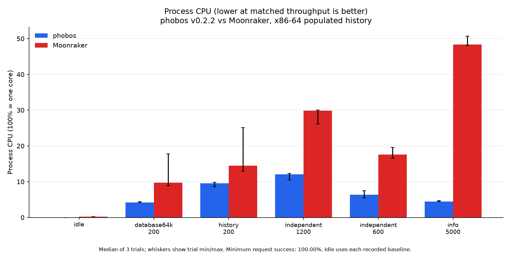
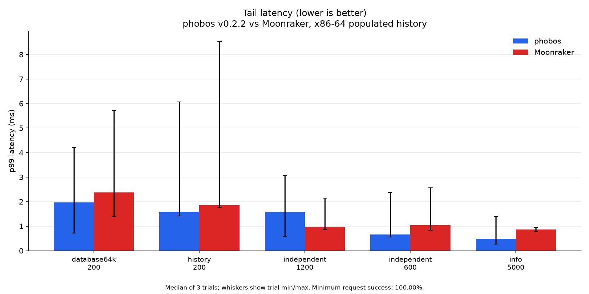
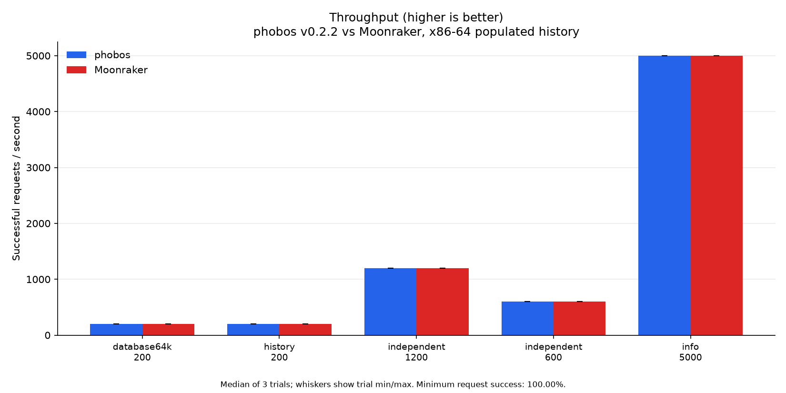
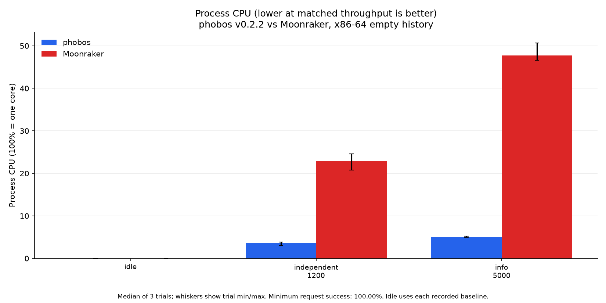
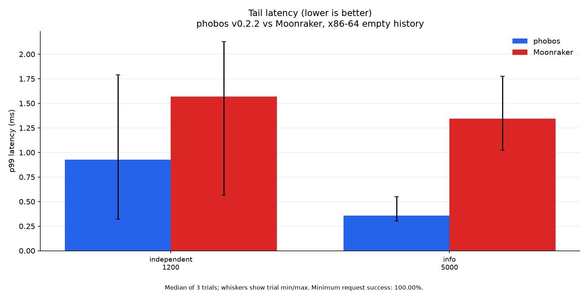
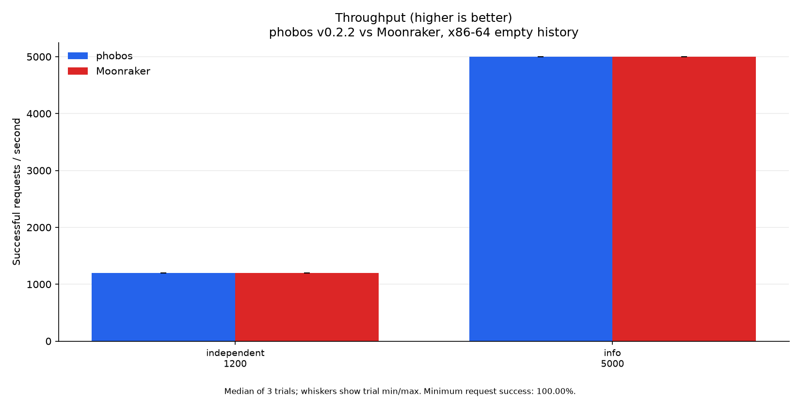

# Performance

Current comparison: **phobos v0.2.2 versus Moonraker**, measured 2026-10-21.
Both phobos binaries are the published static musl ReleaseSmall assets from
tag `v0.2.2`, commit `b079b773823c0d655823f91c1d08f0f96a67ad39`, built with
Zig 0.17.0 and SQLite 3.54.1. No earlier phobos build appears in these tables
or graphics.

**Higher throughput is better. Lower p99 latency, CPU time per request and
RSS are better.** CPU percentage uses 100% for one core. At a paced rate,
meeting that rate is the goal; this is not a maximum-capacity test. Tables
show medians of three trial statistics, not pooled request percentiles.
Plot whiskers show trial minima/maxima, not confidence intervals. Idle bars
show the median of three fresh-process trial medians, without whiskers.

## Real Forge-X printer

Forge-X 1.4.2 chroot, Linux 5.4.61, two Cortex-A7 cores, 110,404 KiB RAM.
The reference is the actual installed Moonraker on Python 3.11.10, reporting
API 1.4.0 and software version `?`. Both probes run sequentially on loopback
7126 while production phobos v0.2.2 continues on 7125. They use independent
copies of the same seed: 266 migrated history jobs, including seven null end
times, plus a synthetic 64 KiB JSON record.

The common core config disables file observation, automatic queue transitions
and startup queue loading. It omits update components/remotes to avoid initial
network refresh. Phobos still registers compatibility components; see the
[observed differences](perf/v0.2.2/mismatches.json). The smaller probe config
differs from the 26-component production config. Config and executable/source
hashes are in the [printer environment](perf/v0.2.2/printer/environment.json).

All 30 eight-second trials succeeded, totaling
8,159 HTTP requests. The independent
mix cycles through `/server/info`, `/server/config`, `/machine/system_info`,
`/server/database/list`, `/server/history/list?limit=20` and `/access/info`.
It makes no Klippy query. Focused trials read info, the history page or the
64 KiB database item. Vegeta uses keepalive with two initial and at most
eight workers, eight connections
and a three-second timeout.

| Workload | v0.2.2 CPU ms/req ↓ | Moonraker CPU ms/req ↓ | v0.2.2 req/s ↑ / p99 ms ↓ | Moonraker req/s ↑ / p99 ms ↓ |
| --- | ---: | ---: | ---: | ---: |
| info50 | 0.525 | 7.900 | 50.09 / 25.10 | 50.03 / 24.18 |
| independent25 | 3.050 | 12.000 | 25.11 / 31.11 | 25.07 / 47.22 |
| independent75 | 3.017 | 11.850 | 75.02 / 33.82 | 74.50 / 118.66 |
| history10 | 13.500 | 27.125 | 10.09 / 36.98 | 10.08 / 64.49 |
| database64k10 | 5.696 | 14.250 | 10.10 / 41.85 | 10.09 / 46.70 |

Phobos uses less CPU per request in every measured printer workload. In the
75/s mix the median is 74.5% lower. Moonraker has slightly lower median info
p99 latency, and overlapping trial ranges remain visible in the plots.
One phobos 64 KiB trial delivered 8.96/s against the offered 10/s despite
100% request success. The median does not erase that shortfall.


Vegeta runs on the desktop through SSH forwarding and WiFi. Latency includes
transport and desktop scheduling. CPU counts only the probe process, excluding
the generator, production and Klippy. The printer has 100 Hz process counters;
short low-CPU trials have coarse resolution. `CONFIG_PERF_EVENTS` is disabled,
so no on-device sampled CPU profile is claimed.

Each repetition starts fresh processes in phobos/Moonraker, Moonraker/phobos,
then phobos/Moonraker order. Workload order reverses in repetition 2. Each
process has eight one-second idle sleeps plus readiness/guard overhead before
load; actual idle observation durations are retained. A roughly 250 ms sampler
records RSS, threads, board memory and swap. Readiness, standby/complete state
and zero heater targets are checked before each case and about once a second
during load, with a 16 MiB MemAvailable stop guard.

All 24 [history comparisons](perf/v0.2.2/printer/history-parity.json) match
Moonraker across default pages, ascending pages with offsets, huge offsets
and time filters. The [complete trials](perf/v0.2.2/printer/summary.json) and
[median/min/max aggregates](perf/v0.2.2/printer/aggregate.json) retain every
result. All probes stopped and their owned directory was removed. Production
PID 29180, executable and boot ID remained unchanged during benchmarking;
Klippy is ready, print state standby, both targets zero, and
7126 has no listener. No live database was opened by the probes; no printer
control, board restart or swap adjustment was used.

## Host, populated history

Ryzen 9 9950X, 32 logical CPUs, CachyOS Linux 7.2.10. Host Moonraker stays at
pin `9008485843740c93e0154ccbdac1fc2b02b03aaa` on Python 3.12.12. The published
x86-64 v0.2.2 asset and Moonraker use the same Klippy protocol stub and copied
266-job seed plus the 64 KiB record. Server affinity is CPUs 2/4, generator
8/10, stub 6 and controller 12/14. These CPUs are not exclusive; this is a
shared desktop, not an isolated-host latency guarantee. No compilation or
second benchmark ran during timed host captures.

| Workload | v0.2.2 CPU ms/req ↓ | Moonraker CPU ms/req ↓ | v0.2.2 req/s ↑ / p99 ms ↓ | Moonraker req/s ↑ / p99 ms ↓ |
| --- | ---: | ---: | ---: | ---: |
| info-5000 | 0.009 | 0.097 | 5000.13 / 0.48 | 5000.35 / 0.87 |
| independent-600 | 0.106 | 0.294 | 600.11 / 0.66 | 600.12 / 1.04 |
| independent-1200 | 0.101 | 0.250 | 1200.01 / 1.58 | 1200.08 / 0.96 |
| history-200 | 0.481 | 0.725 | 200.09 / 1.59 | 200.10 / 1.85 |
| database64k-200 | 0.212 | 0.487 | 200.10 / 1.98 | 200.10 / 2.37 |

Phobos uses less CPU per request, but Moonraker has lower median p99 latency
in the 1,200/s mix (0.96 versus 1.58 ms). Other latency ranges overlap.
These measurements do not establish a universal latency winner.





## Host, empty history

Both servers start with independent fresh databases containing only the same
synthetic 64 KiB record. The independent mix therefore returns empty history.

| Workload | v0.2.2 CPU ms/req ↓ | Moonraker CPU ms/req ↓ | v0.2.2 req/s ↑ / p99 ms ↓ | Moonraker req/s ↑ / p99 ms ↓ |
| --- | ---: | ---: | ---: | ---: |
| info-5000 | 0.010 | 0.096 | 5000.13 / 0.36 | 4999.99 / 1.34 |
| independent-1200 | 0.030 | 0.192 | 1200.08 / 0.93 | 1200.06 / 1.57 |





All 42 host trials succeeded, totaling
643,189 requests. Each trial is eight
seconds, three fresh-process repetitions per backend and fixture, with the
printer's alternating backend/workload order. Each process runs endpoint/history
preflights (including unlimited history), settles for two seconds, has a
five-second idle capture, then a two-second 200/s mix warmup.
The generator has eight fixed workers, keepalive and a two-second timeout.
Process sampling is about 100 ms. All 72
[history checks](perf/v0.2.2/host-history-parity.json) match across both fixtures
and six page/filter cases. Response byte lengths differ through JSON formatting
and identity/component fields; those lengths are retained in the metadata.
Inputs and full trial ranges: [populated](perf/v0.2.2/host-rich/environment.json),
[empty](perf/v0.2.2/host-empty/environment.json).

## Reproduce and limits

Use the [published assets](https://github.com/maci0/phobos/releases/tag/v0.2.2)
and the exact hashes/configurations/rates in each environment record. The
[harness](../tools/perf_harness/README.md) documents isolated databases, stub
setup, Vegeta collection, process metrics and owned-process cleanup. Workloads
and raw numerical summaries are checked in; private databases, response bodies,
logs and binary load captures remain in ignored scratch storage.

Regenerate the three four-figure sets from their checked-in inputs:

```sh
uv run tools/perf_harness/plot_perf.py \
  --input docs/perf/v0.2.2/printer/summary.json \
  --output-dir docs/perf/v0.2.2/printer \
  --title 'phobos v0.2.2 vs Moonraker, Forge-X Cortex-A7'
uv run tools/perf_harness/plot_perf.py \
  --input docs/perf/v0.2.2/host-rich/summary.json \
  --output-dir docs/perf/v0.2.2/host-rich \
  --title 'phobos v0.2.2 vs Moonraker, x86-64 populated history'
uv run tools/perf_harness/plot_perf.py \
  --input docs/perf/v0.2.2/host-empty/summary.json \
  --output-dir docs/perf/v0.2.2/host-empty \
  --title 'phobos v0.2.2 vs Moonraker, x86-64 empty history'
```

Every chart records its input SHA256s. [Memory results](MEMORY.md) include
idle/load RSS, threads and board swap. This study does not measure maximum
capacity, printing, upload throughput, optional hardware, the file backend or
long-soak behavior. Measurements cover x86-64 and one Cortex-A7 printer; other
release profiles are build/test coverage, not physical-printer benchmarks.

Earlier [optimization captures](perf/history-memory-20261021/host/aggregate.json),
[three-round tuning evidence](perf/history-tuning-20261021/summary.json) and
[v0.2.1 release captures](perf/host-v0.2.1/summary.json) stay archived under their
original versions, including negative results. They are excluded from every
current comparison above.
