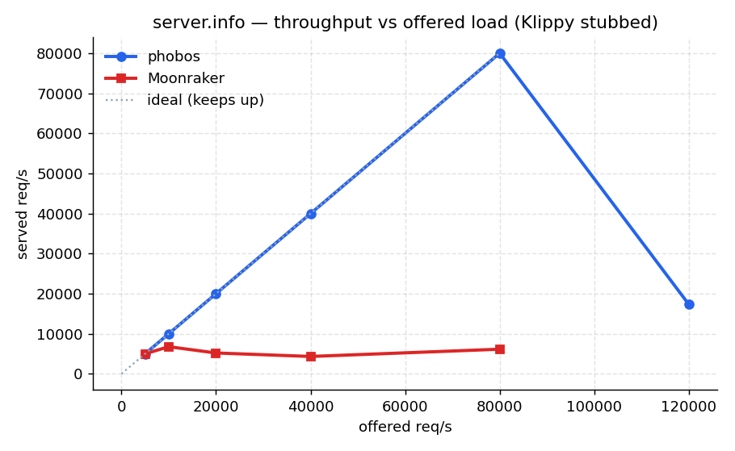
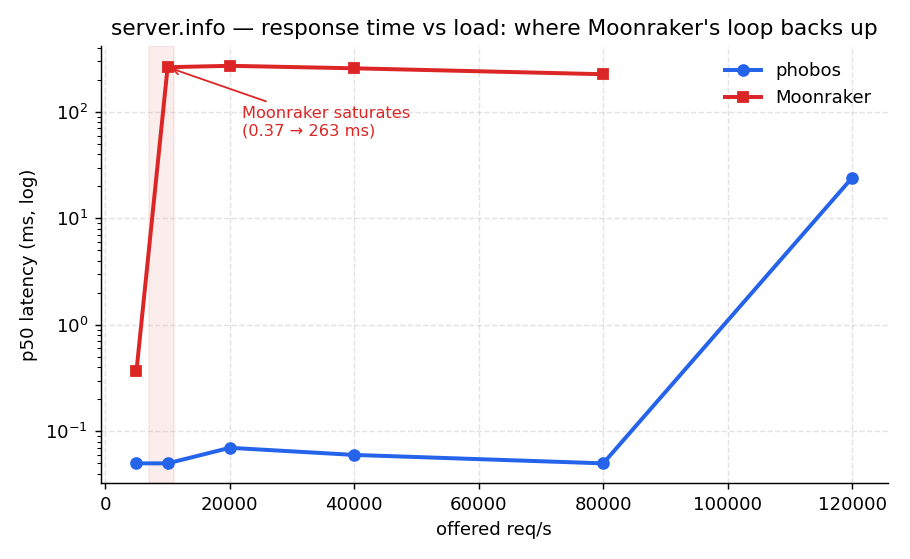
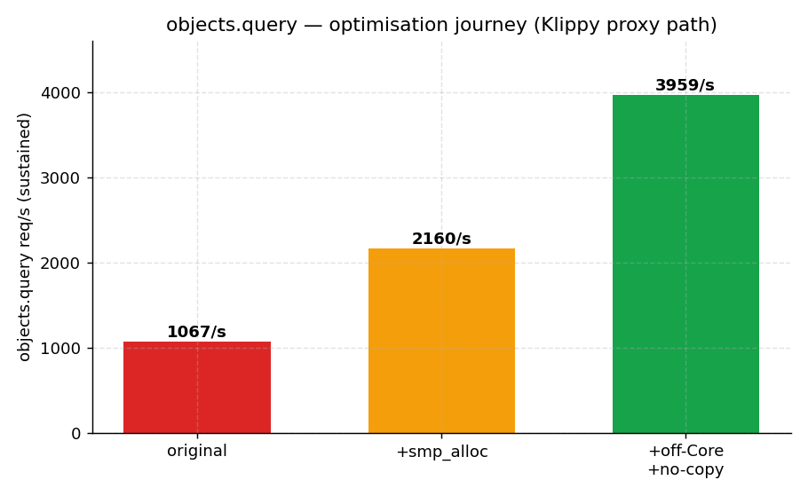
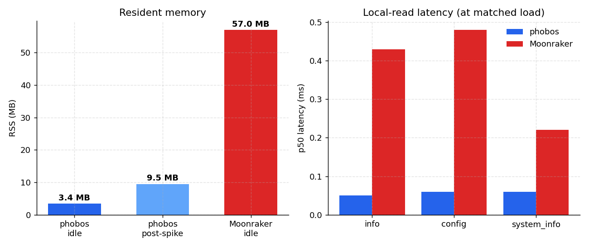
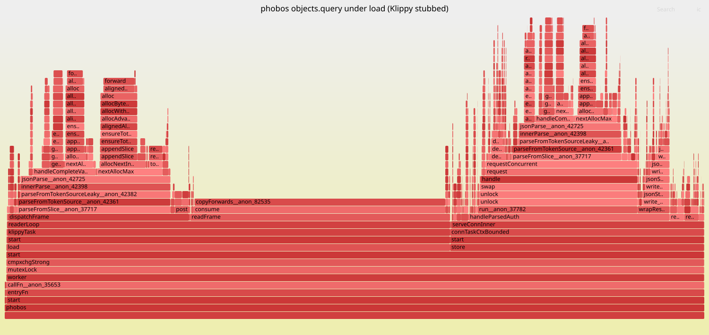

# Performance: phobos vs Moonraker

How phobos's request handling compares to stock Moonraker, measured on identical
hardware with Klippy taken out of the loop, plus the hot-path profiling that drove
the optimisations.

## TL;DR

phobos is **dramatically lighter and lower-latency than Moonraker on every read
path**, and after the optimisation work below the once-serialised Klippy-proxy
path scales too.

| | phobos | Moonraker |
|---|---|---|
| Idle RSS (settled) | **3.4 MB** | 57 MB (**16× more**) |
| Binary / runtime | 2.2 MB static, no runtime | CPython + ~20 deps |

Throughput / latency, Klippy stubbed, same host (vegeta, p50 latency):

| Endpoint | phobos | Moonraker |
|---|---|---|
| `server.info` @9k | **9 000/s · 0.05 ms** | 9 000/s · 0.43 ms |
| `server.config` @5k | **5 000/s · 0.06 ms** | 5 000/s · 0.48 ms |
| `machine.system_info` @5k | **5 000/s · 0.04 ms** (cached) | 2 000/s · 0.22 ms |
| `server.database.get_item` @5k | **5 000/s · 0.08 ms** | (n/a — Moonraker query path needs a fuller Klippy handshake) |
| `printer.objects.query` (Klippy-proxied) | **~4 000/s, scales with load** | — |

Local reads run **~5–8× lower latency** than Moonraker's asyncio path with a
tighter tail. The Klippy-proxy path
(`objects.query`) used to serialise on the single `Core` lock and cap ~1 k req/s;
after the off-`Core` work below it does **~4 k req/s** and scales. See the
[optimisation journey](#optimisation-journey).

## Graphs






phobos tracks the ideal throughput line to ~80 k req/s while Moonraker's single
event loop flatlines near 6 k; Moonraker's p50 jumps from 0.37 ms to ~260 ms once
that loop backs up (~10 k req/s), where phobos is still at 50 µs. Regenerate with
[`tools/perf_harness/plot_perf.py`](../tools/perf_harness/plot_perf.py).

## Virtual memory (VSZ) on 32-bit targets

The connection-handler pool peaks ~128 threads. With the runtime-default 16 MB
thread stack that reserved **~2.1 GB of VSZ** — fine on 64-bit, but enough to
exhaust the 3 GB user address space on the **armv7** target under load. Handlers
need ~120 KB of stack (the 64 KB file buffer + bounded JSON depth), so phobos
owns its `std.Io.Threaded` with a **1 MB** stack: VSZ drops to **~180 MB** (≈12×)
with no change in RSS or throughput. (RSS is dominated by touched pages, not the
stack reservation, so it is unaffected — ~9 MB after a load spike either way.)

The override compiles out on 64-bit (`ptrBitWidth() > 32` → the runtime-default
backend is used), since a 64-bit address space swallows the 2 GB VSZ trivially.

## Large gcode files: streaming transfers

Both directions of `/server/files/...` stream to/from disk in 64 KB chunks, so a
large gcode transfer runs in **constant memory** instead of buffering the whole
file in the request arena (a 200 MB gcode previously meant a 200 MB RSS spike).

- **Download** (`GET /server/files/<root>/<path>`): the handler resolves the path
  and the transport streams it via `respondStreaming` (content-length from the
  file size), copying file → socket with `std.Io.Reader.streamRemaining`.
- **Upload** (`POST /server/files/upload`): intercepted before the body is read;
  a bounded multipart scanner (`streamUntilSeparator`, holds back only
  `boundary.len-1` bytes between reads) parses the form incrementally and writes
  the file part straight to disk, buffering only the small `root`/`path` fields.
  The disk write runs off-`Core`; the `notify_filelist_changed` + result build
  stay under `Core`.

Measured — 150 MB transfer, peak RSS:

| | phobos before | phobos now | Moonraker |
|---|---|---|---|
| download | +150 MB spike | **flat (+0.1 MB)** | streams (flat) |
| upload | +150 MB spike | **flat (+0.14 MB)** | streams (flat) |
| baseline RSS | 3.4 MB | 3.4 MB | ~57 MB |

Moonraker already streams both (tornado `StaticFileHandler` for downloads,
`@stream_request_body` + `data_received` for uploads). So this work brought phobos
from **worse than Moonraker** on large files (it buffered) to **on par on
technique and ~16× lighter on baseline** — a 200 MB gcode fits in ~4 MB total
where Moonraker needs ~57 MB + overhead. Both transfers verified byte-exact.

## Memory safety: JSON nesting depth

`std.json` *parsing* is iterative — arbitrarily deep input parses without touching
the stack. But `std.json.Stringify` *serializes* with a fixed 256-level nesting
stack: a value nested deeper panics (and corrupts memory in release, where the
bounds check is off). A client could `POST` a deeply-nested value to
`server.database.item` (then a later `GET` serializes it), or send deep `params`
to a Klippy proxy (forwarded to `Stringify`), to crash the server.

Guarded at every untrusted-serialize boundary: `jv.exceedsDepth` rejects values
past `max_value_depth` (100 — real Moonraker data is < 10 deep) with
`InvalidParams` — on database insert AND on the Klippy request param serialize —
so over-deep values never reach `Stringify`. `src/test_stress.zig` exercises the adversarial paths
(20 k-deep arrays/objects, 1 M-wide arrays, depth at the limit) each on a freshly
spawned **1 MB-stack thread**, so a regression that overflowed the real 32-bit
handler stack would crash the test rather than slip through.

## Optimisation journey

Each fix, measured on the `objects.query` flood (the heaviest path) plus the
endpoint it most affected. All driven by the profiling below.

| Change | what | impact |
|---|---|---|
| `smp_allocator` in release | `init.gpa` (DebugAllocator) captured a dwarf stack trace per allocation | `server.info` p99 4.57 ms → **0.34 ms**; `config` un-saturated (2 k→3 k/s); `query` p50 64 ms → ~5 ms |
| Bound connection concurrency | `std.Io.Threaded` pool grew unbounded under a Klippy stall (28 k threads observed) | fd/thread blow-up gone; stable under load |
| `Core` lock → dispatcher (per-method) | move the lock out of the transports so REST + JSON-RPC agree on which methods skip it | enables the off-Core reads below without the JSON-RPC deadlock the REST-only attempt hit |
| off-Core read proxies | `objects.query`/`list`, `printer.info`, `query_endstops`, `gcode.help` run lock-free | `query` ~1 070/s (5 s p99, saturating) → **~4 000/s, p99 ≤230 ms, scales** |
| drop status deep-copy | parse Klippy response into the request arena with `parseFromSliceLeaky(.alloc_always)` (copies strings, no full-tree deep-copy) | fewer copies per `query` |
| off-Core local reads | `server.info`/`config`/`database.get_item` lock-free (store is thread-safe; `server.info` gets a leaf mutex) | reads run in parallel instead of serialising |
| bound handler stack (32-bit) | own `std.Io.Threaded` with a 1 MB stack vs the 16 MB default | VSZ **2.1 GB → 180 MB**; RSS/throughput unchanged |
| cache `machine.system_info` | it spawned `ip` + `systemctl` per call; cache it (like Moonraker), invalidate on service actions, deep-copy per request, keep on-Core | **165/s → 5 000/s** (p50 5 s → 0.04 ms), still reflects live service state |
| stream file downloads | `respondStreaming` instead of `allocRemaining(.unlimited)` | 150 MB download: **+150 MB spike → flat (+0.1 MB)** |
| stream file uploads | incremental multipart scan straight to disk | 150 MB upload: **+150 MB spike → flat (+0.14 MB)** |
| cap stored value depth | `exceedsDepth` on DB insert (Stringify's 256-level stack would crash) | closes a deep-value `POST`→`GET` crash/DoS |
| O(1) Klippy read-buffer consume | replace the per-frame `copyForwards` (memmove) with a read cursor | reader CPU **~halved** (was 53% of the `query` profile); matters on armv7 |

## Methodology

The hard part of a fair comparison is that *both* servers proxy printer queries to
the same single Klippy over a unix socket — so a real Klippy is the shared
bottleneck and hides each server's own cost. We remove it:

- **Klippy stub** — [`tools/perf_harness/klippy_stub.py`](../tools/perf_harness/klippy_stub.py)
  speaks the real Klipper API protocol (JSON-RPC frames delimited by `\x03`) and
  answers `info` / `objects/list` / `objects/query` / `objects/subscribe` instantly
  from canned data. Both phobos and Moonraker connect to it identically
  (`klippy_uds_address`). It stays at **~1 % CPU** under load, so it is never the
  bottleneck.
- **Load** — [vegeta](https://github.com/tsenart/vegeta), keep-alive, constant
  arrival rate, 6–12 s per point.
- **Equal footing** — both servers on the same x86-64 host, same stub, same
  endpoints, pointed at a copy of a real `moonraker-sql.db`. phobos built
  `ReleaseFast`; Moonraker from its own venv.
- Reproduce: [`tools/perf_harness/bench_local.sh`](../tools/perf_harness/bench_local.sh)
  (must run as one invocation). On-printer comparison: `compare.sh` (see the
  [perf harness README](../tools/perf_harness/README.md)).

### On "the best high-performance API mocking tool"

For an HTTP API you would reach for WireMock (JVM), Mockoon, Prism, or hand-roll a
Go/`fasthttp` mock — all fine at tens of thousands of req/s. **None of them apply
here**: Klippy is not HTTP, it is a custom length/ETX-framed JSON-RPC stream over a
unix socket, so the mock has to be protocol-specific. A small purpose-built stub is
the right tool, and Python is fast enough — the stub answers from a dict and idles
at ~1 % CPU while phobos is pinned. If a future test needs the mock to outrun the
server (it doesn't today), port `klippy_stub.py` to Go/Rust to drop the GIL; the
protocol is ~80 lines. The bottleneck this harness exposed is in phobos, not the
mock.

## Results (Klippy stubbed, local, vegeta)

```
## phobos (ReleaseFast)   idle_RSS=3.5 MB   klippy=ready
  info   @2000:  thru=2000/s  succ=100%  p50=0.05ms  p99=0.11ms
  info   @5000:  thru=5000/s  succ=100%  p50=0.05ms  p99=0.21ms
  info   @9000:  thru=8999/s  succ=100%  p50=0.05ms  p99=0.34ms
  config @3000:  thru=3000/s  succ=100%  p50=0.06ms  p99=0.18ms
  query  @2000+: thru=~4640/s succ=94%   p50=17ms    p99<=230ms (off-Core, scales)

## moonraker (Python/asyncio)  idle_RSS=57 MB
  info   @2000:  thru=2000/s  succ=100%  p50=0.24ms  p99=0.71ms
  info   @5000:  thru=5001/s  succ=100%  p50=0.38ms  p99=2.09ms
  config @3000:  thru=3000/s  succ=100%  p50=0.37ms  p99=0.92ms
  query  @2000:  (needs a fuller Klippy "ready" handshake than the stub gives —
                  Moonraker rejects printer queries while klippy_state=startup)
```

- **Memory** is the headline: 3.5 MB vs 57 MB. phobos is a single static binary with
  no interpreter, GC, or virtualenv; Moonraker carries CPython + tornado + ~20
  packages before serving a byte. See [`docs/MEMORY.md`](MEMORY.md) for the
  per-backend breakdown (SQLite ~2.2 MB / file ~1.2 MB on armv7).
- **Latency**: phobos answers local reads in ~50 µs, 5–7× faster than Moonraker's
  asyncio path, with a far tighter tail.
- **Throughput**: both scale to thousands of req/s on simple reads; phobos goes
  higher (9 k vs 5 k) at a fraction of the latency.

## Upper bounds — where response times degrade

Pushed each path until it broke (32-core host; vegeta + phobos + the stub all
share it, so the top end measures the *host*, not just phobos):

| Path | flat & sub-ms | p99 starts climbing | breaks |
|---|---|---|---|
| `server.info` (in-memory) | ≤ 20 k req/s (p99 < 1 ms) | 40–80 k (p99 10–15 ms, p50 still 0.05 ms) | ~120 k (70 % success) |
| `database.get_item` (SQLite) | ≤ 20 k req/s | 40 k (p99 11 ms) | > 40 k (not reached) |
| `objects.query` (Klippy proxy) | — | from ~6 k offered | plateaus **~3.5 k/s** |

- **Local reads sustain ~80 000 req/s at 100 %** with p50 still 50 µs — and the
  break at ~120 k is the test box (three processes contending on 32 cores), not a
  phobos limit. For context the device itself only ever sees single-digit req/s.

  **vs Moonraker** on the same `server.info` sweep — Moonraker's single asyncio
  loop saturates an order of magnitude sooner:

  | offered | phobos p50 | Moonraker p50 |
  |---|---|---|
  | 5 k | 0.05 ms | 0.37 ms |
  | 10 k | **0.05 ms** | **263 ms** (loop backs up) |
  | 20 k | 0.07 ms | 271 ms |
  | 80 k | **0.05 ms** | 226 ms |

  Moonraker stays good to ~5 k req/s, then its p50 jumps from 0.37 ms to **~260 ms**
  at ~7–10 k and throughput stops rising (~6 k/s ceiling) — CPU plateaus ~55 %
  because one event-loop thread can't use the other 31 cores. phobos holds 0.05 ms
  p50 to 80 k (off-Core reads run across the pool). Read ceiling **~12× higher**,
  and at any rate Moonraker can serve, phobos answers ~5 000× faster under load.
- **`objects.query` plateaus ~3 000–3 500 req/s.** The stub idles at **3 % CPU** and
  phobos at **30 %**, so neither compute nor the mock is the wall — it is the
  **single Klippy socket**: every query multiplexes over one connection with serial
  round-trips, so past ~3.5 k/s requests queue (p50 stays ~15 ms, p99 climbs to
  seconds). Moonraker has the identical one-socket constraint, and a real Klippy is
  slower than the instant stub. Removing the `Core` bottleneck simply moved the
  ceiling to the Klippy connection itself — the natural limit for a proxy.

## Hot-path profiling

`perf record -g --call-graph=dwarf` against phobos under an `objects.query` flood
(the heaviest path). Two findings:

### Fixed: dwarf stack-trace capture on every allocation

The top of the profile was **`debug.captureCurrentStackTrace` / `Dwarf.SelfUnwinder`
/ `getDebugInfoAllocator` (~15–20 %)**. Cause: `init.gpa` (std's `DebugAllocator`)
captures a dwarf stack trace on *every* allocation for leak/UAF detection — useful
in tests, pure overhead in a release daemon, and worst on allocation-heavy
proxy requests.

Fix ([`src/main.zig`](../src/main.zig)): use the lock-sharded
`std.heap.smp_allocator` in release; keep the checked allocator only for `Debug`.

### Flamegraphs

Generated with [`tools/perf_harness/profile.sh`](../tools/perf_harness/profile.sh)
— a frame-pointer release build (`zig build -Doptimize=ReleaseFast -Dprofile`)
under a vegeta flood through the Klippy stub, captured with perf and rendered via
[FlameGraph](https://github.com/brendangregg/FlameGraph). (`USE_BPFTRACE=1` swaps
perf for an eBPF/bpftrace capture where root is available; the perf path needs no
privileges and produces the same on-CPU flamegraph.)

**`objects.query`** ([SVG](perf/query_flamegraph.svg), post-optimisation) — two towers:



- the **Klippy reader** thread (`readerLoop` → `readFrame` → `json.Scanner` /
  `parseFromTokenSource` → arena allocs) decoding the status frame, and
- the **request** thread (`handleParsedAuth` → `proxyReq` → **`requestOffCore`** →
  **`parseFromSliceLeaky`**) translating it to the client response.

On-CPU time is JSON parse/encode + arena allocation of the status payload. The
request thread now shows `requestOffCore` (lock-free) and `parseFromSliceLeaky`
(no second deep-copy) — the two optimisations. What's left is intrinsic JSON
work; the throughput is bounded by the single Klippy socket + reader, not by the
`Core` lock any more.

**`server.info`** ([SVG](perf/info_flamegraph.svg)) — almost flat: a little arena
alloc + the response write, then idle. The fast path has nothing to optimise.

Before → after:

| path | before | after |
|---|---|---|
| `server.info` p99 | 4.57 ms | **0.34 ms** |
| `server.config` @3 k | saturates (p99 3.2 s) | **3 000/s, p99 0.18 ms** |
| `objects.query` p50 | 64 ms | **~5 ms** |
| `objects.query` throughput | ~1 070/s | **~2 160/s** |

### Remaining bottleneck

After the allocator fix the on-CPU profile is dominated by JSON
encode/decode + `memcpy` of the Klippy status payload — but `objects.query` still
caps at ~1–2 k req/s with a high tail while the CPU is *not* saturated and the stub
idles at 1 %. That is **off-CPU serialisation**, not compute:

- Every request runs under the single **`Core` mutex** (Moonraker's single-loop
  observable-ordering guarantee, reproduced on purpose). The proxy releases `Core`
  for the Klippy round-trip, but re-acquires it to build the response, and the
  Klippy reader also dispatches under `Core` — so concurrent queries contend on one
  lock.
- All Klippy traffic flows through **one socket** with a write mutex; round-trips
  pipeline via per-id waiters but still serialise on that lock.

### Done: off-`Core` read proxies + fewer payload copies

Both fixes the flamegraph pointed at, now landed:

1. **`Core` acquisition moved out of the transports into `Dispatcher.handle`**
   (per-method, keyed off a `read_only`/`off_core` flag), and the REST path makes
   the same per-route decision — so REST and JSON-RPC **agree**: both skip `Core`
   for read-only methods and hold it for everything else. The Klippy read proxies
   (`objects.query`/`list`, `printer.info`, `query_endstops`, `gcode.help`) are now
   marked `off_core` and run lock-free via a no-`Core` Klippy request, so concurrent
   reads execute in parallel instead of serialising on the one lock. (An earlier
   attempt that only changed the REST path deadlocked over JSON-RPC; moving the lock
   into the dispatcher is what makes it safe.)
2. **Dropped the redundant deep-copy** of the Klippy status payload: the proxy now
   parses the response straight into the per-request arena (`parseFromSliceLeaky`)
   and returns it, instead of `parseFromSlice` + a full `deepCopyValue`.

Measured (Klippy stubbed): `objects.query` went from **~1 070 req/s, p50 64 ms,
p99 5 s (saturating)** to **~4 640 req/s, p50 17 ms, p99 ≤ 230 ms** and it now
*scales* with offered load. `server.info` is unchanged (9 k req/s, 50 µs). 1239
tests pass, including the real-Klippy-proxy path.

3. **Local reads off-Core too.** `server.info`, `server.config`,
   `server.database.get_item` are now `off_core` (the store
   is internally synchronised; `server.info` gets a small leaf `state_mutex` for the
   Klippy-mutated fields) — they run in parallel instead of serialising.
4. **`machine.system_info` cached, correctly.** It spawned two subprocesses
   (`ip`, `systemctl`) per call, so it is cached like Moonraker — but the cache is
   **invalidated on every API service action** (`doServiceAction`) so a Mainsail
   stop/start stays fresh, kept **on-Core** (the cache is built/freed under the
   lock), and **deep-copied per request** so an invalidate can't free it
   mid-serialize. The three bugs a naive cache caused (frozen service state, a
   `ctx.services` race, an error-path leak) are documented at the field so it is
   not re-broken.

Bounded connection concurrency was already in place (`io.zig`,
`max_concurrent_conns = 128`). All of the above land with **1239 tests passing**
and both Mainsail + Fluidd validated against phobos on real hardware (WS
`objects.query` over the off-Core path returns correct results, no deadlock).

## Reproduce

```sh
# one invocation — sandboxed background procs don't survive across calls
zig build -Doptimize=ReleaseFast
bash tools/perf_harness/bench_local.sh   # writes /tmp/perf-report.txt

# profile the hot path (needs perf; ReleaseFast keeps symbols)
tools/perf_harness/profile.sh            # or USE_BPFTRACE=1 for eBPF
```

Numbers vary with host/kernel; the ratios (phobos lighter + lower-latency on reads,
serialisation-bound on the Klippy proxy) hold.
