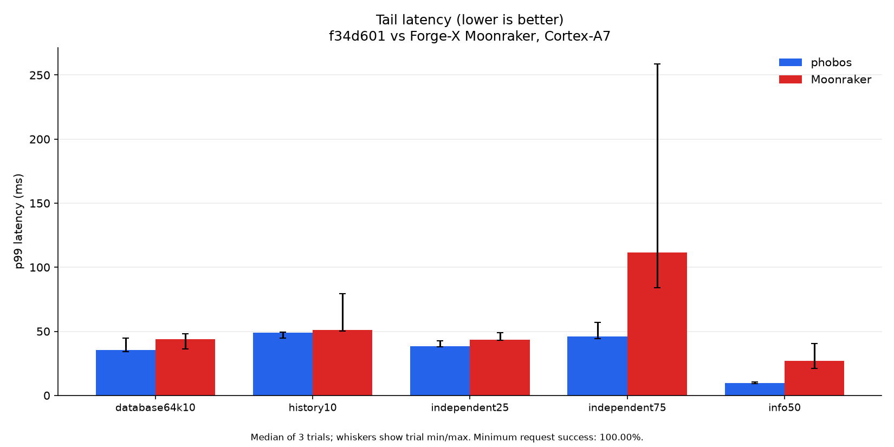
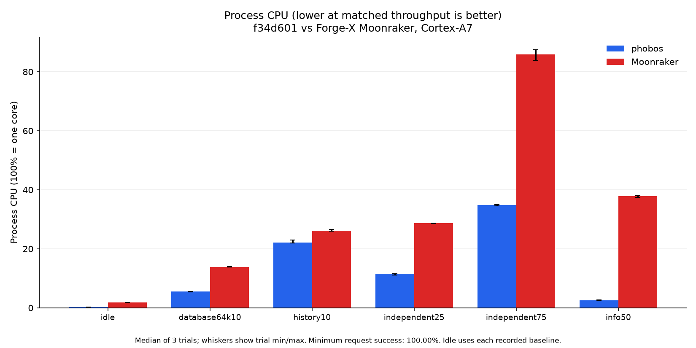
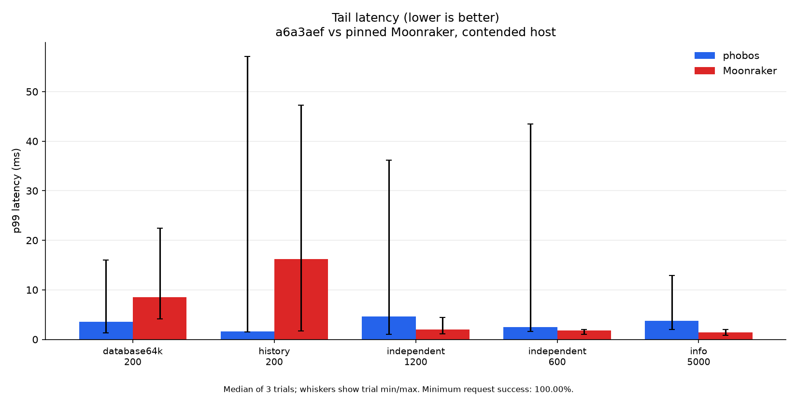

# Performance

Measured 2026-10-21 with Zig 0.17.0 and embedded SQLite 3.54.1. The host
optimization capture is commit `a6a3aef`; the final printer capture is `f34d601`,
which also fixes nullable migrated history end times. Earlier phobos means
`39386ca`, already including lazy temperature rings. These are separate
versioned experiments, not measurements of every current build or printer.

**Higher throughput is better. Lower latency, RSS and CPU time per completed
request are better.** At a paced rate, keeping up is the goal. CPU percentage
uses 100% for one core; CPU time per request also accounts for missed rates.
Tables show medians of three trial statistics, not pooled percentiles.

## Real Forge-X printer

Forge-X 1.4.2 chroot, Linux 5.4.61, two Cortex-A7 cores and 110,404 KiB RAM.
The actual installed Moonraker reports API 1.4.0 and version `?` on Python
3.11.10. It is distinct from the newer pinned host reference. All probes run
sequentially on `127.0.0.1:7126`, while production phobos v0.2.1 remains on
7125. Each startup restores an independent private database copy with 266
legacy jobs and the same synthetic 64 KiB record.

The common core config disables automatic queue transitions and file
observation. It has no configured update remotes; Moonraker update components
are omitted because disabling periodic refresh does not prevent its initial
refresh. Phobos still registers its update and OctoPrint compatibility
components. This smaller benchmark config is not the 26-component production
config. Hashes, config and source fingerprints are in the
[environment record](perf/history-memory-20261021/printer/environment.json).

45 eight-second trials completed with 100% HTTP success
(12,240 requests).
The independent mix cycles through info, config, system info, database
namespace list, a 20-job history page and access info. It makes no Klippy query.
The two focused workloads read that page and a 64 KiB JSON payload.

| Workload | Earlier phobos ms/request ↓ | Optimized phobos ms/request ↓ | Moonraker ms/request ↓ |
| --- | ---: | ---: | ---: |
| Info, 50/s | 0.525 | 0.525 | 7.925 |
| Independent mix, 25/s | 10.650 | 4.850 | 12.050 |
| Independent mix, 75/s | 10.783 | 4.883 | 12.050 |
| History page, 10/s | 57.750 | 23.125 | 27.375 |
| 64 KiB record, 10/s | 6.250 | 5.750 | 14.625 |

↓ Lower is better. In the 75/s mix, optimized phobos uses
54.7% less CPU time per request than the earlier build and
59.5% less than Moonraker. It uses less CPU per request than
Moonraker in every measured workload. Differences in the unchanged info path
also show the resolution and variation of short process-counter measurements.
This is a workload-specific result, not a general speed guarantee.

| Workload | Earlier phobos req/s ↑ / p99 ms ↓ | Optimized phobos req/s ↑ / p99 ms ↓ | Moonraker req/s ↑ / p99 ms ↓ |
| --- | ---: | ---: | ---: |
| Info, 50/s | 50.10 / 9.42 | 50.09 / 9.62 | 50.06 / 26.94 |
| Independent mix, 25/s | 25.11 / 80.77 | 25.11 / 38.53 | 25.07 / 43.60 |
| Independent mix, 75/s | 74.46 / 91.25 | 74.82 / 45.79 | 74.68 / 111.37 |
| History page, 10/s | 10.03 / 89.06 | 10.08 / 48.85 | 10.07 / 50.98 |
| 64 KiB record, 10/s | 10.10 / 36.49 | 10.10 / 35.29 | 10.09 / 43.86 |

Vegeta runs on the desktop through SSH and WiFi. Latency includes transport
and desktop scheduling. The 25/s mix and focused read ranges overlap; there
is no universal latency winner. [All trial statistics](perf/history-memory-20261021/printer/all-trials.json)
and [median/min/max aggregates](perf/history-memory-20261021/printer/aggregate.json)
retain those variations.




There are three fresh-process repetitions per backend. Backend order is
baseline/Moonraker/candidate, candidate/Moonraker/baseline, then
Moonraker/baseline/candidate; repetition 2 reverses workload order. Each
process settles with eight one-second sleeps plus guard/read overhead before
load. Observed idle windows are recorded separately. The generator uses two
initial and at most eight workers, eight connections, keepalive and a
three-second timeout. A roughly 250 ms sampler records process and board
memory; process user/system ticks are read around each trial at 100 Hz.
CPU excludes the generator, production daemon and Klippy.

The final build matches actual Moonraker for all 266 copied history records,
including seven null end times, both orders, offsets, time filters and a
single unfinished job. See the [seven-case parity record](perf/history-memory-20261021/nullable-history-parity.json).
The older baseline still has the null-to-zero bug. Remaining observed
differences are recorded in [the mismatch classification](perf/history-memory-20261021/mismatches.json).
The earlier pre-fix load trials are retained separately, not substituted for
the final-build results.

All probes stopped. Production PID 2243, its release executable and the board
boot ID remained unchanged; Klippy stayed ready, the print complete and heater
targets zero. Board MemAvailable stayed at or above
34,268 KiB with a 16 MiB stop guard. Probe VmSwap
stayed zero; board swap already existed and its free space varied. No live
database, printer configuration, print, motion, heating, update or restart
action was used. The printer kernel disables `CONFIG_PERF_EVENTS`; there is
no on-device sampled CPU profile.

The [final production checks](perf/history-memory-20261021/printer/final-state.json)
passed eight read requests with 62,040 KiB board memory available. Production
had 1,192 KiB swapped; the probe-only RSS table is not a claim about the whole
board's resident footprint. Swap settings were unchanged.

## Host optimization capture

Ryzen 9 9950X, 32 logical CPUs, CachyOS Linux 7.2.10. Servers are pinned to
CPUs 2/4, generator to 8/10, stub to 6 and controller to 12/14. These CPUs
are not exclusive. Other CPU-heavy desktop jobs and substantial load/tail
variation were observed. The performance governor was read during capture.
The [contention samples](perf/history-memory-20261021/host/contention.json)
start after interference was noticed, so they do not cover every trial.

The unchanged Moonraker pin `9008485843740c93e0154ccbdac1fc2b02b03aaa` runs
on Python 3.12.12. Both servers use the same Klippy protocol stub and copied
266-job fixture plus 64 KiB record. Empty-history trials compare the two
phobos builds separately. Source, binary and seed hashes are in
[host metadata](perf/history-memory-20261021/host/environment.json).
The later nullable-time fix is not part of this host capture or CPU profile.

All 57 trials succeeded (803,711 requests).
Each is eight seconds, with a fixed eight-worker generator, keepalive and
two-second timeout. Three fresh-process repetitions use the printer's backend
order. Each has a five-second idle capture and two-second 200/s mix warmup;
workload order reverses in repetition 2. Process samples are about 100 ms.

| Workload | Earlier phobos ms/request ↓ | Optimized phobos ms/request ↓ | Moonraker ms/request ↓ |
| --- | ---: | ---: | ---: |
| Info, 5,000/s | 0.012 | 0.016 | 0.103 |
| Independent mix, 600/s | 0.502 | 0.171 | 0.338 |
| Independent mix, 1,200/s | 0.461 | 0.156 | 0.266 |
| History page, 200/s | 2.544 | 0.563 | 1.044 |
| 64 KiB record, 200/s | 0.287 | 0.287 | 0.662 |

| Workload | Earlier phobos req/s ↑ / p99 ms ↓ | Optimized phobos req/s ↑ / p99 ms ↓ | Moonraker req/s ↑ / p99 ms ↓ |
| --- | ---: | ---: | ---: |
| Info, 5,000/s | 5000.11 / 0.85 | 5000.12 / 3.73 | 5000.40 / 1.38 |
| Independent mix, 600/s | 600.04 / 3.75 | 600.15 / 2.45 | 600.09 / 1.81 |
| Independent mix, 1,200/s | 1199.76 / 3.56 | 1199.93 / 4.58 | 1199.93 / 1.97 |
| History page, 200/s | 200.06 / 6.57 | 200.07 / 1.64 | 200.02 / 16.18 |
| 64 KiB record, 200/s | 200.11 / 1.52 | 200.11 / 3.57 | 199.97 / 8.57 |

The populated-history CPU reduction is visible, but this contended host does
not establish a clean latency speedup. Three trials fell below 95% of the
offered rate: Moonraker's 64 KiB read (172.4/200), populated phobos info
(3,930.5/5,000), and empty phobos info (4,593.7/5,000). Successful requests
alone do not prove a target rate was met.

Empty-history mix CPU increased from
27.1 to
49.0 microseconds/request;
empty info increased from
10.3 to
13.3.
These unfavorable rows remain in the [complete trial set](perf/history-memory-20261021/host/all-trials.json).
The source contribution cannot be isolated from desktop contention here;
no empty-store performance improvement is claimed. An earlier
[same-binary control](perf/history-memory-20261021/host/aa-control.json)
showed large worker-pool/RSS variation, but used 10,000/s and 64 workers and
is not an uncertainty bound for this fixed-worker run.



## Resolved CPU profiles

Both optimized profile binaries use ReleaseSmall, full LTO, symbols and frame
pointers, the same populated fixture, affinity and independent mix at 1,200/s.
After two seconds of load warmup, perf samples `cycles:u` at 1,999 Hz with
frame-pointer call graphs for 30 seconds of the exact server PID and its threads.
Both 34-second load reports contain 40,800 successful requests. Only perf
collection/decoding uses `sudo -n`; no profiler sysctl or capability changed.

| Profile | Samples | Sampled cycle periods | Unknown leaf, cycle weight | Lost samples |
| --- | ---: | ---: | ---: | ---: |
| Earlier phobos | 30,595 | 69.00 billion | 2.08% | 0 |
| Optimized phobos | 9,630 | 19.85 billion | 1.98% | 0 |

Unresolved kernel-address leaves remain despite user-cycle collection.
This is not 100% resolved attribution. Arena allocation,
resize and small-copy leaf shares fell from 23.94/11.78/12.50% to
11.20/3.08/6.77%. Selected-record decoding and SQL preparation remain visible.
These profile builds change code generation and are separate from the
uninstrumented resource/latency comparisons. Cycle/sample totals are not
function-call counts or a dedicated-host speedup guarantee.

Open the [before](perf/history-memory-20261021/profile/before/flamegraph.svg)
and [after](perf/history-memory-20261021/profile/after/flamegraph.svg) SVGs
for hover, zoom and search. The [profile summary](perf/history-memory-20261021/profile/summary.json)
and neighboring flat reports retain counts, hashes and load reports.
FlameGraph scripts are pinned to `41fee1f99f9276008b7cd112fca19dc3ea84ac32`;
the embedded plotting code's [notice and license](perf/history-memory-20261021/profile/NOTICE.md)
accompany the figures. The maintained profile helper also passed a real
five-second collection with 10,800 successful requests and owned-process cleanup.

## Reproduce and limits

Build static assets with [BUILDS.md](BUILDS.md). The
[harness](../tools/perf_harness/README.md) documents setup, target lists,
collection and owned-process cleanup. General comparison defaults remain
ReleaseFast; the profiler defaults to ReleaseSmall with the release LTO policy.
These measurements explicitly use ReleaseSmall. Private databases, response
bodies, configurations and raw profiler/load captures stay in `.scratch/`.
Portable measured summaries and plot-input hashes are checked in.

Regenerate the four-figure sets:

```sh
uv run tools/perf_harness/plot_perf.py \
  --input docs/perf/history-memory-20261021/host/summary.json \
  --output-dir docs/perf/history-memory-20261021/host \
  --title 'a6a3aef vs pinned Moonraker, contended host'
uv run tools/perf_harness/plot_perf.py \
  --input docs/perf/history-memory-20261021/printer/summary.json \
  --output-dir docs/perf/history-memory-20261021/printer \
  --title 'f34d601 vs Forge-X Moonraker, Cortex-A7'
```

Whiskers are trial minima/maxima, not confidence intervals. Idle charts use the
median of three recorded idle trial medians.

No printing, optional hardware certification, large-file transfer, long soak
or isolated-host empty-store performance test is claimed. Current CI executes
native x86-64 and AArch64 suites/smoke checks and cross-builds all seven
profiles; real-printer load here covers Cortex-A7 only. Historical v0.2.1
[host](perf/host-v0.2.1/summary.json) and
[printer](perf/printer-v0.2.1.json) release captures retain their original
fixtures and version labels. They are not substituted for these runs.
