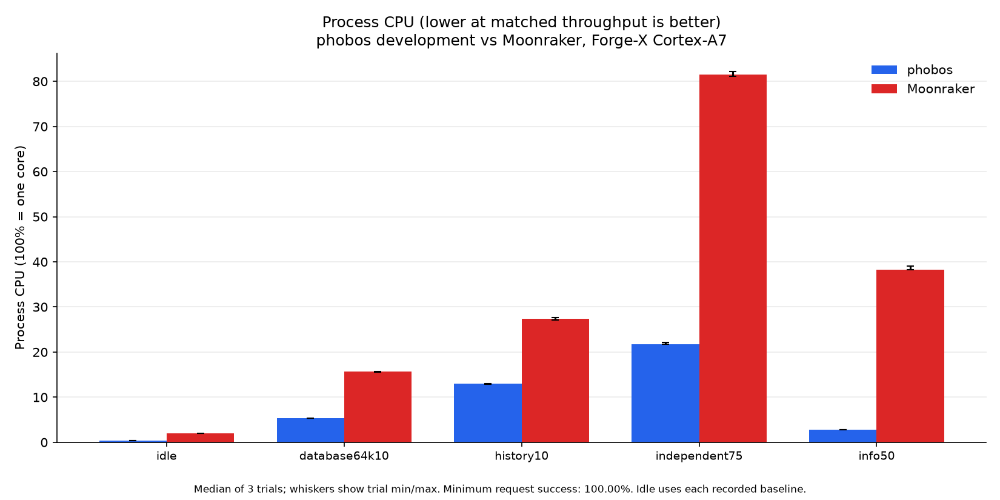
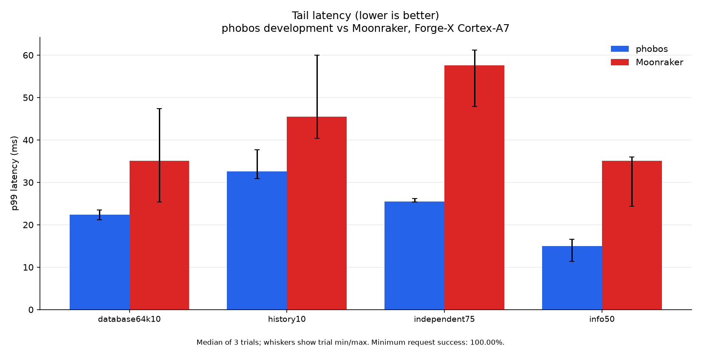
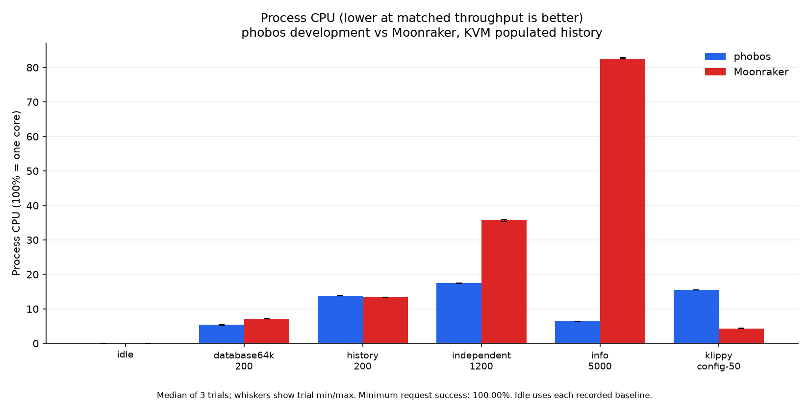
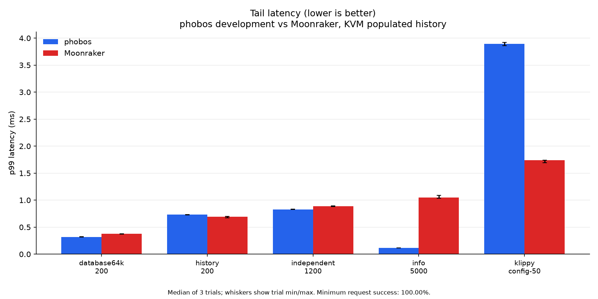
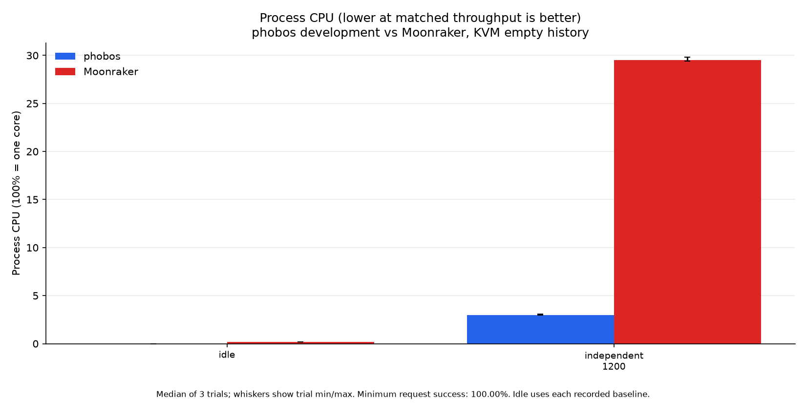
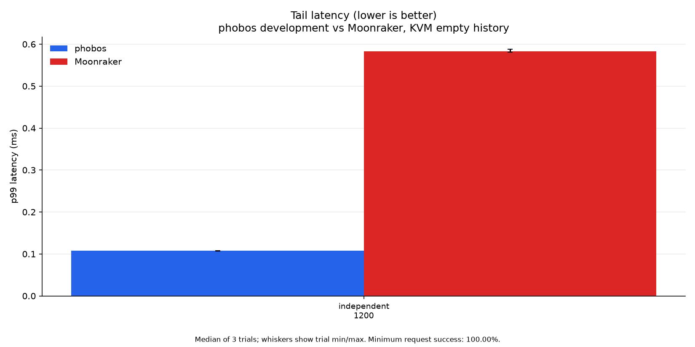

# Performance

Current measurements compare the **0.2.2 development build with Moonraker**,
measured 2026-10-22. This includes the JSON, history allocation, Klippy reply
routing and TCP delivery changes in this tree. It is not the published v0.2.2
asset. Exact source blobs, binary hashes, seeds and configuration are recorded
with each capture. The pre-change build at `7764f3697a04` remains in the
before/after evidence; every active graphic contains only the development
build and Moonraker. [Published v0.2.2 captures](perf/v0.2.2/) remain archived.

**Lower CPU time, latency and RSS are better. Higher successful throughput is
better.** At a paced rate the goal is to meet the offered rate; these are not
maximum-capacity tests. Tables show medians of three trial statistics, not
pooled request percentiles. Plot whiskers show trial minima/maxima, not
confidence intervals. Idle bars show the median of three fresh-process trial
medians. CPU percentage uses 100% for one core.

## Real Forge-X printer

Forge-X 1.4.2 chroot, Linux 5.4.61, two Cortex-A7 cores and 110,404 KiB RAM.
The reference is the installed Moonraker on Python 3.11.10, API 1.4.0.
Production was paused during the study. All probes ran sequentially inside
the chroot on `127.0.0.1:7126`, using separate copies of the same 266-job
seed and a synthetic 64 KiB record. No probe opened the production database.
The smaller benchmark config differs from production; the
[remaining differences](perf/optimization-20261022/mismatches.json) are identity, supported
defaults, policy and private-fixture environment differences, with no new
code bug observed in these reads.

The fixed-arrival Python stdlib generator runs on printer CPU 0; all server
threads run on CPU 1. HTTP uses printer loopback, keepalive, at most eight
workers and a three-second timeout. Latency includes generator queueing.
SSH is outside the timed request path. Local health checks require readiness,
complete/standby state and zero heater targets throughout load, with a
16 MiB board-memory floor. The independent six-endpoint mix does not query
Klippy; focused reads select info, a 20-job history page or the 64 KiB item.

All 36 twelve-second HTTP trials succeeded: **15,660 requests**, plus
**108 full WebSocket subscriptions** and **54 matching history comparisons**.
The HTTP count includes all three builds used in the before/after study;
the two plotted backends account for 10,440 requests.

| Workload | Development CPU ms/req ↓ | Moonraker CPU ms/req ↓ | Development req/s ↑ / p99 ms ↓ | Moonraker req/s ↑ / p99 ms ↓ |
| --- | ---: | ---: | ---: | ---: |
| database64k10 | 5.33 | 15.58 | 10.08 / 22.41 | 10.07 / 35.12 |
| history10 | 12.92 | 27.33 | 10.07 / 32.56 | 10.06 / 45.48 |
| independent75 | 2.91 | 10.90 | 74.93 / 25.53 | 74.91 / 57.58 |
| info50 | 0.567 | 7.67 | 50.02 / 14.98 | 50.00 / 35.13 |





Full subscriptions request 268 live Klippy objects, including six pins hidden
by production's Fluidd config. Each backend starts 12 new WebSocket
connections at one per second in each repetition. CPU time per subscription
is 78.33 ms for development phobos versus
106.67 ms for Moonraker. Median scheduled-arrival
through decoded-reply latency is 286.43 versus
242.62 ms. This includes client JSON decoding;
it is not a browser-page loading benchmark. All requested object names match.

Before/after CPU medians change from 5.75 to 5.33 ms for the 64 KiB response
(7.2% lower) and from 94.17 to 78.33 ms per full subscription (16.8% lower).
History and small info CPU medians are unchanged at printer counter resolution.
Info scheduled-arrival p99 is worse: 14.98 versus 11.79 ms, with overlapping
trial ranges. Its median worker-start service p99 is 8.65 versus 8.04 ms;
generator queue p99 spans 5.93 to 10.93 ms across the two builds. No universal
latency improvement is claimed. Results cover the combined changes, not an
isolated speedup attribution to each change.

An earlier host-forwarded study showed a larger history p99 regression; it
did not recur consistently with printer-local generation. Another study
stopped when a host health request timed out during a baseline run. No daemon
crash was recorded; its exact cause remains unknown. The final study moved
timed health checks onto the printer and captures thread wait channels on
failure. All completed negative results and the interruption remain in
the [experiment records](perf/optimization-20261022/experiments/).

The original production executable was restored on 7125, ready with zero
heater targets, print complete and idle. The probe listener is absent and
the board boot ID is unchanged. The accepted-socket TCP_NODELAY test also
passed on the physical ARM printer for IPv4 and IPv6. No hardware command,
board restart, swap change or candidate installation was used.
[Final state](perf/optimization-20261022/printer/final-state.json),
[all builds](perf/optimization-20261022/printer/all-builds.json),
[subscriptions](perf/optimization-20261022/printer/subscriptions.json) and
[environment](perf/optimization-20261022/printer/environment.json) retain the evidence.

After the study and source verification, the exact tested ARM binary was
installed on production port 7125 under the existing deployment authorization.
The previous executable, launcher and quiescent database are backed up.
All 262 production subscription objects return successfully, Klippy is ready
and heater targets remain zero. The [deployment record](perf/optimization-20261022/deployment.json)
is separate from the benchmark's earlier restored-production snapshot.

## KVM guest: isolated physical cores

The benchmark PC at 192.168.0.99 is a Ryzen 9 5950X. Its private four-vCPU
KVM guest has 4 GiB preallocated locked RAM and no network card. Both daemons,
Vegeta and the synthetic Klippy stub run entirely inside it. The same
266-job seed and 64 KiB item are used; the empty fixture contains only that
item. Moonraker is pinned to `9008485843740c93e0154ccbdac1fc2b02b03aaa`.
Python and SQLite versions are recorded in the
[guest environment](perf/optimization-20261022/vm-environment.json).

An isolated cgroup reserves host CPUs 8-15/24-31, a complete L3 group including
SMT siblings. User/system slices exclude them. vCPUs pin to host cores
10/11/12/13 with FIFO priority 10, the emulator to CPU 8. In the guest the
server uses CPU 1, generator 2/3 and stub/controller 0. No vCPU shares a
physical core. Idle polling occupies four host cores and is not a deployment
setting. Existing frequency policies remain unchanged; fixed-frequency
performance is not claimed.

**Literal zero steal and guaranteed physical performance were not established.**
Guest steal deltas sum to {"cpu": 1, "cpu0": 0, "cpu1": 0, "cpu2": 0, "cpu3": 0}.
These are 100 Hz exported counters; aggregate and per-CPU rounding can differ.
Host scheduler counters record a maximum server-vCPU run-queue delay of
0.00061% of its observed
window, and 0.00061% for any
vCPU. No trial is removed for positive interference. VM/cgroup swap and quota
throttling remain zero. RAM locking stays above
4,838,436 KiB. The
[isolation summary](perf/optimization-20261022/vm-isolation-summary.json) retains every window
and frequency range. Host kernel, interrupt, thermal and memory-bus effects
remain possible despite exclusive cores.

### Populated history

| Workload | Development CPU ms/req ↓ | Moonraker CPU ms/req ↓ | Development req/s ↑ / p99 ms ↓ | Moonraker req/s ↑ / p99 ms ↓ |
| --- | ---: | ---: | ---: | ---: |
| database64k-200 | 0.270 | 0.360 | 200.09 / 0.320 | 200.09 / 0.375 |
| history-200 | 0.695 | 0.670 | 200.09 / 0.732 | 200.08 / 0.696 |
| independent-1200 | 0.146 | 0.299 | 1200.10 / 0.829 | 1200.12 / 0.890 |
| info-5000 | 0.013 | 0.166 | 5000.05 / 0.117 | 4999.93 / 1.05 |
| klippy-config-50 | 3.10 | 0.860 | 50.08 / 3.89 | 50.09 / 1.74 |





The config workload queries a large synthetic configfile reply through the
local Klippy stub. Other workloads have no Klippy round trip in their load
path. The stub executes nothing and does not reproduce continuous status floods.

Compared with the pre-change build, the 64 KiB response uses 6.9% less CPU
(0.290 to 0.270 ms/request), and the synthetic config reply uses 3.1% less
(3.20 to 3.10 ms/request). History CPU is unchanged at 0.695 ms/request.
Moonraker remains faster for history and the synthetic config reply: phobos
uses 3.7% and 260.5% more CPU respectively. Phobos uses less CPU for the other
populated-fixture workloads and less sampled RSS throughout. There is no
universal performance winner.

### Empty history

| Workload | Development CPU ms/req ↓ | Moonraker CPU ms/req ↓ | Development req/s ↑ / p99 ms ↓ | Moonraker req/s ↑ / p99 ms ↓ |
| --- | ---: | ---: | ---: | ---: |
| independent-1200 | 0.025 | 0.247 | 1200.05 / 0.108 | 1200.00 / 0.583 |





All **54 ten-second trials** completed with 100% HTTP
success, **706,480 requests**, and 108 matching history checks.
Those totals include baseline, development and Moonraker; plotted figures
contain only the latter two. Each fixture/backend gets three fresh processes,
endpoint/history preflights, two seconds to settle, five seconds idle and a
two-second 200/s mix warmup. Vegeta uses eight fixed workers, keepalive and a
two-second timeout. Backend and workload orders vary by repetition. No trial
is discarded for an unfavorable result.

Vegeta retains no response bodies after full-content preflights. It drains
each response; its zero `bytes_in` is retained bytes, not wire traffic. A first
twenty-second study filled its 8 GiB private capture disk while recording large
bodies. Its 44 completed trials and disk-capacity failure remain in the
[experiment archive](perf/optimization-20261022/experiments/vm-capacity-failure.json).
The fresh final study uses a 16 GiB disk, a 2 GiB free-space floor and the same
ten-second/body-retention settings for every backend. Earlier partial trials
are excluded from active tables and plots.

The guest stops its children and remounts its private disk read-only before
completion. The manager stops QEMU, removes its private CPU partition and
restores exact prior CPU slice limits and frequency settings.
[Cleanup](perf/optimization-20261022/vm-cleanup.json) records these checks. The
[host environment](perf/optimization-20261022/vm-host-environment.json),
[scheduler boundaries](perf/optimization-20261022/vm-host-events.json) and
[resource samples](perf/optimization-20261022/vm-host-resource-samples.json) remain checked in.

## Reproduce and limits

The [capture method](perf/optimization-20261022/METHOD.md) specifies fixtures, rates, order,
affinity, collectors and cleanup. The [harness](../tools/perf_harness/README.md)
documents the existing local generator and plotting tools. Each environment
contains `summary.json`, both idle summaries and plot-input hashes. Regenerate
each four-figure set with:

```sh
uv run tools/perf_harness/plot_perf.py \
  --input docs/perf/optimization-20261022/printer/summary.json \
  --output-dir docs/perf/optimization-20261022/printer \
  --title 'phobos development vs Moonraker, Forge-X Cortex-A7'
```

Repeat with `vm-rich` or `vm-empty` and the corresponding title. Private
databases, response bodies, logs and binary load captures stay in ignored
scratch storage. The native optimized perf capture guides hot-path selection;
its shared-host timing is excluded from these comparisons. The printer kernel
disables perf events, so no on-device sampled CPU profile is claimed.

[Memory results](MEMORY.md) separate allocation work from resident pages.
These studies do not measure maximum capacity, printing, uploads, hardware
drivers, the file backend, long soaks or notification-flood throughput. Other
ARM/AArch64 profiles pass build/ABI verification, not physical-printer testing.
