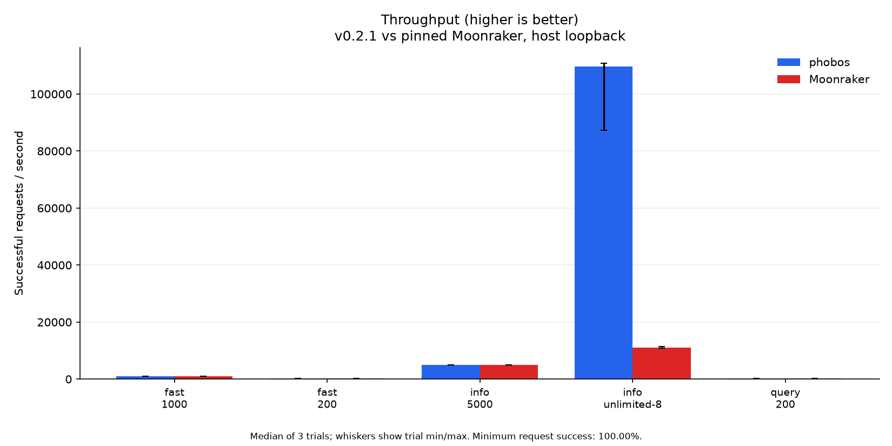
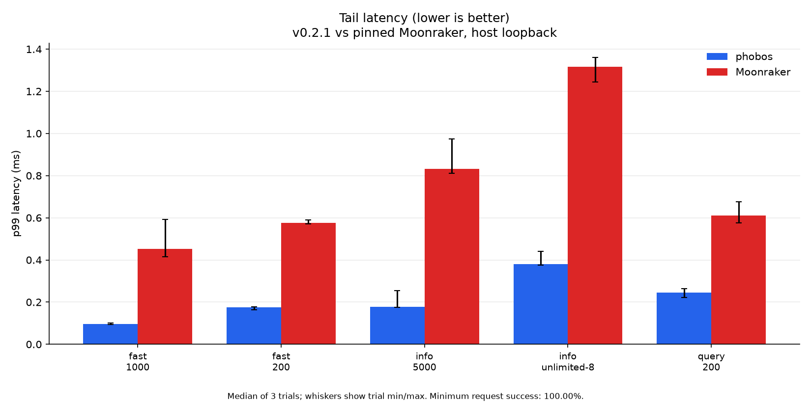
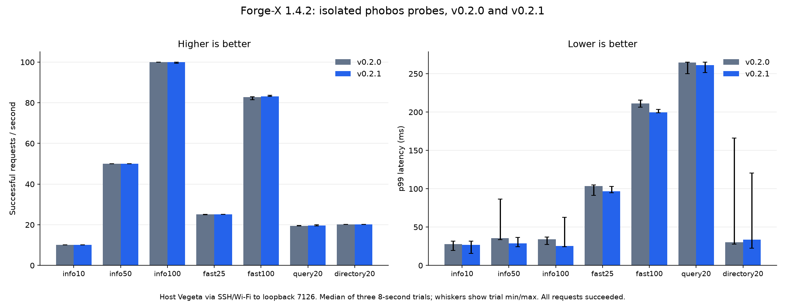

# Performance

Measured 2026-10-21 for phobos v0.2.1 with SQLite 3.54.1. These are short
read-load comparisons with recorded fixtures, not printer compatibility or
long-running stability guarantees. [Memory](MEMORY.md) records process RSS and
CPU from the same runs. Historical values and unresolved-symbol flamegraphs
were removed from the current report; their original files remain in Git history.

**How to read the results:** throughput (requests/s) is higher-is-better;
latency and RSS are lower-is-better. CPU is lower-is-better only at the same
completed workload. For a fixed offered rate, keeping up with that rate is
the goal; tiny throughput differences around the target do not decide a winner.

## Host comparison with Moonraker

AMD Ryzen 9 9950X, 16 cores / 32 logical CPUs, CachyOS x86-64,
Linux 7.2.10-1-cachyos, performance governor, no isolated CPU set.
The load generator, server and Klippy stub share this desktop. Cross-compiles
and printer load generation were stopped during the capture.

The portable x86-64 static musl ReleaseSmall asset has SHA-256
`ce21f105069d049e42ce5d40b8bc12b4fb6d9ba1ebb75e27588ced86165c1a93`.
Zig is 0.17.0. Full Moonraker runs the unchanged reference pin
`9008485843740c93e0154ccbdac1fc2b02b03aaa` on Python 3.12.12.
Its environment uses Tornado 6.5.5 and SQLite 3.50.4; phobos embeds SQLite 3.54.1.
The runtime source is `b5e353f`; the matrix asset is byte-identical to the
independently built benchmark executable.

Both servers use the same Klippy protocol stub, ready handshake and seeded
`mainsail.settings` value in fresh independent SQLite stores. The independent
mix cycles through server info, config, system info, that database item,
access info and history list. It does not query Klippy. The query workload
asks the stub for `heater_bed`, `toolhead` and `print_stats`.

Each backend ran three 10-second trials per workload, 30 measured trials
total. Every request succeeded (3,796,280 requests). Values below are medians
of the three trial statistics. A median p99 is not a pooled percentile.
Success counts HTTP status; fixture response contents were checked before
load. The same requests do not produce byte-identical payloads: server info
was 640 bytes for phobos and 1,174 bytes for Moonraker. The stub provides
canned replies and does not reproduce Klippy's continuous status flood.

| Workload / offered rate | phobos req/s ↑ | phobos p50 / p99 ms ↓ | Moonraker req/s ↑ | Moonraker p50 / p99 ms ↓ | Better in this capture |
| --- | ---: | ---: | ---: | ---: | --- |
| Info, unlimited / 8 workers | 109,645.7 | 0.034 / 0.380 | 11,065.6 | 0.675 / 1.317 | phobos: 9.9× throughput, lower latency |
| Info, 5,000/s | 5,000.0 | 0.033 / 0.178 | 5,000.4 | 0.325 / 0.833 | Same rate; phobos lower latency |
| Independent mix, 200/s | 200.1 | 0.069 / 0.176 | 200.1 | 0.254 / 0.575 | Same rate; phobos lower latency |
| Independent mix, 1,000/s | 1,000.0 | 0.042 / 0.096 | 1,000.0 | 0.181 / 0.452 | Same rate; phobos lower latency |
| Stub query, 200/s | 200.1 | 0.106 / 0.245 | 200.1 | 0.274 / 0.611 | Same rate; phobos lower latency |

↑ Higher is better. ↓ Lower is better. At 5,000/s, phobos's p99 is 4.7×
lower and both servers keep up. The [resource results](MEMORY.md) also show
lower phobos CPU at the matched rates and 9.7× lower idle RSS in this fixture.

The unlimited result uses exactly eight load-generator workers. Its trial
throughput ranges were 87,351.6 to 110,832.0/s for phobos and 10,911.8 to
11,419.7/s for Moonraker. This measures the complete shared-host setup at
that concurrency, not a saturation ceiling. Paced trials begin with eight
workers and allow up to 64. Keepalive and a two-second request timeout are
enabled; the connection limit uses Vegeta's default.

HTTP readiness, successful fixture reads and three seconds of settling
precede a ten-second idle sample. A two-second independent-mix warmup at
200/s precedes load. Each server process is reused for its 15 measured
trials; repetition 2 reverses workload order. Resident allocations retained
from earlier workloads therefore contribute to later RSS measurements.
Process samples are taken every 100 ms. CPU is user plus system ticks for
the server process only, with 100% equal to one core; stub and load-generator
CPU are excluded. Vegeta is 12.13.0.




The [30 trial reports](perf/host-v0.2.1/summary.json),
[environment and method](perf/host-v0.2.1/environment.json) and
[plot input hashes](perf/host-v0.2.1/plot-inputs.json) accompany the figures.
Whiskers show trial minima and maxima, not confidence intervals.

## Real Forge-X printer

Forge-X 1.4.2 chroot, Linux 5.4.61, two Cortex-A7 cores, ARMv7,
110,404 KiB RAM. Published v0.2.0 and the exact v0.2.1 Cortex-A7 asset ran
sequentially on `127.0.0.1:7126`. Both used the real component configuration,
independent copies of the same stable database/WAL snapshot, and the real
Klippy socket. File observation was `none`, matching this kernel's disabled
inotify support. Automatic queue loading/transition and update refresh were
disabled. Production v0.2.0 stayed on port 7125.

Vegeta ran on the desktop through SSH and WiFi. Reported latency includes
that transport and, for object queries, the real Klippy round trip. It is
not server-only latency. The independent mix uses info, config, system info,
database namespace list, history list and access info; it excludes Klippy.

Three eight-second trials per workload and version produced 42 trials, all
with 100% HTTP success. Both builds used two initial and at most eight
workers, eight connections, keepalive and a two-second request timeout.
The table shows trial medians. Exact paths, counts and trial ranges are in
the [printer summary](perf/printer-v0.2.1.json).

| Workload / offered rate | v0.2.0 req/s ↑ | v0.2.0 p50 / p99 ms ↓ | v0.2.1 req/s ↑ | v0.2.1 p50 / p99 ms ↓ |
| --- | ---: | ---: | ---: | ---: |
| Info, 10/s | 10.12 | 5.11 / 27.75 | 10.12 | 5.03 / 26.81 |
| Info, 50/s | 50.09 | 4.78 / 35.62 | 50.09 | 4.73 / 28.75 |
| Info, 100/s | 100.02 | 4.62 / 34.28 | 100.02 | 4.62 / 25.44 |
| Independent mix, 25/s | 25.06 | 8.03 / 103.54 | 25.11 | 7.96 / 96.74 |
| Independent mix, 100/s | 82.70 | 126.13 / 211.37 | 83.15 | 125.44 / 199.76 |
| Real Klippy query, 20/s | 19.52 | 140.58 / 264.68 | 19.57 | 132.20 / 261.20 |
| Config directory, 20/s | 20.11 | 6.76 / 30.13 | 20.11 | 7.05 / 33.58 |



↑ Higher is better. ↓ Lower is better. There is **no clear overall winner**
between these releases on the printer: throughput is similar, latency ranges
vary with the network, and the directory median favors v0.2.0 while other
latency medians favor v0.2.1. The memory report gives the measured RSS difference.

The 100/s independent mix reached about 83/s with the eight-worker bound;
it did not keep up with the requested rate. These bounded trials are not a
maximum-throughput test. Network variation and short repetitions do not
establish a speedup or regression between the two releases.

The candidate's idle RSS was 3,100 KiB and measured load peak was 5,056 KiB.
Available board memory stayed at or above 49,540 KiB across both versions.
Production readiness, completed/standby print state, zero heater targets and
a 16 MiB available-memory floor were checked during each trial. A lightweight
shell sampler read process RSS, threads, CPU ticks and board memory about
every 250 ms; the kernel clock tick rate was verified as 100 Hz.

Both probes were stopped. Production PID and board boot ID were unchanged;
Klippy remained ready, the last print complete and heater targets zero.
No live database was opened for modification and no print or printer-control
action was issued. A second full Moonraker was not started on this small board;
the direct Moonraker comparison is the host run above.

## Reproduce and limits

Build/validate the assets with [the release helper](BUILDS.md). The
[performance harness](../tools/perf_harness/README.md) documents the stub,
read target lists, setup checks and owned-process cleanup. Its general local
benchmark and profiler use ReleaseFast by default; the results above used the
explicit portable ReleaseSmall release assets and the protocol recorded here.
Raw captures, private configurations and per-process samples remain below
`.scratch/`; the portable measured summaries are checked in.

To regenerate host figures from those summaries:

```sh
uv run tools/perf_harness/plot_perf.py \
  --input docs/perf/host-v0.2.1/summary.json \
  --output-dir docs/perf/host-v0.2.1 \
  --title 'v0.2.1 vs pinned Moonraker, host loopback'
```

These runs do not test printing, motion, heating, firmware updates, optional
hardware drivers, large-file transfer throughput, long soaks or every CPU
profile under load. The separate ARM32 smoke checks cover startup, real
object queries, copied SQLite floating-point history values and directory
statistics on Cortex-A7. AArch64 has build/ELF verification only.
