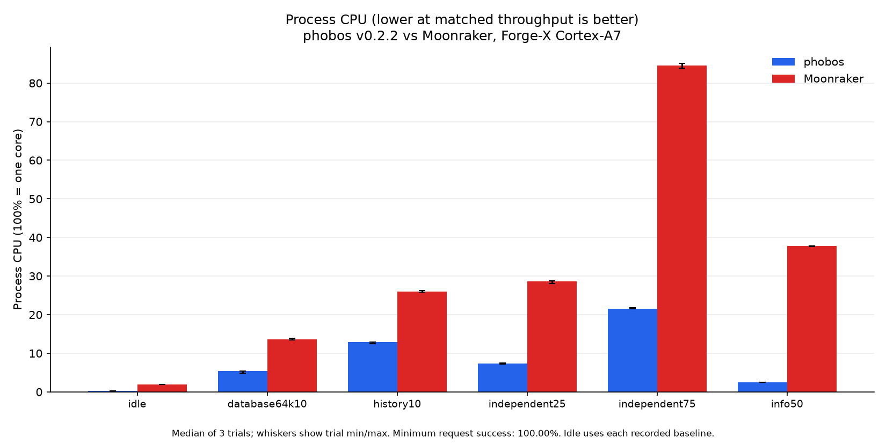
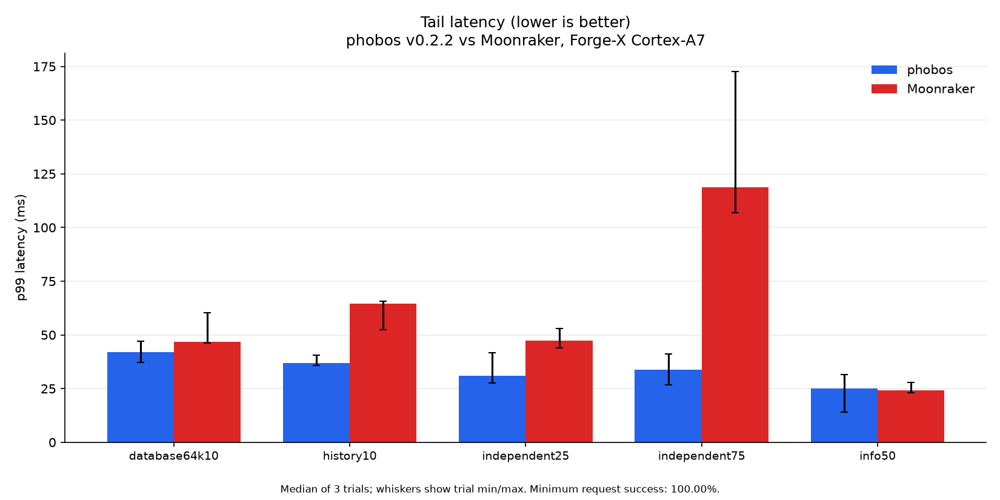
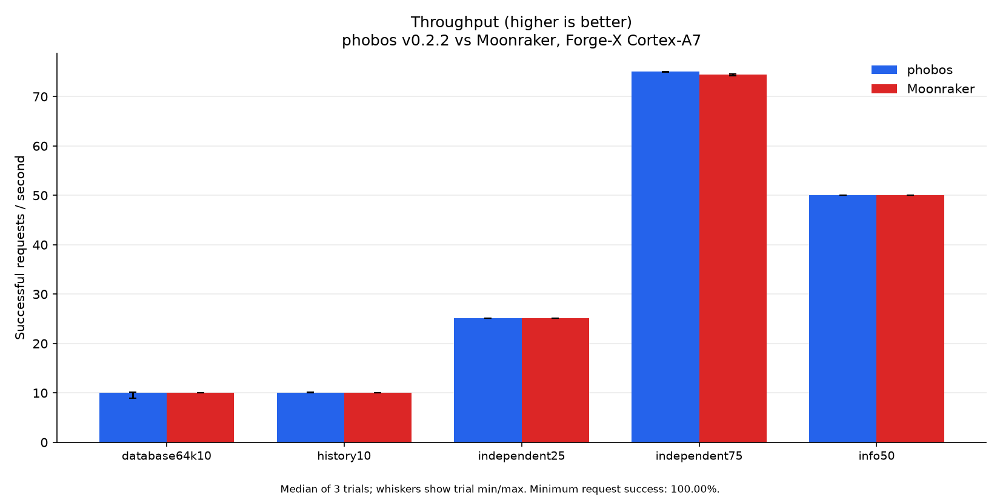
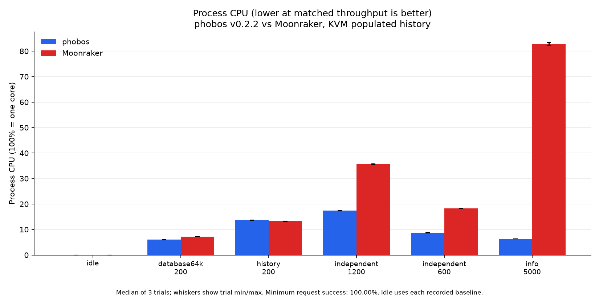
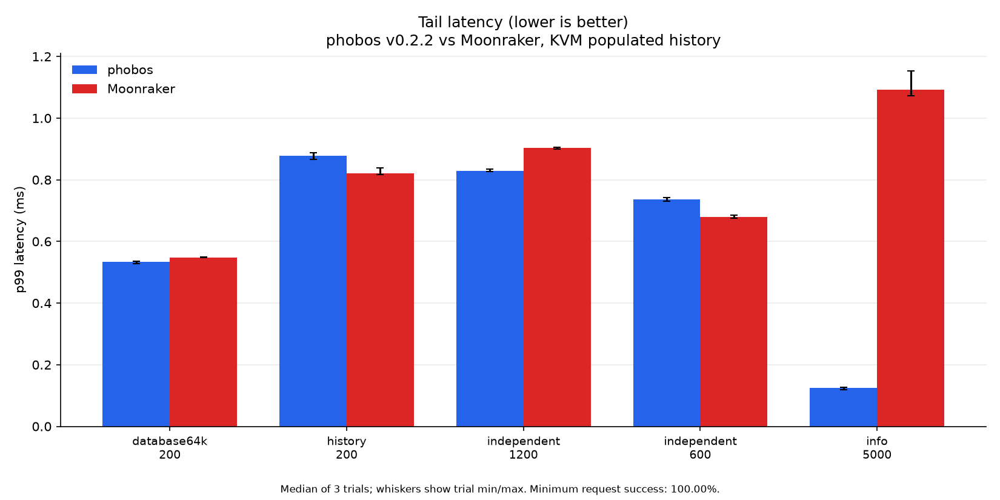
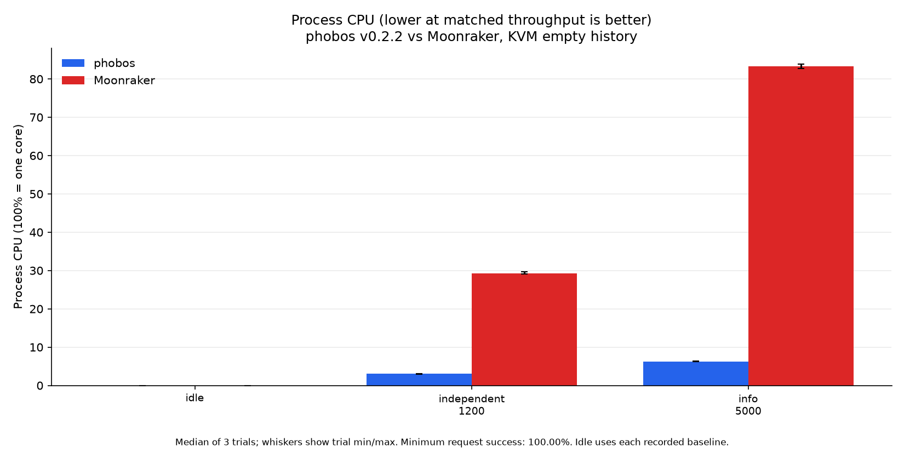
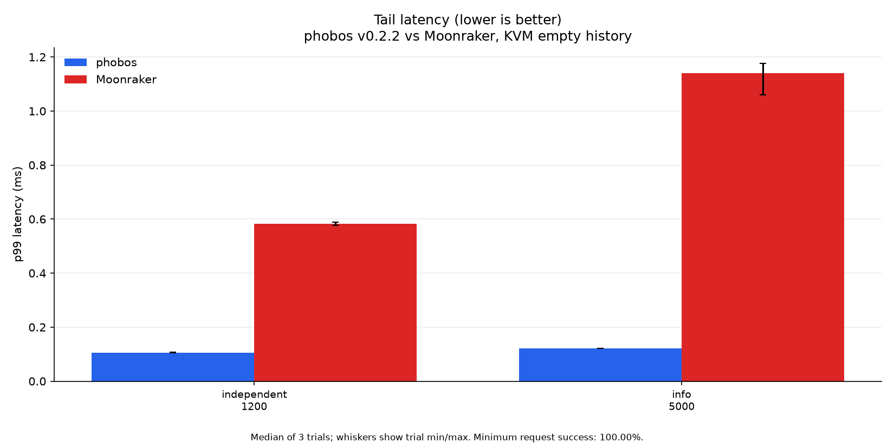

# Performance

Current comparison: **phobos v0.2.2 versus Moonraker**, measured 2026-10-21.
Both phobos binaries are the published static musl ReleaseSmall assets from
tag `v0.2.2`, commit `b079b773823c0d655823f91c1d08f0f96a67ad39`, built with
Zig 0.17.0 and SQLite 3.54.1. No earlier phobos build appears in these tables
or graphics.

**Higher throughput is better. Lower p99 latency, CPU time per request and
RSS are better.** CPU percentage uses 100% for one core. At a paced rate,
meeting that rate is the goal; this is not a maximum-capacity test. Tables
show medians of three trial statistics, not pooled request percentiles.
Plot whiskers show trial minima/maxima, not confidence intervals. Idle bars
show the median of three fresh-process trial medians, without whiskers.

## Real Forge-X printer

Earlier capture, 2026-10-21. The VM followup did not contact the printer;
all printer states in this section describe that earlier capture.

Forge-X 1.4.2 chroot, Linux 5.4.61, two Cortex-A7 cores, 110,404 KiB RAM.
The reference is the actual installed Moonraker on Python 3.11.10, reporting
API 1.4.0 and software version `?`. Both probes ran sequentially on loopback
7126 while production phobos v0.2.2 continues on 7125. They use independent
copies of the same seed: 266 migrated history jobs, including seven null end
times, plus a synthetic 64 KiB JSON record.

The common core config disables file observation, automatic queue transitions
and startup queue loading. It omits update components/remotes to avoid initial
network refresh. Phobos still registers compatibility components; see the
[observed differences](perf/v0.2.2/mismatches.json). The smaller probe config
differs from the 26-component production config. Config and executable/source
hashes are in the [printer environment](perf/v0.2.2/printer/environment.json).

All 30 eight-second trials succeeded, totaling
8,159 HTTP requests. The independent
mix cycles through `/server/info`, `/server/config`, `/machine/system_info`,
`/server/database/list`, `/server/history/list?limit=20` and `/access/info`.
It makes no Klippy query. Focused trials read info, the history page or the
64 KiB database item. Vegeta uses keepalive with two initial and at most
eight workers, eight connections
and a three-second timeout.

| Workload | v0.2.2 CPU ms/req ↓ | Moonraker CPU ms/req ↓ | v0.2.2 req/s ↑ / p99 ms ↓ | Moonraker req/s ↑ / p99 ms ↓ |
| --- | ---: | ---: | ---: | ---: |
| info50 | 0.525 | 7.900 | 50.09 / 25.10 | 50.03 / 24.18 |
| independent25 | 3.050 | 12.000 | 25.11 / 31.11 | 25.07 / 47.22 |
| independent75 | 3.017 | 11.850 | 75.02 / 33.82 | 74.50 / 118.66 |
| history10 | 13.500 | 27.125 | 10.09 / 36.98 | 10.08 / 64.49 |
| database64k10 | 5.696 | 14.250 | 10.10 / 41.85 | 10.09 / 46.70 |

Phobos uses less CPU per request in every measured printer workload. In the
75/s mix the median is 74.5% lower. Moonraker has slightly lower median info
p99 latency, and overlapping trial ranges remain visible in the plots.
One phobos 64 KiB trial delivered 8.96/s against the offered 10/s despite
100% request success. The median does not erase that shortfall.





Vegeta runs on the desktop through SSH forwarding and WiFi. Latency includes
transport and desktop scheduling. CPU counts only the probe process, excluding
the generator, production and Klippy. The printer has 100 Hz process counters;
short low-CPU trials have coarse resolution. `CONFIG_PERF_EVENTS` is disabled,
so no on-device sampled CPU profile is claimed.

Each repetition starts fresh processes in phobos/Moonraker, Moonraker/phobos,
then phobos/Moonraker order. Workload order reverses in repetition 2. Each
process has eight one-second idle sleeps plus readiness/guard overhead before
load; actual idle observation durations are retained. A roughly 250 ms sampler
records RSS, threads, board memory and swap. Readiness, standby/complete state
and zero heater targets are checked before each case and about once a second
during load, with a 16 MiB MemAvailable stop guard.

All 24 [history comparisons](perf/v0.2.2/printer/history-parity.json) match
Moonraker across default pages, ascending pages with offsets, huge offsets
and time filters. The [complete trials](perf/v0.2.2/printer/summary.json) and
[median/min/max aggregates](perf/v0.2.2/printer/aggregate.json) retain every
result. All probes stopped and their owned directory was removed. Production
PID 29180, executable and boot ID remained unchanged during benchmarking;
Klippy was ready, print state standby, both targets zero, and
7126 had no listener. No live database was opened by the probes; no printer
control, board restart or swap adjustment was used.

## KVM guest: isolated physical cores

Measured 2026-10-21 UTC (2026-10-22 in Singapore). This study replaces the
active shared-desktop host figures.
The printer was not contacted during VM setup, testing or cleanup. The VM has
no network device; both daemons, the load generator and a Klippy stub run
entirely inside it. Requests use guest loopback and the six-endpoint independent
mix above, with no Klippy query or external service in the load path.

The VM runs the same published x86-64 v0.2.2 ReleaseSmall asset and Moonraker
pin `9008485843740c93e0154ccbdac1fc2b02b03aaa` on Python 3.12.12. Phobos embeds
SQLite 3.54.1; Moonraker's copied Python runtime uses SQLite 3.50.4. The private
populated fixture retains 266 migrated jobs and the synthetic 64 KiB value;
the empty fixture contains the value only. All 72 history checks match.

QEMU 11.1.2/KVM runs Linux 7.2.9-2-cachyos with four vCPUs and 4 GiB RAM on
the second PC, a Ryzen 9 5950X with 64 GiB host RAM. A cgroup v2
`isolated` partition reserves a complete L3 group on host CPUs
8-15/24-31, including all SMT siblings. User/system slices are verified to
exclude those CPUs. vCPUs 0/1/2/3 pin to physical CPUs 10/11/12/13 with
SCHED_FIFO priority 10; the emulator pins to CPU 8. The server uses guest CPU 1,
generator CPUs 2/3, and stub/controller CPU 0. No vCPU shares an SMT core.
Unlike the prior native capture, each server has one CPU here. Results across
the two environments are separate studies, not an isolation speedup estimate.

RAM is preallocated and locked; observed locked memory stays above
4,838,436 KiB. VM swap and cgroup memory swap stay
zero, and cgroup counters record no quota throttling. Guest `idle=poll` keeps
vCPUs runnable to avoid halt/wake scheduling delays. Process CPU figures
exclude those idle polls: this setup occupies four host cores even when the
measured server is idle, and is not a deployment CPU-saving recommendation.

**The requested absolute zero-steal/guaranteed-performance condition was not
established.** Kernel KVM guest accounting and `kvm-steal-time` are enabled.
Across the 42 measured windows, the recorded guest steal-tick deltas sum to
cpu: 2, cpu0: 0, cpu1: 0, cpu2: 0, cpu3: 0. These are 100 Hz exported counters;
aggregate and per-CPU rounding can differ. Host vCPU scheduling counters retain nanosecond
run-queue delay: maximum server-vCPU delay is
0.00115% of its observed window,
and the maximum for any vCPU is
0.00117%. Windows include the
250 ms start lead and result collection. No trial is removed for nonzero
interference. Exclusive cores prevent normal workload sharing but do not
eliminate host kernel, interrupt, thermal or memory-bus effects. The existing
performance governor and its original min/max bounds remain in use;
fixed-frequency operation is not claimed. Observed frequency ranges
remain in the [isolation summary](perf/v0.2.2/vm-isolation-summary.json).

The [kernel cpuset documentation](https://www.kernel.org/doc/html/latest/admin-guide/cgroup-v2.html#cpuset)
describes isolated partitions; [KVM steal accounting](https://docs.kernel.org/virt/kvm/x86/msr.html#custom-msr-list)
defines runnable time when a vCPU did not run. A displayed zero is not a
substitute for a CPU reservation or an independent scheduling measurement.

### Populated history

| Workload | v0.2.2 CPU ms/req ↓ | Moonraker CPU ms/req ↓ | v0.2.2 req/s ↑ / p99 ms ↓ | Moonraker req/s ↑ / p99 ms ↓ |
| --- | ---: | ---: | ---: | ---: |
| info-5000 | 0.013 | 0.166 | 5000.05 / 0.125 | 4999.98 / 1.093 |
| independent-600 | 0.145 | 0.305 | 600.05 / 0.736 | 600.05 / 0.679 |
| independent-1200 | 0.145 | 0.298 | 1200.03 / 0.829 | 1200.04 / 0.904 |
| history-200 | 0.688 | 0.667 | 200.04 / 0.877 | 200.04 / 0.821 |
| database64k-200 | 0.300 | 0.357 | 200.04 / 0.534 | 200.04 / 0.547 |

Phobos uses less CPU per request in four of five populated-history workloads.
For the history page it uses 3.0% more CPU per request than Moonraker, with
nonoverlapping trial ranges. Moonraker also has lower median p99 latency for
the history page and the 600/s mix. Phobos has lower sampled RSS throughout;
the results do not establish a universal performance winner.





### Empty history

| Workload | v0.2.2 CPU ms/req ↓ | Moonraker CPU ms/req ↓ | v0.2.2 req/s ↑ / p99 ms ↓ | Moonraker req/s ↑ / p99 ms ↓ |
| --- | ---: | ---: | ---: | ---: |
| info-5000 | 0.013 | 0.167 | 5000.04 / 0.122 | 5000.16 / 1.141 |
| independent-1200 | 0.025 | 0.245 | 1200.03 / 0.105 | 1200.00 / 0.582 |





All 42 twenty-second trials completed with 100% HTTP success,
1,607,980 requests in total. Three fresh-process repetitions
alternate phobos/Moonraker, Moonraker/phobos, then phobos/Moonraker. Workload
order reverses in repetition 2. Each process runs endpoint/history preflights,
settles for two seconds, has a five-second idle capture, then a two-second
200/s mix warmup. Vegeta has eight fixed workers, keepalive and a two-second
timeout. Process sampling is about 100 ms. Only successful requests enter the
CPU/request denominator; actual throughput and every trial range stay visible.

The VM was stopped, its private CPU partition removed, and original host CPU
policies verified after cleanup. The host user slice again has CPUs 0-31.
Sleep/idle inhibition covers the test and is released afterward. The temporary
sudo rule is removed after root cleanup. QEMU, BusyBox and Vegeta packages
remain installed on the second PC. No printer, golden image or existing VM
was modified.
[Host configuration](perf/v0.2.2/vm-host-environment.json),
[all scheduling boundaries](perf/v0.2.2/vm-host-events.json),
[resource samples](perf/v0.2.2/vm-resource-samples.json),
[parity](perf/v0.2.2/vm-history-parity.json) and
[cleanup](perf/v0.2.2/vm-cleanup.json) are checked in. The
[controller cleanup](perf/v0.2.2/vm-controller-cleanup.json) records release of
the local sleep inhibitor. The
[capture method](perf/v0.2.2/VM_METHOD.md) records configuration, workload
order and counter definitions. The first PC's
[partial study](perf/v0.2.2/vm-local-partial/README.md) retains 30 complete
populated-history trials and its disk-capacity failure; it is excluded from
these active figures. The earlier shared-host
[populated](perf/v0.2.2/host-rich/summary.json) and
[empty](perf/v0.2.2/host-empty/summary.json) captures remain archived unchanged.

## Reproduce and limits

Use the [published assets](https://github.com/maci0/phobos/releases/tag/v0.2.2)
and the exact hashes/configurations/rates in each environment record. The
[harness](../tools/perf_harness/README.md) documents isolated databases, stub
setup, Vegeta collection, process metrics and owned-process cleanup. Workloads
and raw numerical summaries are checked in; private databases, response bodies,
logs and binary load captures remain in ignored scratch storage.

Regenerate the three four-figure sets from their checked-in inputs:

```sh
uv run tools/perf_harness/plot_perf.py \
  --input docs/perf/v0.2.2/printer/summary.json \
  --output-dir docs/perf/v0.2.2/printer \
  --title 'phobos v0.2.2 vs Moonraker, Forge-X Cortex-A7'
uv run tools/perf_harness/plot_perf.py \
  --input docs/perf/v0.2.2/vm-rich/summary.json \
  --output-dir docs/perf/v0.2.2/vm-rich \
  --title 'phobos v0.2.2 vs Moonraker, KVM populated history'
uv run tools/perf_harness/plot_perf.py \
  --input docs/perf/v0.2.2/vm-empty/summary.json \
  --output-dir docs/perf/v0.2.2/vm-empty \
  --title 'phobos v0.2.2 vs Moonraker, KVM empty history'
```

Every chart records its input SHA256s. [Memory results](MEMORY.md) include
idle/load RSS, threads and board swap. This study does not measure maximum
capacity, printing, upload throughput, optional hardware, the file backend or
long-soak behavior. Measurements cover x86-64 and one Cortex-A7 printer; other
release profiles are build/test coverage, not physical-printer benchmarks.

Earlier [optimization captures](perf/history-memory-20261021/host/aggregate.json),
[three-round tuning evidence](perf/history-tuning-20261021/summary.json) and
[v0.2.1 release captures](perf/host-v0.2.1/summary.json) stay archived under their
original versions, including negative results. They are excluded from every
current comparison above.
