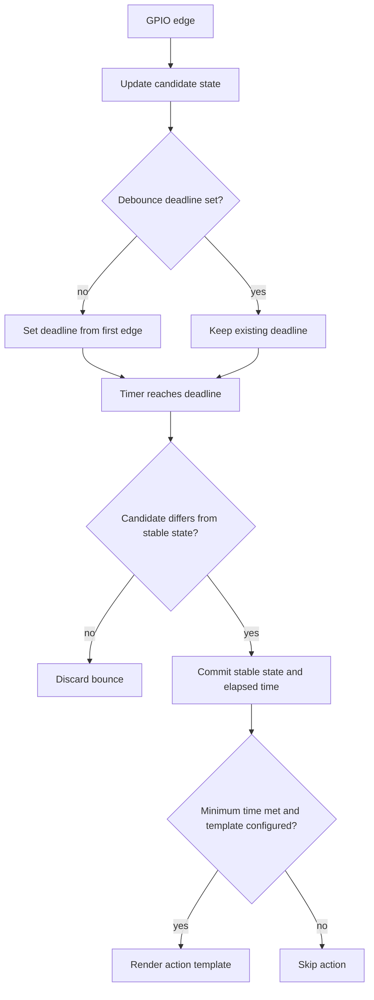

# Power and GPIO buttons

`[power <name>]` reads `off_when_shutdown`, `off_when_shutdown_delay`,
`on_when_job_queued`, `bound_services`, `restart_klipper_when_powered`,
`restart_delay`, `restrict_action_processing`, and `timer`. The deprecated
`bound_service` and `on_when_upload_queued` options are accepted. Bound service
names lose a trailing `.service` and duplicate names run once per transition.
Startup validates bindings before applying initial power states.
GPIO timers turn an enabled device off; Shelly and Tasmota timers delay an off
command using their device protocols. A repeated request for the current state
does not reset its timer or repeat its service actions.

Status refresh precedes toggle resolution and the printing lock. External state
changes notify clients; they also run bound service and restart actions when
`restrict_action_processing` is false. The internal-only `set_device_power`
method accepts `device`, `state`, and `force`; public power endpoints cannot
bypass the printing lock. Failed single-device requests name the resolved state
and a sanitized error name.

Generic HTTP power devices can use `request_template` and `response_template`
with the bounded template engine. Context variables are `command`, `urls`, and
`http_request`. Request methods are `send`, `last_response`, `set_method`,
`set_url`, `set_body`, `add_header`, `set_headers`, and `reset`. `send` accepts
`method`, `url`, and `body` keyword overrides. Responses expose `json()`, `text`,
`content`, `status_code`, and `url`. `async_sleep(seconds)` is available. HTTP
requests have three attempts, a one-second retry pause, a 20-second deadline per
attempt, a 4096-byte response limit, and 64 KiB for template request settings.
The response template must render exactly `on` or `off`, ignoring case.

`[button <name>]` requires `pin` and at least one of `on_press` or `on_release`.
`minimum_event_time` defaults to zero; `debounce_period` defaults to 0.05 seconds
and must be at least 0.01 seconds. Pins accept `gpiochipN/gpioN`, `gpioN`, or a
line number, plus `!` inversion and `^`/`~` pull bias. Input uses the Linux GPIO
character-device edge API (ABI v1); reads and cancellation use `std.Io`.

Button templates receive `event.elapsed_time`, `event.received_time`,
`event.render_time`, `event.pressed`, and persistent in-memory `user_data`.
`user_data.__setitem__(key, value)` stores data across events, bounded to 64 KiB.
`call_method(name, **params)` calls an internal API method.
`send_notification(aux)` sends `notify_button_event` with the button name, type,
event fields, and auxiliary value, at most once per rendered template. Events
that bounce back to the previous state or arrive below `minimum_event_time`
do not render an action.

The shared engine supports statements, expressions, `do`, object `get`, and
native callbacks; it keeps the existing sensor template API. Each render has a
64 KiB evaluation limit, 64 KiB output limit, and 10,000 execution steps. Full
Jinja2 remains outside scope.

Daemon startup explicitly starts the power timer and button readers. Tests use
synchronous clock ticks, local HTTP servers, fake event files, and temporary
GPIO roots. Teardown cancels and joins workers before freeing services,
connections, templates, or input files. Physical GPIO behavior remains unverified.
