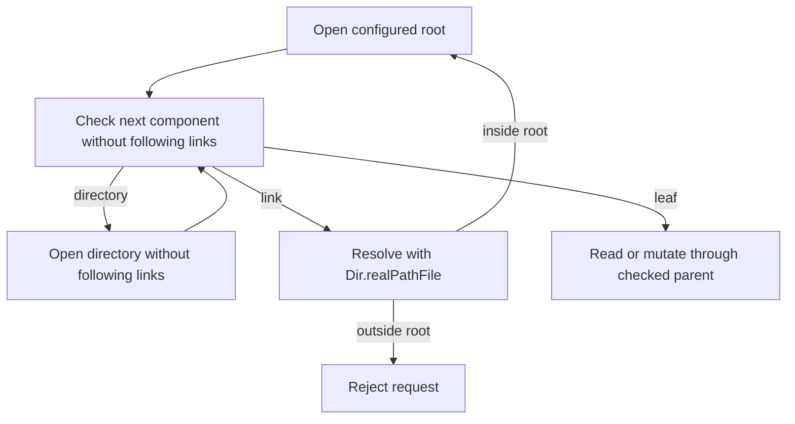

# Standard library choices

Use the installed Zig 0.17.0 sources when choosing an API. Prefer `std.Io` for
I/O, standard containers and codecs for primitives, and builtins for typed
conversions and memory operations. Keep Moonraker protocol rules at their callers.
These choices apply to first-party Zig modules, build code and `disk_usage.c`;
vendored libraries keep their upstream implementations.

| Operation | Implementation |
| --- | --- |
| Files, directories, copies, atomic replacement | `std.Io.File` and `std.Io.Dir` |
| Root-contained paths and symlinks | `Dir.realPathFile` for link resolution, followed by directory-relative opens with `follow_symlinks = false` |
| Virtual files with a zero stat size | `File.readerStreaming` and bounded `Reader.allocRemaining` |
| TCP, Unix sockets, DNS, peer addresses | `std.Io.net` |
| HTTP and server WebSockets | `std.http` |
| TLS and certificate validation | `std.crypto.tls.Client` and `std.crypto.Certificate.Bundle` |
| Clocks, deadlines and cancellation | `std.Io.Clock`, `Event`, `Future`, `operateTimeout` |
| Secret entropy and cryptography | `io.randomSecure`, `std.crypto` |
| Process arguments and execution | `std.mem.concat`, `std.process.run` and `std.Io.Select` cancellation, without shell interpolation |
| Bounded temperature and G-code stores | `std.Deque.initCapacity` with eviction before `pushBackAssumeCapacity` |
| Klippy message delimiters | `Reader.streamDelimiterLimit` and `Writer.writeByte` |
| MQTT remaining lengths | `Reader.takeLeb128` and `Writer.writeLeb128`, with the four-byte MQTT limit |
| HTTP percent decoding | `std.Uri.Component.toRawMaybeAlloc`; form queries also replace `+` with a space |
| Calendar rules and UTC formatting | `std.time.epoch` and `std.fmt` |
| JSON parsing and serialization | `std.json` |
| Release archives | `std.zip.Iterator` and `Entry.extractTo`, with `Writer.hashed(Crc32)` verification and checked staging directories |
| Request arguments | `json/params.zig` over standard numeric parsers and ASCII helpers |
| Text searches, case conversion, hex and Base64 | `std.mem`, `std.ascii`, `std.fmt`, `std.base64` |
| Test directories and allocation failures | `std.testing.tmpDir` and `checkAllAllocationFailures` |
| ZIP archives | Native `std.zip` headers and readers, `std.compress.flate.Compress`, `std.hash.Crc32` and `std.Io.File.Writer` |

The installed `std.zip` module reads and extracts archives, but does not write
them. `zip_writer.zig` provides bounded streaming ZIP32 framing using those
native structures and codecs; no filesystem-stat ABI or compression adapter is
needed. Large source files stream through one reusable DEFLATE workspace.

An I/O reader's internal buffer must not alias the output buffer of a read.
Use `File.readStreaming` for a one-shot byte read. Keep persistent network
readers alive across messages so pipelined bytes remain available.

`File.reader` defaults to positional reads. An allocating writer can use the
file's stat size, so it can mistake `/proc` or `/sys` content for an empty file.
`readerStreaming` explicitly disables that size assumption. Bound the read and
return an owned slice rather than returning an `ArrayList.items` allocation.

The standard LEB128 reader permits extended encodings. MQTT restricts a remaining
length to four bytes; the limited reader uses one byte of lookahead so packet
data cannot be consumed into a discarded temporary buffer.

`std.process.run` applies its timeout while draining output, then waits for the
child without a deadline. `util/process.zig` cancels the whole operation at the
deadline so closing stdout and stderr cannot leave a service or Git command hung.
Service actions require a discovered unit for systemd and supervisord. Simple
and none providers accept only fixed allowed names; requests cannot add arbitrary
service names or script paths.
Failed commands and expired deadlines reach the service caller before state or
notifications change. Timeout conversion leaves timestamp headroom for large
finite configuration values; the native duration is capped at i64 nanoseconds.

Device and snapshot HTTP requests use `Client.request`, native body writers and
response readers. `Client.fetch` assumes a failed body reader always has a
specific `bodyErr`, which can be null after cancellation. The shared
`http_get.requestToWriter` helper preserves a generic read failure in that case.
Requests negotiate identity encoding and reject encoded responses; their owning
future joins before the client, buffers or request storage are released.

## Platform adapters

These operations have no equivalent higher-level API in the installed library.
Keep their declarations local and typed. Replace them when a suitable standard
API becomes available and passes both host and ARM checks.

| Adapter | Reason |
| --- | --- |
| Serial configuration in `serial.zig` | `std.Io` has no termios configuration operation. Use `std.posix.tcgetattr` and `tcsetattr`, including Linux baud bits. Do not assume `ispeed`/`ospeed` fields exist on MIPS. |
| System identity in `machine.zig` | No higher-level uname or effective-UID operation. `process.getUserInfo` resolves names to IDs, not IDs to names. |
| V4L2 layouts in `machine.zig` and `video_modes.zig` | No standard V4L2 declarations. Typed local structures cover capabilities, formats and frame sizes; device control uses `std.Io.operate(.device_io_control)`. |
| SocketCAN setup in `canbus.zig` | No CAN address variant or socket constructor in `std.Io.net`. Typed libc socket/bind calls create the handle; transfers, deadlines and close use `std.Io`. |
| GPIO input layout in `gpio_input.zig` | No GPIO declaration. Local Linux ABI v1 structs and `std.os.linux.IOCTL.IOWR` provide edge requests and initial values through `io.operate(.device_io_control)`; event reads and cancellation use `std.Io.File`. |
| Disk capacity in `disk_usage.c` | No `std.Io` filesystem-capacity operation. ARM C translation produces an opaque `statvfs` type because its platform header has a bitfield. The C header owns its ABI. |
| Local refresh hours, PanelDue timestamps and timelapse output names in `local_time.c` | `std.Tz` parses TZif tables but does not evaluate POSIX footers or expose local-time conversion. `localtime_r` applies host timezone and future DST rules; C owns `struct tm` and `time_t`. PanelDue uses English ctime fields; timelapse uses bounded `strftime`. |
| Directory watches in `file_observer.zig` | No `std.Io` filesystem observer. The local adapter uses typed Linux inotify setup, masks and event layout; reads, deadlines, close and worker cancellation use `std.Io`. |
| SQLite bindings in `sqlite_c.zig` | No standard SQLite driver. The translated `SQLITE_TRANSIENT` function-pointer sentinel fails ARM alignment checks; the local opaque-pointer declaration preserves the C sentinel. |
| Network address enumeration | `std.Io.net.Interface` maps names and indices but does not enumerate addresses. The `ip -json` fallback remains. |
| WebSocket client frames | The standard server codec requires masked input and writes unmasked output. Client masking and bounded frame validation remain local. |

Zig 0.17.0 has `std.Build.addTranslateC`; it does not have `@cImport`. Translation
does not remove the ARM header and sentinel limitations above.

The file observer starts only in the daemon. `[file_manager] file_system_observer`
selects `inotify` (default) or `none`; an invalid value warns and selects `none`.
Checked directory handles supply `/proc/self/fd` watch paths, retaining root
containment during watch installation. Core serializes watch-table changes,
registered-root updates, cache invalidation and notifications; native reads run
outside Core. Shutdown cancels and joins the read before freeing roots or connections.
Watches are bounded to 512 directories, pending actions to 128, owned relative
names to 128 KiB and each native read to 16 KiB. Completed writes and directory
changes coalesce for 250 ms; unmatched moves become deletions after one second.
Atomic replacement reports the final file, and `.thumbs`, `.git` and configured
excludes produce no observer events. Inode aliases share their first installed
watch. Startup limit failures reject startup; runtime exhaustion, kernel queue
overflow or an externally replaced root stops observation with a warning and
restores direct API notifications. Restart to observe subsequent external changes.

File operations retain an open root handle and check every path component.
Native canonicalization handles nested links and `..`; an in-root target is
reopened relative to the retained root without following unchecked links.
Regular-file existence uses `Resolved.stat`, including for unreadable file data;
component/link checks and the returned file kind still govern the result.
Directory, missing and escaping paths report false. The `resolve_beneath` option
alone is insufficient because the installed Linux
backend ignores it. The private root walker uses `Dir.Iterator`: `Dir.Walker`
reopens directories with symlink following enabled and cannot accept a checked
child handle. The private walker follows checked in-root directory links.
Listings visit each canonical directory once; copies expand each alias and
reject ancestor cycles or links into the output tree. Traversal permits 4096
directory visits, including the root, then returns a parameter error. Canonical
paths do not identify bind-mount aliases; those remain subject to the visit
limit because `File.Stat` exposes no device ID. Disk capacity uses `fstatvfs`
on the checked directory handle.
Unlink, rename and atomic replacement operate on the final entry itself rather
than following its link target.

Copies and uploads use `File.Atomic` replacement. A truncated upload file part
discards its temporary file and preserves the existing destination. Each file
part commits when its separator arrives; the multipart form is not a transaction.
Directory copies also preserve completed entries if a later entry fails. A
loaded gcode file is protected from mutation only while Klippy is ready and
print_stats is printing or paused. Listed linked files have read-only permissions.

Metadata parsing uses a per-file arena backed by the stable file-manager
allocator, then copies the resulting JSON into the response allocator. Extended
directory listings retain metadata and thumbnail data, without retaining each
file's 256 KiB header and 32 KiB footer buffers. A scratch arena backed by the
response arena would retain those buffers until the whole request ended.

## Protocol and ownership code

HTTP query and JSON-RPC handlers share `json/params.zig`. Optional readers use
defaults only for absent keys; present invalid values, including null, return
400. Boolean arguments accept booleans or case-insensitive `true`/`false`
strings. Numeric arguments follow Moonraker's decimal conversions, including
integer truncation and boolean numbers. Text arguments require strings rather
than Python representations of objects. String lists accept arrays of strings
or trimmed comma-separated text. Handler-specific validation follows conversion.
Raw JSON readers preserve null, including database values and an optional read
key. Spool clearing through HTTP uses an absent `spool_id`; explicit null is a
conversion error. The Klipper remote method separately accepts an integer or
null. Usernames must be non-empty single DataStore keys without dots; creating
a dotted username returns 400 instead of writing a nested user record.

Keep application grammars that have no standard implementation: Moonraker
configuration, RSS/XML and RFC 2822 syntax, G-code comments, multipart
separators, PanelDue checksums, the supported template language, and MQTT packet
fields. Use standard tokenizers, numeric parsers, searches, writers and calendar
rules inside those grammars.
RSS input must be valid UTF-8 before any feed fields are captured. Opaque ETag
bytes that are not UTF-8 are omitted from the JSON-backed cache; their response
body remains usable and later requests fetch without that conditional tag.

Configuration globs support `*` and `?` through a local matcher; `std.Io.Dir`
provides iteration but no glob operation. Template title casing keeps its own
word-start rules over `std.ascii`; case-insensitive searches use
`std.ascii.findIgnoreCase`.

Sensor templates evaluate with `std.heap.FixedBufferAllocator`: temporary state
uses at most 64 KiB on the handler stack, and nested execution shares a
10,000-step budget. Exceeding either limit fails the render without publishing
partial measurements. Only successful numeric results and their copied keys
enter the caller's arena. Power batch responses copy each device's state before
the next device request can release Core and change that state.
Template replacements check size growth with `std.math` before
`std.mem.replaceOwned`, whose size calculation can overflow on 32-bit targets.

Serial deadline reads and writes use `std.Io.Select` and join canceled operations
before returning their borrowed buffers. Pseudo-terminal tests cover silent reads
and a write that fills the peer's queue. Physical UART timing remains unverified.

WLED startup queries `{"v":true}` before its configured initial state. An owned
worker retries only pending strips every two seconds for 120 seconds; it stops
before context teardown. HTTP commands make at most three attempts, with a 100 ms
pause between failed attempts. Unsupported serial baud rates fail when a strip
is added. Each serial strip owns a persistent port and joined
reader that drains replies, validates bounded JSON lines, and wakes a pending state
query. Commands serialize through the strip's mutex while Core is released; pinned
connections survive concurrent strip replacement. Klippy registers `set_wled` and
`set_wled_state` through App's existing remote queue. Protocol tests use loopback
HTTP and pseudo-terminals, not physical strips.

TD-1 discovery starts immediately and runs every five seconds. It owns at most
64 persistent readers, each stopped and joined outside Core before removal. A
reader retrieves `errors.txt` before exposing `td: null`, receives at most 4 KiB
across 64 blocks, and acknowledges each block. Protocol reads and writes share
absolute five-second deadlines. Continuous CSV updates and error text enter the
device map under Core; external text must be UTF-8. `[td1] baudrate` defaults to
115200 and rejects unsupported rates at configuration load. Scan times match
Moonraker's UTC `datetime.isoformat() + "Z"`, including microseconds and offset.
Device reboot is queued to its reader and waits outside Core for the `change
settings` / `RGB_Enabled = True` / `done` exchange. Board and host reboot APIs
remain deliberate no-ops. Protocol and teardown tests use pseudo-terminals;
physical TD-1 timing remains unverified.
Announcement refreshes check their stop event before starting the next feed
download, so shutdown does not wait through every configured feed timeout.

Update tests create native temporary repositories whose `origin` points to the
same local fixture. Refresh assertions check the resulting tracking ref; the
test suite does not fetch the project's remote.

Spoolman HTTP requests race a native `Io.Select` timer, cancelling and joining
the request after ten seconds. Response data is copied out only after the task
finishes. Bodies, reason text and headers must be UTF-8; invalid text returns
the unavailable response. External JSON passes the depth guard before
serialization. The v1 proxy preserves upstream status and HTTP reason text;
v2 prefers the JSON `message` field. WebSocket keepalive uses `Io.operateTimeout` on the underlying
reader and writer, including TLS, with a ping every twenty seconds and one
interval to receive a matching pong. Startup status emission takes Core; active
spool changes emit while Core is held, and repeated selections do not emit.

Notifier records validate ASCII word-character service URL prefixes and the
case-insensitive `text`, `html` and `markdown` body formats before registration.
Klipper's `notify` method resolves configured names through the notifier handler. Delivery still
fails with `AppriseNotAvailable`; the transport and full template rendering are
not implemented.

Update, recovery, rollback and Feather Git commands serialize through an owned
`std.Io.Mutex` outside Core. An atomic busy flag rejects competing mutations and
refreshes; the printing flag blocks refresh and mutations. Status requests
suppress requested refreshes while busy or printing and throttle them to one per
minute. Notifications take Core only after releasing the command mutex.

The daemon copies its startup environment once for Git commands, excluding every
`GIT_*` override while retaining HOME, proxy and SSH-agent settings. Fixture Git
commands use an explicit empty environment. Inherited `GIT_DIR`, `GIT_WORK_TREE`
and index/config overrides cannot redirect a fixture command into another checkout.
Git text used in JSON must pass `std.unicode.utf8ValidateSlice`; invalid version
or log output uses the existing unavailable-status fallback.

Base32, UUID layout and CIDR prefix matching remain small local codecs. The
standard library has no matching complete API. Address comparison for trusted
clients intentionally ignores ports; `IpAddress.eql` also compares the port.
Webcam UUID5 hashing streams the namespace, prefix and name through
`std.crypto.hash.Sha1.update`. Power URL credentials use
`std.Uri.Component.formatEscaped`, and URL constructors free partial results
when a later allocation fails.

Webcam URL rewriting uses `std.Uri` to preserve encoded credentials, queries and
fragments. Native UDP connect selects the routed source address through
`socket.address` without sending a datagram. DNS runs with a joined deadline
outside Core. Linux TCP listener snapshots use bounded streaming file reads
because the installed library has no listener-enumeration API.

Owned JSON snapshots still require a recursive copy and matching cleanup.
`std.json.Value.jsonParseFromValue` returns its source unchanged, so it cannot
detach a snapshot from a request arena. Inputs must pass the existing depth
guard before copying or serialization.

HTTP, JSON-RPC and notification payloads use `json/value.zig.StringifyValue`.
Plain ASCII uses vector comparisons and `@reduce`. Long valid UTF-8 strings use
a 1 KiB output buffer; their 34 mandatory escapes are generated at compile time
by `std.json.Stringify.encodeJsonStringChars`. Vector masks, `@ctz` and fixed-width
copies process ordinary byte runs; targets without byte vectors use a scalar
loop. Buffered writers receive escaped vectors directly through
`std.Io.Writer.writableSliceGreedy` and `advance`; small/unbuffered writers keep
the 1 KiB staging path. Exact-size and draining-writer tests cover reserve/flush
boundaries, and nested-value fuzzing exercises allocating and fixed writers.
Other options and invalid UTF-8 use the standard encoder. Punctuation and
scalar formatting remain in `std.json.Stringify`. Differential tests cover every
byte, vector/buffer boundaries, Unicode, options and writer/allocation failures.

Klippy frames receive one complete `std.json` parse and depth check on the reader.
Response waiters retain the parsed arena, then copy the result into their caller's
allocator before releasing it. The reader uses a 64 KiB standard I/O buffer.
Method frames dispatch under Core; present null methods are rejected. Handshake
ID matching uses a typed envelope. Tests cover owned replies, allocation failure,
large pipelined frames and continuous pushes during requests.

`json/parse.zig` adapts the standard token source for long ASCII string values.
It reserves their encoded-length bound once, decodes ordinary runs with portable
vectors and shrinks the owned token. Object keys, Unicode escapes, UTF-8,
structure, numbers and other tokens retain the standard scanner/parser. Simple
ASCII escapes are validated by the adapter. Its complete-input value transition
uses the checked Zig 0.17 scanner fields; differential byte/malformed/fuzz tests,
decoded-length limits, ownership and allocation-failure tests guard that coupling.
SQLite JSON records and history columns use its caller-arena entry point.
Documents shorter than the long-token threshold use the standard parser directly.
Validated plain strings bulk-copy once; escaped strings retain the vector decoder.
Unicode-escape screening uses standard scalar searches with a preceding-byte
check, avoiding a generic substring search in the sampled config path.

Each Klippy status update produces one notification per interested client,
filtered by its object and field subscriptions. Status frames are serialized
after filtering; generic notifications share a prebuilt frame. Connection pins,
Core ordering and the existing per-frame write deadline remain in force.

The entry point uses `std.process.Init.gpa`. Zig 0.17 selects its checked
allocator in Debug and ReleaseSafe, and `std.heap.c_allocator` for this
libc-linked program in ReleaseFast and ReleaseSmall. Component and request
allocators remain explicit; the entry point does not override that choice.

The daemon owns its `std.Io.Threaded` backend on all targets. Its worker stacks
use the listener's 1 MiB bound; the backend receives the startup environment so
child processes retain PATH and other configured variables. A real child-process
test checks environment propagation, including generated values.

The SQLite store reuses two prepared statements for namespace enumeration and
table-existence checks under its existing operation mutex. Results are never
cached. Statements reset after reads and allocation failures; table-name bindings
are cleared promptly. SQLite's `prepare_v2` schema invalidation remains active,
and teardown finalizes both statements before closing the database. Tests check
new namespaces, table creation/deletion, preparation counts and allocation failures.

TCP listeners set `TCP_NODELAY` through `std.c.setsockopt`; the installed
`std.Io.net` exposes no socket-option setter. Linux inherits the flag on accepted
connections, including WebSocket upgrades. Tests read it back on accepted IPv4
and IPv6 sockets through the typed `std.c.getsockopt` binding. Transfers,
deadlines, close and cancellation still use `std.Io`.

HTTP and JSON-RPC serialize handler results before releasing Core, because
results can borrow mutable component strings. Transport screening runs after
method, transport, argument and authentication checks for each request, including
batch items. A failed upstream request can replace the reserved `_method` value
with an owned status/message object immediately before returning
`UpstreamRequestFailed`; client-supplied reserved values are always replaced.

WebSocket authentication state is initialized before registry insertion and
published atomically. Notification fan-out excludes unauthenticated sessions.
Listener capacity waits remain cancellable and close the accepted stream if
canceled before a handler starts.

Klippy requests release Core before writing as well as waiting for a reply.
Socket writes use a native stream writer with one absolute five-second deadline
for the complete ETX frame. Each bridge shuts down the client socket when its
Klippy connection ends, without waiting for the client's close response.
Remote calls use a native `Io.Group` with a semaphore limiting active tasks to
16, independently of the 16-request queue. Each task owns its request until it
finishes. Shutdown cancels and joins the group before component teardown, then
drains pending requests with `getOneUncancelable`, including under cancellation
and queue-mutex contention. Queues also drain when the worker could not start.

WebSocket batches dispatch connection-bound methods per item. Status subscriptions
replace the connection's previous object/field map; initial responses and pushes
are pruned to it. Klippy's aggregate is rebuilt from active connections and
internal heater objects. Subscription requests serialize separately from Core
and use a twenty-second deadline. Handshake ids are read with the JSON parser,
so whitespace and nested unrelated `id` fields cannot change response matching.

Successful persisted logout and deletion revoke matching WebSocket sessions.
User strings remain owned by the serve loop; registry comparison and replacement
hold its mutex, while the authentication gate is atomic. Revoked callers expose
no authenticated user. Upgrade authentication, registry insertion and identify
run under Core, ordered with credential changes; network writes happen afterward.
Klippy method frames and parsed results pass the JSON depth bound before they
can reach handlers or serializers.

WebSocket responses, notifications, pongs and bridge close frames use one absolute
five-second write budget per complete frame. Native `net_write` consumes buffered
headers, payload vectors and repeated slices without resetting that deadline.
Each frame starts its budget under the session's write mutex, including the first
frame after an idle period. A timeout shuts down both socket directions.

Inbound WebSocket frames use the native server codec with a lazily grown input
buffer capped at 10 MiB. The announced length is checked before allocation;
consuming a large message restores the original small buffer when the remaining
buffered input fits. Pongs are discarded before checking the following frame's
capacity because the native reader otherwise skips them internally.

Fragmented messages share the same 10 MiB aggregate limit. The adapter validates
fragment sequencing and presents each fragment to the native complete-frame
reader for masking and payload decoding. Ping and pong frames may interrupt a
message without becoming part of it. Assembly storage grows geometrically within
the limit and is released before the next message; close and allocation failure
release partial storage during session cleanup.

Agent RPC waits use native semaphores with absolute deadlines outside Core.
Connection ids carry no pointers; registry pins keep a selected connection alive
across a write. Response correlation checks the owning connection and copies the
frame before waking its waiter. Owned WebSocket task groups cancel and join before
the session's writer and registry entry are removed. Dynamic Klippy registrations
use a separately locked map and are replayed by the normal handshake.

Console snapshots iterate the standard deque directly and reserve the requested
array length. Their three-field JSON maps use public `ObjectMap.entries`
capacity and `reIndex` before `putAssumeCapacity`, avoiding geometric growth
slack while preserving the standard map's index invariants. Wrapped ordering,
count slicing and allocation failures retain request-arena ownership.
