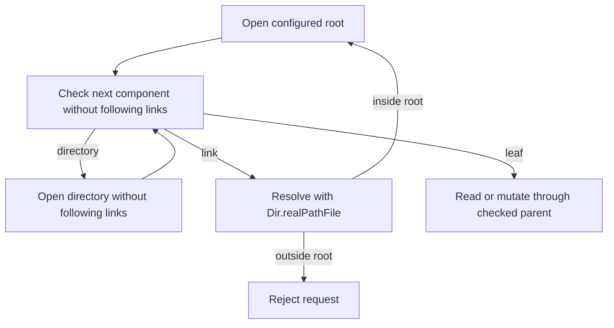

# Standard library choices

Use the installed Zig 0.17.0 sources when choosing an API. Prefer `std.Io` for
I/O, standard containers and codecs for primitives, and builtins for typed
conversions and memory operations. Keep Moonraker protocol rules at their callers.
The review covers first-party Zig modules, build code and `disk_usage.c`;
vendored libraries retain their upstream implementations.

| Operation | Implementation |
| --- | --- |
| Files, directories, copies, atomic replacement | `std.Io.File` and `std.Io.Dir` |
| Root-contained paths and symlinks | `Dir.realPathFile` for link resolution, followed by directory-relative opens with `follow_symlinks = false` |
| Virtual files with a zero stat size | `File.readerStreaming` and bounded `Reader.allocRemaining` |
| TCP, Unix sockets, DNS, peer addresses | `std.Io.net` |
| HTTP and server WebSockets | `std.http` |
| TLS and certificate validation | `std.crypto.tls.Client` and `std.crypto.Certificate.Bundle` |
| Clocks, deadlines and cancellation | `std.Io.Clock`, `Event`, `Future`, `operateTimeout` |
| Secret entropy and cryptography | `io.randomSecure`, `std.crypto` |
| Process arguments and execution | `std.mem.concat` and `std.process.run`, without shell interpolation |
| Bounded temperature and G-code stores | `std.Deque.initCapacity` with eviction before `pushBackAssumeCapacity` |
| Klippy message delimiters | `Reader.streamDelimiterLimit` and `Writer.writeByte` |
| MQTT remaining lengths | `Reader.takeLeb128` and `Writer.writeLeb128`, with the four-byte MQTT limit |
| HTTP percent decoding | `std.Uri.Component.toRawMaybeAlloc`; form queries also replace `+` with a space |
| Calendar rules and UTC formatting | `std.time.epoch` and `std.fmt` |
| JSON parsing and serialization | `std.json` |
| Request arguments | `json/params.zig` over standard numeric parsers and ASCII helpers |
| Text searches, case conversion, hex and Base64 | `std.mem`, `std.ascii`, `std.fmt`, `std.base64` |
| Test directories and allocation failures | `std.testing.tmpDir` and `checkAllAllocationFailures` |

An I/O reader's internal buffer must not alias the output buffer of a read.
Use `File.readStreaming` for a one-shot byte read. Keep persistent network
readers alive across messages so pipelined bytes remain available.

`File.reader` defaults to positional reads. An allocating writer can use the
file's stat size, so it can mistake `/proc` or `/sys` content for an empty file.
`readerStreaming` explicitly disables that size assumption. Bound the read and
return an owned slice rather than returning an `ArrayList.items` allocation.

The standard LEB128 reader permits extended encodings. MQTT restricts a remaining
length to four bytes; the limited reader uses one byte of lookahead so packet
data cannot be consumed into a discarded temporary buffer.

## Platform adapters

These operations have no equivalent higher-level API in the installed library.
Keep their declarations local and typed. Replace them when a suitable standard
API becomes available and passes both host and ARM checks.

| Adapter | Reason |
| --- | --- |
| Serial configuration in `serial.zig` | `std.Io` has no termios configuration operation. Use `std.posix.tcgetattr` and `tcsetattr`, including Linux baud bits. |
| System identity in `machine.zig` | No higher-level uname or effective-UID operation. `process.getUserInfo` resolves names to IDs, not IDs to names. |
| Video capability layout in `machine.zig` | No V4L2 declaration. Use a local `extern struct`, `std.os.linux.IOCTL.IOR` and `io.operate(.device_io_control)`. |
| Disk capacity in `disk_usage.c` | No `std.Io` filesystem-capacity operation. ARM C translation produces an opaque `statvfs` type because its platform header has a bitfield. The C header owns its ABI. |
| SQLite bindings in `sqlite_c.zig` | No standard SQLite driver. The translated `SQLITE_TRANSIENT` function-pointer sentinel fails ARM alignment checks; the local opaque-pointer declaration preserves the C sentinel. |
| Network address enumeration | `std.Io.net.Interface` maps names and indices but does not enumerate addresses. The `ip -json` fallback remains. |
| WebSocket client frames | The standard server codec requires masked input and writes unmasked output. Client masking and bounded frame validation remain local. |

Zig 0.17.0 has `std.Build.addTranslateC`; it does not have `@cImport`. Translation
does not remove the ARM header and sentinel limitations above.

File operations retain an open root handle and check every path component.
Native canonicalization handles nested links and `..`; an in-root target is
reopened relative to the retained root without following unchecked links. The
`resolve_beneath` option alone is insufficient because the installed Linux
backend ignores it. The private root walker uses `Dir.Iterator`: `Dir.Walker`
reopens directories with symlink following enabled and cannot accept a checked
child handle. Disk capacity uses `fstatvfs` on the checked directory handle.
Unlink, rename and atomic replacement operate on the final entry itself rather
than following its link target.

Copies and uploads use `File.Atomic` replacement. A truncated upload file part
discards its temporary file and preserves the existing destination. Each file
part commits when its separator arrives; the multipart form is not a transaction.

## Protocol and ownership code

HTTP query and JSON-RPC handlers share `json/params.zig`. Optional readers use
defaults only for absent keys; present invalid values, including null, return
400. Boolean arguments accept booleans or case-insensitive `true`/`false`
strings. Numeric arguments follow Moonraker's decimal conversions, including
integer truncation and boolean numbers. Text arguments require strings rather
than Python representations of objects. String lists accept arrays of strings
or trimmed comma-separated text. Handler-specific validation follows conversion.

Keep application grammars that have no standard implementation: Moonraker
configuration, RSS/XML and RFC 2822 syntax, G-code comments, multipart
separators, PanelDue checksums, the supported template language, and MQTT packet
fields. Use standard tokenizers, numeric parsers, searches, writers and calendar
rules inside those grammars.

Configuration globs support `*` and `?` through a local matcher; `std.Io.Dir`
provides iteration but no glob operation. Template title casing keeps its own
word-start rules over `std.ascii`; case-insensitive searches use
`std.ascii.findIgnoreCase`.

Update tests create native temporary repositories whose `origin` points to the
same local fixture. Refresh assertions check the resulting tracking ref; the
test suite does not fetch the project's remote.

Base32, UUID layout and CIDR prefix matching remain small local codecs. The
standard library has no matching complete API. Address comparison for trusted
clients intentionally ignores ports; `IpAddress.eql` also compares the port.

Owned JSON snapshots still require a recursive copy and matching cleanup.
`std.json.Value.jsonParseFromValue` returns its source unchanged, so it cannot
detach a snapshot from a request arena. Inputs must pass the existing depth
guard before copying or serialization.
